# DocCode — Multi-Agent Development Plan

Companion to `DocCode BRD Write Documents Like Code.md` (the BRD). The BRD is the **what**; this document is the **how**: a work-package DAG, file-ownership map, agent roles, and gate checklists designed to be executed by a fleet of coding agents with an orchestrator.

- **Version:** 1.5 · **Date:** 2026-10-29
- **Target:** DocCode 0.1.0 on PyPI
- **Authority order:** BRD requirement IDs > this plan > agent judgment. Where they conflict, the BRD wins and the orchestrator files an amendment to this plan.
- **Amended 2026-10-30 (owner decisions; the BRD amended from decisions 0004 and 0005):** WP-002 runs one owner session plus two agent-simulated persona sessions; WP-020 runs a 1-rep `--cli` shake-out before the official `--live` run, under a $175 per-run cap, and the owner labels alone; FR-DYN-7 is added to WP-208b; WP rows affected by the separate section and node ID namespaces, the `fmt` token, `SectionContent.items` and the new mock defaults are updated.
- **Changes in 1.5 (evals first, BRD §5.7):** eval work packages WP-010..WP-020 in Wave 0 (MVP first, baseline scoreboard + calibration + prototype ablation before WP-003), the DocCode adapter in WP-113 (mock) and WP-212 (auto), WP-305 redefined as the first live DocCode eval, WP-505 DX agent proxy and WP-506 held-out release eval (WP-504 no longer runs evals), an Eval engineer role, the `doccode`-import rule for `evals/`, and effort and eval spend added.
- **Changes in 1.4 (readiness review):** owners and wave ordering fixed so no wave depends on code without an owner (renderer registry and run records move to Wave 1, the `AnthropicProvider` stub and `DEFAULT_MODEL` move to the freeze), WP-208 split into WP-208a–d, Wave 4 made acyclic (WP-403a/b, §7 PDF in WP-409), §7 example in Wave 2 (WP-211), contract settled before the freeze (static fingerprints, `Check` protocol, cache-friendly prefix order, `effort` replaces `temperature`, event fields, `link_hosts`, token forms), effort re-baselined.
- **Changes in 1.3 (document coherence, BRD §4.17):** WP-111 builds the frame (Wave 1). WP-210 builds the shared brief, editor and repetition logic (Wave 2). WP-208 integrates them, including sequential flow. The lockfile, budget, eval, examples and docs are updated to match.
- **Changes in 1.2 (red-team fixes):**
  - Wave 0 adds a PDF-engine decision and an API spike with a user test **before** the contract freeze (now WP-003).
  - New work for: value nodes, dynamic sections, `ctx` references, token-misuse detection, output clean-up and checks, data blocks, attachments and prompt caching, ready-queue scheduling, rate limits, the lockfile, the link policy, provenance stripping, content diff and the quality eval.
  - A Wave 2 test-author lane added.
- **Changes in 1.1:**
  - Gate G4 sequencing fixed.
  - Config work moved to Wave 2.
  - WP-302 and WP-303 sequenced instead of parallel.
  - Every requirement assigned.
  - Manifests, gate-failure procedure and effort added.

---

## 0. How to run this plan

### 0.1 Topology

One **Orchestrator** agent owns the queue. Work is organized into six **waves** that map 1:1 to BRD phases. Within a wave, work packages (WPs) run in **parallel lanes** where their dependencies allow; between waves there is a hard **gate** that must pass in CI before any WP of the next wave is dispatched.

```
Wave 0 ──G0──> Wave 1 ──G1──> Wave 2 ──G2──> Wave 3 ──G3──> Wave 4 ──G4──> Wave 5 ──G5──> 0.1.0
(15 WPs)       (15 WPs)       (17 WPs)       (6 WPs)        (11 WPs)       (7 WPs)
```

### 0.2 The rules that make parallelism safe

1. **Contract freeze first — but only after the spike.** WP-002 tests the API with users (the owner, plus two agent-simulated persona sessions); the owner folds the findings into the BRD; *then* WP-003 lands every protocol, dataclass signature, and exception class as typed stubs with `raise NotImplementedError` bodies before any implementation WP starts. Implementation agents fill bodies; they never change signatures. (Exceptions, all written in full by WP-003: `config.py` ships a working `resolve()` that returns library defaults only, so Wave 1 can run before WP-203 completes the chain; `DocumentContent.save()`, `render()` and `diff()` are one-line delegates to `render/base.py` and `content/diff.py`; constants such as `DEFAULT_MODEL` and the built-in brief instruction have real values; event classes and content dataclasses are plain frozen dataclasses with no bodies to fill.)
2. **One writer per file.** Every WP declares an exclusive file list (§3) in its manifest (§0.7). An agent that needs to edit a file it does not own stops and files a **Contract Request** (§0.4) instead of editing.
3. **Tests are the handoff.** A WP is done when its own tests pass *and* it has not broken any earlier WP's tests. The test suite, not conversation, is the integration medium.
4. **Evals first, and independent.** The eval harness, baselines, graders and judge (BRD §5.7) are built in Wave 0 before the contract freeze, and the baseline scoreboard is the target every later gate is measured against. Nothing under `evals/` except `evals/generators/doccode_adapter/**` may import `doccode`; WP-019's `evals/checks/check_imports.py` fails CI otherwise. Builder agents never receive held-out seeds, held-out cases or held-out outputs (§5.2).

### 0.3 Per-WP contract (what the orchestrator hands an agent)

Every dispatch message must contain exactly these fields:

```
WP-ID:        WP-103
Title:        Dependency graph + ExecutionPlan
Wave:         1
Requirements: FR-DAG-1..4, FR-REF-2, FR-REF-4, FR-REF-9 (validation), FR-PRM-5
Owns (write): src/doccode/execution/graph.py
Reads only:   src/doccode/core/**, src/doccode/errors.py, tests/test_graph.py + tests/test_plan.py (written by WP-1T, hard separation §1)
Depends on:   WP-003, WP-101, WP-109, WP-1T
Deliverables: implementation + tests + docstrings with examples
Acceptance:   <verbatim gate criteria for this WP's wave, from §2>
Done when:    `make check` passes; coverage on owned module >= 90%
Escalate if:  a public signature in errors.py or core/ must change
```

### 0.4 Contract Request (CR) process

When an agent finds the frozen contract wrong or insufficient:

1. Stop work on the affected part; continue everything else in the WP.
2. Write `docs/decisions/NNNN-<topic>.md` with: the requirement ID, the problem, two or three options, a recommendation.
3. Post a CR to the orchestrator naming the file and signature.
4. Orchestrator decides. If the change touches the API-sensitive BRD sections listed in BRD §10.5 (§4.1–4.4, §4.9, §4.13, §4.14, §4.16, §4.17), it escalates to the human owner. Otherwise the orchestrator amends the stub in a single commit and notifies every in-flight agent in the wave.

Agents never resolve CRs by mutual edit.

### 0.5 Shared conventions (every agent must follow)

| Topic | Rule |
| --- | --- |
| Branches | `wp/<id>-<slug>`, e.g. `wp/103-graph`. One PR per WP, squash-merged into `main`. The spike uses `spike/api` and is never merged. |
| Commits | `feat(graph): topo levels [FR-DAG-3]` — subsystem scope, requirement IDs in brackets. |
| Test names | `test_fr_ref_1_fstring_creates_edge` — the requirement ID is in the name, lowercase, underscores. One test per MUST, minimum. Eval harness tests live under `evals/` and follow the same rule (`test_eval_8_grader_never_imports_doccode`). |
| Type checking | `mypy --strict src/` must pass. No `Any` in a public signature; no `# type: ignore` without a trailing reason comment. |
| Lint | `ruff check` + `ruff format --check`. Line length 100. |
| Docstrings | Every public class/function: one-line summary, Args/Returns/Raises, and at least one runnable `>>>`-style example (NFR-20). |
| Error messages | Raise through the `DocCodeError(message, *, ids=(), hint=None)` constructor from WP-003, so every message names the IDs involved and a fix where one exists (FR-ERR-2). Every error test asserts both. |
| Dependencies | Adding anything outside NFR-2 requires a decision record **and** orchestrator approval. pandas is never imported (FR-DOC-11 duck-types it). |
| Network | No test may touch a socket. The `conftest.py` fixture from WP-001 enforces this; do not disable it. |
| Model IDs | Never literal in `src/` or `examples/` outside `providers/anthropic.py:DEFAULT_MODEL`, except the allowlisted `providers/pricing.py` and `evals/config.toml` (FR-PRV-3). A grep test enforces this by pattern, allowlisting exactly those files (WP-301). Docs and examples recommend pinned model IDs (FR-PRV-1). |
| Sampling settings | DocCode has no `temperature`; the setting is `effort` (FR-PRV-1). `AnthropicProvider` never sends `temperature`, `top_p` or `top_k` (FR-PRV-2). Every eval call sets `effort` explicitly and never uses refusal fallbacks (EVAL-21). |
| API key | Agents never hold an Anthropic key. Live tests and live eval runs are run by the owner, locally or through the owner-approved GitHub environment (EVAL-18). |
| Verification | `make check` = `ruff check && ruff format --check && mypy --strict src && pytest -q --cov && python scripts/check_ownership.py`. An agent may not report done without pasting its output. |

### 0.6 Decisions pre-resolved so agents do not stall

BRD §8 leaves questions open. Agents must not block on them. These are the standing answers; the orchestrator confirms with the human owner **once, during Wave 0**, and amends here if the owner disagrees. **Confirmed by the owner on 2026-10-30**, together with BRD §1.5 targets and §1.7 assumptions.

| BRD open question | Standing decision for 0.1.0 | Consequence for the plan |
| --- | --- | --- |
| Package name | Attempt `doccode`; WP-000 confirms. Fallbacks, in order: `doccode-py`, `docsascode`, `prosecode`. Import name stays `doccode` regardless. | WP-000 gate; no code impact. |
| PDF engine | WeasyPrint unless decision 0003 recommends Typst and the owner approves. | WP-402 implements whichever is chosen; the BRD is amended before WP-003 if Typst wins. |
| Python floor | **3.10** as specified (NFR-1). Use `typing.Self`/PEP 695 only behind version guards; prefer plain generics. `tomli` on 3.10 only (NFR-2). | WP-001 CI matrix and dependencies. |
| Structured output (FR-PRM-7) | **In 0.1.0, behind the `schema` extra**, built in Wave 3 as WP-303. If WP-303 is not green at gate G3, it is cut to 0.2.0 by the orchestrator — not deferred silently. | WP-303 is the only WP that may be cut whole. A SHOULD or MAY item inside another WP may carry forward only as a documented carry-forward at a gate (§5); no MUST and no other WP is cut. |
| Second provider | Out of scope for 0.1.0. `Provider` protocol must stay SDK-agnostic so an OpenAI-compatible adapter is a pure addition. | Design constraint on WP-105/WP-300. |
| Lock used automatically by `doccode run`? | **No**, only with `--lock`/`--locked` in 0.1.0; revisit after user feedback. | WP-500. |
| `numbers_from` on by default? | **No**, opt-in per prompt; docs recommend it for data reports. | WP-205, WP-503 docs. |

| Coherence scope and presets | **Full scope ships** (FR-COH-1..6). The G0 ablation (WP-020, decision 0006) chooses the default preset per family and the tuned built-in prompt text that WP-003 freezes; G3 (WP-305, decision 0007) confirms or changes them. A layer that measurably hurts goes to the owner, who may change a default or reopen scope; nothing is cut automatically. A preset change after the freeze is a CR escalated to the owner (BRD §4.17 is API-sensitive). | WP-020, WP-003, WP-305 |
| Eval models | Generators use `DEFAULT_MODEL` from decision 0005 at an explicit effort; the judge is `claude-opus-5-5` at an explicit effort, never weaker than the generator. Pinned in `evals/config.toml` (EVAL-12, EVAL-21). | WP-010, WP-000 |

Also deferred by the BRD itself: FR-PRM-8 (MAY, section-aware system prompts) goes to 0.2.0 and has no WP.

### 0.7 WP manifests and the ownership check

The orchestrator writes one manifest per WP before dispatch, at `.orchestrator/wp/<WP-ID>.toml`:

```toml
id = "WP-103"
wave = 1
requirements = ["FR-DAG-1", "FR-DAG-2", "FR-DAG-3", "FR-DAG-4", "FR-REF-2", "FR-REF-4", "FR-REF-9", "FR-PRM-5"]
owns = ["src/doccode/execution/graph.py"]
depends_on = ["WP-003", "WP-101", "WP-109", "WP-1T"]
```

Eval work packages use the same `WP-<nnn>` IDs (WP-010..WP-020, WP-113, WP-212, WP-305, WP-505, WP-506) and branch names (`wp/010-eval-core`), with `requirements` listing `EVAL-<n>` IDs and `owns` globs under `evals/`, so the ownership and traceability scripts need no special case.

`scripts/check_ownership.py` (WP-001) runs in CI on every PR. It reads the WP ID from the branch name (`wp/<id>-…`), loads the manifest, and fails if the diff touches any path outside `owns`. New files under `docs/decisions/` are always allowed. Globs are permitted in `owns`.

### 0.8 Effort and spend

Re-baselined in 1.4. The 1.3 figure (19 agent-days of wall time) counted only the critical path of agent work and no human time, which the readiness review judged optimistic by two to three times. The estimate is now given in three columns:
- **Agent-days** is the total implementer, test-author and designer effort in the wave (what the spend cap pays for).
- **Critical path** is the agent wall time with the lanes in §2 run in parallel.
- **Human and calendar** is the owner's time in and around the gate. Gate sign-off is budgeted at two business days each (BRD §1.6).

| Wave | Agent-days | Critical path (agent days) | Human actions in the gate | Human and calendar estimate |
| --- | --- | --- | --- | --- |
| 0 | 16.75 (8 library + 8.75 eval) | 7 (WP-000 → WP-010 → WP-012/WP-013 → WP-014 → WP-015 → WP-018 → owner labelling → WP-020 → WP-003; the spike path WP-000 → WP-002 → sessions runs alongside) | Confirm §0.6, BRD §1.5 metrics and §1.7 assumptions; create the GitHub repo and the owner-approved eval environment; review the dev cases and baseline prompts (about 1 h) and freeze them; make the MVP live run and the G0 baseline run; label for calibration (about 3 h, alone); decide presets and prompt text (decision 0006); run one spike session as the developer persona, have the two agent-simulated persona sessions run (data analyst, DevOps/CI), and make one live call; approve spike-driven BRD changes; approve the PDF engine | 5 business days for the spike sessions and decision 0004 (overlapping the eval build; with no recruiting this is probably slack), 2 for the eval runs and labelling, 2 for BRD approval, 2 for sign-off: **about 3.5 calendar weeks** |
| 1 | 16.5 | 6.5 (WP-100 → WP-101 → WP-102/103 → WP-107 → WP-108, with WP-113 after WP-108) | Sign-off | 2 business days: **about 1.5 weeks** |
| 2 | 23 | 12 (WP-2T → WP-208a → 208b → 208c → 208d → WP-209/WP-211 → WP-212) | Sign-off | 2 business days: **about 3 weeks** |
| 3 | 8 | 5 (WP-300 → WP-303, with WP-301 → WP-302 alongside; WP-305 after WP-300/WP-301) | Run the live test and the first live DocCode eval with the owner's key; confirm presets (decision 0007); rule on WP-303 | 2–3 business days for live runs and eval scoring, 2 for sign-off: **about 2 weeks** |
| 4 | 14 | 8 (WP-401 → WP-403a → WP-408 → WP-403b → WP-409) | Sign-off; manual template-guide review | 3 business days: **about 2.5 weeks** |
| 5 | 10 | 7 (WP-502 → WP-500 → WP-503 → WP-505 → WP-506 → WP-504) | Rotate the held-out seeds and run the held-out release eval; run the human DX timing; configure trusted publishing; approve PyPI publish | 3 business days: **about 2 weeks** |
| **Total** | **88.25** (about 12 of them eval) | **45.5** | Six gates, one user study, four live eval runs (MVP, G0, G3, G5) | **about 14.5 calendar weeks** (about 45.5 agent days plus about 27 business days of human time, part of which overlaps) |

Fix WPs after a failed gate (§5.1) are not included; the orchestrator adds a 20% contingency to each wave's spend cap for them. The orchestrator re-baselines after G1 and records actuals in `docs/STATUS.md`.

**Spend cap:** before dispatching a wave, the owner records a token or USD cap for that wave in `docs/STATUS.md`. The orchestrator pauses dispatch at 80% of the cap and asks the owner before continuing.

**Eval API spend** is paid with the owner's key, recorded in `docs/STATUS.md` as its own line within the wave's cap, and enforced per run by `max_usd` in `evals/config.toml` (EVAL-20): a run whose projected cost exceeds it refuses to start. The owner set `run.max_usd = 175` for the G0 run (2026-10-30), inside the Wave 0 cap. Estimates (`docs/EVALS_PROPOSAL.md` §7.3–7.4, re-baselined after the MVP run):

| Run | Wave / gate | Estimate |
| --- | --- | --- |
| MVP run (6 cases × 3 reps × B0–B2, pairwise) | Wave 0 | $5–10 |
| Baseline scoreboard and prototype ablation (24 dev × 3 reps × 7 generators, the official `--live` run; preceded by a 1-rep `--cli` shake-out through headless Claude Code, which uses no API key) | G0 (WP-020) | $100–160 |
| First live DocCode eval (24 dev × 3 reps × 8 DocCode generators, baselines reused) | G3 (WP-305) | $130–200 |
| Held-out release eval (24 held-out × 3 reps × 5 generators) | G5 (WP-506) | $60–120 |
| DX agent proxy | G5 (WP-505) | $1–5 |
| Smoke runs, on demand | any | $3–5 each |
| **Total to 0.1.0** | | **about $350–550** |

---

## 1. Agent roles

Spawn these roles; a single agent may hold several roles across waves, but never two roles on the same WP.

| Role | Count | Responsibility | Tools it needs |
| --- | --- | --- | --- |
| **Orchestrator** | 1 | Owns the WP queue and manifests, dispatches, enforces gates, resolves CRs, keeps `docs/STATUS.md` current. Writes no production code. | repo read, PR merge, CI status |
| **Researcher** | 1 (Waves 0 and 3) | Wave 0: prior-art search, PyPI name check, PDF-engine comparison, and the current Anthropic model IDs and Messages request shape (`output_config.effort`, no `temperature`/`top_p`/`top_k`) for `DEFAULT_MODEL` and WP-003 (decision 0005), plus the facts the eval harness needs: each model's default effort and whether thinking can be disabled, the `refusal` stop reason and `stop_details`, the server-side `fallbacks` parameter (so WP-010 can make sure it is never sent), Message Batches pricing, and prices incl. cache read/write for `evals/config.toml`. Wave 3: re-confirms model IDs and SDK call shape, and supplies prompt-caching rules (breakpoint limit, per-model minimum cacheable size) and prices (incl. cache read/write) from official docs, handed to WP-300/WP-301. | web search, web fetch |
| **Spike builder** | 1 (Wave 0) | Builds the throwaway prototype for WP-002 and the session kit. The owner runs the one human session; the two simulated sessions are run by fresh agents given only the session kit, never by the spike builder. Must not be the Architect, so the freeze is reviewed by fresh eyes. | repo write (spike branch only) |
| **Architect** | 1 (Wave 0, on call after) | Writes the contract freeze (WP-003) from the spike-amended BRD. Sole owner of `errors.py`, `__init__.py`, `tests/conftest.py` and every protocol signature for the whole project. Reviews all CRs. | repo write |
| **Implementer** | 4–6 | Executes one implementation WP at a time. | repo write, test runner |
| **Eval engineer** | 1–2 (Wave 0, then on call) | Builds and maintains `evals/` (WP-010..WP-020, WP-113, WP-212, WP-305, WP-505, WP-506): harness, cases, baselines, prototypes, graders, judge, calibration, adapter, gate runs prepared for the owner. Never holds the Implementer role on a WP whose behaviour the evals measure (WP-107, WP-110, WP-111, WP-205, WP-208a–d, WP-210, WP-300), and never receives held-out seeds, cases or outputs. | repo write limited to `evals/**`, `.github/workflows/evals-*.yml`; no API key |
| **Test author** | 1–2 | Writes adversarial tests for graph/references/executor/expansions/lockfile *before* implementation lands (BRD §10.4), plus property tests and golden tests. | repo write, test runner |
| **Template designer** | 1 (Wave 4) | Built-in templates (incl. table and metric block styles) and the designer-facing guide. **Must not read or write any `.py` file** — this constraint is the test for the BRD Phase 4 criterion "without opening any Python file". Uses only the installed `doccode template` commands (WP-408) once they land. | repo write limited to `src/doccode/templates/**`, `docs/templates.md` |
| **Reviewer** | 1–2 | Gate review: requirement coverage, API surface, security (NFR-14..17, NFR-22, NFR-26), no stray deps, the eval rules (no `doccode` import outside the adapter, no held-out material in the repo, baseline prompts unchanged since their freeze). Can block a gate. | repo read, CI status |
| **Docs/Release** | 1 (Wave 5) | MkDocs site, README, CHANGELOG, project policy files, TestPyPI → PyPI. | repo write, publish creds (human-held) |

**Hard separation:** the agent that implements a WP never writes that WP's acceptance tests for graph, references, executor, expansions, or lockfile (WP-101, WP-103, WP-107, WP-207, WP-208a, WP-208b, WP-208c, WP-208d). The test authors (WP-1T, WP-2T) write those first; the mermaid graph (§4) makes those WPs depend on the test lane. Likewise the agent that builds an eval never implements the feature that eval measures (Eval engineer row above), so the measure is not written by the party it grades.

---

## 2. Wave map and work packages

Legend: **S** = serial (blocks the wave), **P** = parallel lane. "Req" cites BRD requirement IDs.

### Wave 0 — Prior art, scaffold, evals and baselines, spike, contract freeze  (BRD Phase 0)

Order: WP-000 first. Then the eval MVP (WP-010 → WP-011/WP-012/WP-013 → WP-014) starts at once, alongside WP-001 and WP-002. The rest of the eval work (WP-015..WP-019) runs in parallel with the scaffold and the spike sessions. WP-020 (baseline scoreboard, calibration, prototype ablation and decision 0006) is a G0 criterion and must merge before WP-003 starts.

| WP | Mode | Title | Req | Depends |
| --- | --- | --- | --- | --- |
| WP-000 | S | Prior-art search (incl. DSPy, Instructor, Mirascope, Hamilton, Prefect, Quarto, Jupyter Book) + PyPI name check + PDF-engine comparison + **current Anthropic model IDs and Messages request shape** (the Researcher, from official docs: `output_config.effort`, no `temperature`/`top_p`/`top_k`) → `docs/decisions/0001-prior-art.md`, `0002-package-name.md`, `0003-pdf-engine.md`, `0005-default-model.md`. **Stop-and-report gate** if a near-duplicate exists. | BRD Phase 0, FR-PRV-3 (model ID), FR-PRV-2 (request shape), EVAL-21 (eval API facts) | — |
| WP-001 | P | Repo scaffold: `pyproject.toml` (hatchling, src layout, extras `pdf`/`schema`/`dev`, `tomli` on 3.10, `py.typed`, MIT), ruff/mypy/pytest config, `Makefile` with `check`, pre-commit, GitHub Actions matrix (3.10–3.14 Linux; 3.12 macOS+Windows), socket-blocking `conftest.py`, one passing smoke test, `.gitignore` incl. `.doccode_cache/` (the lock dir is **not** ignored). Stub `README.md`, `CHANGELOG.md` (Unreleased), `mkdocs.yml`. Scripts: `scripts/check_ownership.py` (§0.7), `scripts/traceability.py` (§6, parsing FR, NFR and EVAL IDs and scanning `tests/` and `evals/`) and a CI job for each. `.github/workflows/evals-*.yml` is left to WP-019. | NFR-1, NFR-2, NFR-4..6, NFR-16 | WP-000 |
| WP-002 | P | **API spike + user test** on `spike/api` (≤2 agent-days, never merged): UC-1 and the BRD §7 example end to end with `MockProvider`, ready-queue execution, one expansion, Markdown + HTML. Three 30-min sessions: the owner as the developer persona (P1), and two simulated by fresh agents given only the session kit, playing the data-analyst (P2) and DevOps/CI (P3) personas (the method WP-505 uses); the owner makes one live call. Limitation, stated in 0004: only the owner's session is human, so the simulated sessions confirm or refute predicted confusions but do not measure a newcomer's time to first document; the human timing before release still runs (BRD §1.5). Output: `docs/decisions/0004-api-spike.md` with time-to-first-document per session, confusions, and recommended API changes. Owner approves BRD amendments before WP-003 starts. | BRD Phase 0 | WP-000 |
| WP-003 | S | **Contract freeze** from the spike-amended BRD. Bodies `raise NotImplementedError` except the full bodies listed in §0.2. Includes:<br>• `errors.py`: the full hierarchy and warnings from FR-ERR-1, with the base class `DocCodeError(message, *, ids=(), hint=None)` per FR-ERR-2; `ExecutionError.cause` (FR-EXE-4).<br>• `providers/base.py`: `Provider` with a static `fingerprint()`; `CompletionRequest` with `system`, `prefix`, `messages`, `effort`, `max_tokens`, `response_format` and `metadata` (`node_id`, `kind`, `section_id`); `Completion` with cache tokens (FR-PRV-1).<br>• `providers/anthropic.py`: `DEFAULT_MODEL` with the real ID from decision 0005, and an `AnthropicProvider` class stub (constructor signature incl. `api_key`, `client`, `base_url`, `rate_limit`) that does not import `anthropic` (NFR-3).<br>• `execution/cache.py`: the `Cache` protocol.<br>• `execution/run.py`: `RunRecord`, `PromptRecord` with every FR-EXE-9 field (incl. `prefix`, `pre_edit_text`), and the event dataclasses with the full FR-EXE-8 fields.<br>• `execution/coherence.py`: function signatures and the built-in brief instruction constant (text from decision 0006). The preset table (FR-COH-6) and the frame wording follow decision 0006 too.<br>• `content/model.py`: frozen dataclasses, field-complete, including `preamble`, `link_hosts`, `TableBlock` and `MetricBlock`, plus the delegating `save()`/`render()`/`diff()` methods; `content/links.py` and `content/diff.py` signatures.<br>• `render/base.py`: the `Renderer` protocol and registry signatures.<br>• `config.py`: the `configure` signature (`model`, `effort`, `max_tokens`, `system`, `provider`, `context`, `cache_dir`, `pricing`, `max_concurrency`, `timeout`, `rate_limits`; FR-CFG-1); a working `resolve()` that returns library defaults, including `DEFAULT_MODEL`.<br>• `context.py`, `parse.py`: public signatures. `checks.py`: the `Check` protocol (`name`, `fingerprint()`, `sources()`, `__call__(text, sources)`), the built-ins and `custom()` (FR-OUT-4).<br>• The token grammar of FR-REF-1, incl. the parameterised `⟦doccode:ref:<key>\|max_chars=<n>⟧` and `⟦doccode:ref:<key>\|fmt=<spec>⟧` forms (FR-REF-1 as amended 2026-10-30), as a shared regex constant in `core/prompt.py`, so WP-103 accepts it from Wave 1.<br>• Public signatures for `Document` (incl. `effort`, `style`, `link_allowlist`, `attach`, `expand`, `purpose` and the coherence options), `Section` (incl. `brief`, `table`/`metric` returning `None`, `add`), `Prompt` (the full FR-PRM-1 set incl. `effort`, `refs`, `on_check_fail`, `frame`, `output_schema`), `Value`, `ctx`, `Budget`, `RateLimit` and `Editor`.<br>• `__init__.py` exporting exactly the BRD §10.8 surface.<br>`mypy --strict` must be green. | FR-ERR-1, FR-ERR-2, FR-PRV-1, FR-CNT-1..3, FR-RND-1, FR-EXE-8..10, FR-CFG-1, FR-REF-1 (token grammar), FR-COH-6 (preset defaults from decision 0006) | WP-001, WP-002, WP-020 + owner approval |
| WP-010 | P | **Eval MVP 1: harness core.** `evals/pyproject.toml` (own deps: `anthropic`, `tomli`, `markdown-it-py`), `evals/config.toml` (models, explicit effort, prices, `judge_version`, thresholds, `max_usd`), case JSON Schema and loader, `Generator` protocol, `GenerationResult`/`CallRecord`, the `LLM` wrapper (usage from responses, explicit effort, no sampling parameters, no fallbacks, served-model assertion, refusals as error rows, retries, cost), manifest, JSONL storage, resume, pre-run cost projection, `python -m evals` runner. All tests with a stubbed client. | EVAL-1, EVAL-2, EVAL-15, EVAL-20, EVAL-21 | WP-000 |
| WP-011 | P | **Eval MVP 2: fixtures and MVP cases.** `synth_company`, minimal `synth_repo`, `truth.json` with traps and `allowed_derived`; the 6 MVP dev cases (3 F2 with T1/T2/T4/T5, 2 F1, 1 F3). | EVAL-1, EVAL-7 | WP-010 |
| WP-012 | P | **Eval MVP 3: graders.** Number extraction, UNR and silent UNR with the `Value`/`allowed_derived` rule, trap hits, 6-gram XREP, structure, chatter, constraint adherence, data-block exactness, injected-link survival on HTML, cost, cache hit rate, latency, locked-rerun check; perturbation suite and null baseline. No `doccode` import. | EVAL-8, EVAL-14, EVAL-22, EVAL-24 | WP-010 |
| WP-013 | P | **Eval MVP 4: baselines.** B0 one-shot, B1 naive parallel, B2 sequential chain, with versioned prompts for owner review. | EVAL-3 | WP-010 |
| WP-014 | P | **Eval MVP 5: pairwise judge and reports.** Pairwise judge (both orders, tie on disagreement, evidence first, length-bias report) through the Message Batches API, `judge_version`, `report.md`, `compare` with cluster-bootstrap CIs. The owner then makes the MVP live run (about $5–10) and labels 20 pairs. | EVAL-9, EVAL-12, EVAL-16 | WP-012, WP-013 |
| WP-015 | P | Absolute rubric (six anchored criteria, three grouped calls) and the claim checker. | EVAL-10, EVAL-11 | WP-014 |
| WP-016 | P | Full dev set: `synth_repo`, `synth_incident`, F1–F7 to 24 cases; held-out family generators reading owner-held seeds from outside the repo; `truth.json` regeneration check. | EVAL-6, EVAL-7 | WP-011 |
| WP-017 | P | Prototypes P1–P4 following FR-COH-1..4 and the ablation report (per-family deltas, cost and latency). | EVAL-4 | WP-013, WP-014 |
| WP-018 | P | Calibration tooling: Markdown/CLI labelling flow, agreement statistics (pairwise agreement, weighted κ). | EVAL-13 | WP-014, WP-015 |
| WP-019 | P | Eval CI: offline eval job on every PR (graders, perturbations, schema, truth regeneration), `evals/checks/check_imports.py` (fails on any `doccode` import outside `evals/generators/doccode_adapter/`), owner-approved `workflow_dispatch` smoke and gate workflows behind a GitHub environment, scoreboard commit step. | EVAL-8 (import check), EVAL-14, EVAL-18 | WP-001, WP-012, WP-014 |
| WP-020 | S | **G0 eval run (human-gated).** Owner freezes baseline prompts. Then, in order: (1) **shake-out**: a full-dev-set `--cli` run of B0–B2 and P1–P4 with every grader and judge, 1 rep, through headless Claude Code (no API key; unofficial, never the scoreboard), so grader and judge faults are fixed before money is spent; (2) **official run**: the owner runs B0–B2 and P1–P4 on the dev set with `--live`, 3 reps, under the per-run cap `run.max_usd = 175` (owner, 2026-10-30). The owner labels 40 pairs and 20 documents alone; judge-vs-human agreement computed against the owner's labels, and human-vs-human agreement reported as not measured unless a second labeller joins later (EVAL-13); **baseline scoreboard and prototype ablation committed** under `evals/scoreboard/`; `docs/decisions/0006-eval-baseline.md` records the default preset per family and the tuned frame, brief and editor prompt text for WP-003, and confirms or rejects each of the three provisional prototype variations (BRD §4.17: editor reuses the shared prefix; audience and style in the frame; old sections trimmed to their first paragraph). | EVAL-3, EVAL-4, EVAL-13, EVAL-16 | WP-015, WP-016, WP-017, WP-018, WP-019 |

**Gate G0:** eval MVP (WP-010..WP-014) merged and its live run done by the owner; the offline eval job and import check green in CI; 24 dev cases and the held-out generator exist; baseline prompts frozen by the owner; judge calibrated (≥ 75% pairwise agreement, κ ≥ 0.6 per gated criterion, EVAL-13); **baseline scoreboard and prototype ablation published and decision 0006 approved, all before WP-003 starts**; `make check` green on an empty-implementation repo; `import doccode` works, exports only the approved names (incl. `AnthropicProvider` and `MockProvider`) and imports no `anthropic`; ownership and traceability scripts run in CI; decision records 0001–0005 merged; spike-driven BRD amendments approved by the owner; PDF engine chosen; human owner has confirmed §0.6, BRD §1.5 and BRD §1.7, and the GitHub repo exists.

---

### Wave 1 — Authoring API, values, clean-up, content model, fully offline  (BRD Phase 1)

| WP | Mode | Title | Req | Depends |
| --- | --- | --- | --- | --- |
| WP-100 | P | `core/context.py`: scope chain and resolution order (the global-config level reads `config.resolve()`, which returns no context until WP-203), `str()` conversion, `__doccode__()` hook, dict/list → indented JSON; `ctx` references emitting `⟦doccode:ctx:<name>⟧`. | FR-CTX-1, FR-CTX-2, FR-CTX-4 | WP-003 |
| WP-101 | P | `core/prompt.py`: `Prompt` ctor (full FR-PRM-1 kwarg set incl. `effort`, `attachments`, `checks`, `on_check_fail`, `raw`), `PromptRef`, opaque 12-hex key per prompt, `__str__`/`__format__` emitting `⟦doccode:ref:<key>⟧` and rejecting format specs (a `Value` accepts them, WP-109), `__add__`/`__radd__` with `str` (FR-REF-1 SHOULD), `repr()` with `⟦doccode:repr:<key>⟧` marker, weak orphan registry, `refs=` named references, token-mode vs placeholder-mode brace rules (FR-REF-8), `.output` with `NotExecutedError`, registered ID defaulting. | FR-PRM-1..6, FR-PRM-10, FR-PRM-11, FR-REF-1, FR-REF-5, FR-REF-8, FR-REF-9 (format/repr) | WP-003, WP-100, WP-1T |
| WP-102 | P | `core/section.py`, `core/document.py`, `core/expand.py`: document-level defaults, `style`, `link_allowlist`, `provider`, `purpose`, coherence options and presets with explicit overrides (FR-COH-6); `section(context=, brief=)` and `as s`; nesting/levels; `contextvars` active-section stack; Unicode-aware slugs; `DuplicateIdError` within each of the two ID namespaces (section IDs; node IDs for prompts, values and expansions; FR-DAG-1); default expansion ID from the containing section, `_expand.<n>` at document level, with suffixes when taken (FR-DYN-1); `text()` blocks incl. preamble; `table()`/`metric()` (literal or `Value`, returning `None`); `attach()`; `section.add()`; `expand()` registration, the stack-positioning helper and the **expansion context** that the executor opens around `build` (FR-DOC-9 exemption); insertion order; `set_context()`; subclassability; freeze + `copy()` preserving prompt keys. | FR-DOC-1..13, FR-DYN-1, FR-VAL-3 (authoring), FR-COH-6 | WP-003, WP-101, WP-109 |
| WP-103 | P | `execution/graph.py`: nodes (prompts, values, expansion points), per-document `_anon.<n>` IDs, key → node mapping, edges from token scan (instructions, system prompts, static text; plain and `max_chars` token forms) and `depends_on`, edges from check `sources()` (FR-REF-2), **coherence nodes**: `_brief` with edges to every other prompt, `_editor` after every other node, sequential-flow edges in document order (FR-DAG-1); token-misuse validation (incl. a `fmt` token on a prompt key, and references inside `context=` values, FR-CTX-2), the placeholder checks of FR-REF-8 (token-mode `{name}` matching a context or `refs` name; the f-string hint for unknown names), cycle detection with full path, `extend()` to validate and merge an expansion's subgraph at run time, display levels, `ExecutionPlan` with input estimate (incl. brief and editor estimates per FR-EXE-7), worst-case output estimate, generated-ID list, unreferenced-helper flags and size-unknown expansion nodes, text-tree `__str__`, `to_mermaid()`, `mock_template()` (FR-DAG-4 SHOULD). | FR-DAG-1..4, FR-REF-2, FR-REF-4, FR-REF-9 (validation), FR-PRM-2, FR-PRM-3, FR-PRM-5, FR-DYN-3 (validation) | WP-003, WP-101, WP-109, WP-1T |
| WP-104 | P | `content/model.py` bodies: frozen dataclasses incl. `preamble`, `link_hosts`, `TableBlock`, `MetricBlock`, and `SectionContent.items` with derived `blocks`/`subsections` (FR-CNT-2); `to_dict`/`to_json`/`from_json` with the three FR-CNT-4 round-trip assertions; provenance stripping by default (exactly the FR-CNT-8 fields) with `include_provenance=True`; `save_run()`; `schema_version = 1`; `ContentVersionError`; migration registry (empty); zero imports from `core`/`providers` (import-guard test). `content/links.py`: link extraction from Markdown and host matching with subdomains (pure functions, shared by WP-107 and WP-400). | FR-CNT-1..5, FR-CNT-8, NFR-26 (host matching) | WP-003, WP-112 |
| WP-105 | P | `providers/mock.py`: deterministic `MockProvider` — dict map, JSON-file path or callable; unknown keys → `ConfigError` with closest IDs, with expansion-prefixed keys checked when the expansion runs; kind-aware defaults read from `request.metadata` (brief skeleton with the four headings and one bullet per section; editor `{"edits": [], "notes": []}`; a 3-item bulleted list when `feeds_expansion` is set; otherwise `[mock:<id>]` + first 80 chars of the unresolved instruction, references shown as `{id}`); tokens `len(text)//4`; static `fingerprint()`; ignores `effort`. | FR-PRV-1, FR-PRV-4 | WP-003 |
| WP-106 | P | `render/base.py` **registry body** (register/lookup by format name, extension inference, `RenderError` on unknown extension, the `save_content`/`render_content` functions that `DocumentContent.save()`/`render()` delegate to) + `render/markdown.py` + `render/json.py`: title, preamble, `##`/`###` by level, each section's `items` in order, pipe tables with caption, metric lines, `ErrorBlock` blockquote. | FR-RND-1..3 | WP-003, WP-104 |
| WP-107 | P→S | `execution/executor.py` **minimal sequential** path: validate → run values → assemble the document system prompt (FR-PRM-12) and shared part (FR-PRV-7 order: document system, outline frame from `frame.py`, attachments) → per-prompt part (prompt-specific system, position line, instruction) → resolve the instruction in a single literal pass → call provider with `metadata` → clean-up via `hygiene.py` → build `PromptRecord`s → compute `link_hosts` and record disarmed-link warnings (NFR-26, via `content/links.py`) → assemble `DocumentContent` incl. preamble and data blocks. Handles `coherence="basic"`/`"off"` only; `_brief`/`_editor` nodes raise `NotImplementedError` until WP-208d. No cache, retry, concurrency, expansions, checks or lock yet. | FR-EXE-1 (sync only), FR-REF-3, FR-PRM-12, FR-VAL-2 (sequential), FR-COH-1 (assembly), FR-PRV-7 (layout), NFR-26 (execution part) | WP-100..106, WP-109..112, WP-1T |
| WP-108 | S | `examples/01_weekly_status.py` (zero-arg `build()` + `__main__` block, as in BRD §7) + end-to-end test under `MockProvider` writing Markdown. | BRD §2.1 UC-1 | WP-107 |
| WP-109 | P | `core/value.py` (`Value` node, `.result`, `__format__` with a spec emitting the `fmt` token, `__add__`/`__radd__`) + `parse.py` (`list_items`, `json`). | FR-VAL-1, FR-DYN-6 | WP-003 |
| WP-110 | P | `execution/hygiene.py`: `OUTPUT_INSTRUCTION` constant, heading normalisation (helpers at level 2), duplicate-title removal, conversational trimming with `OutputCleanupWarning`; pure functions over text. | FR-OUT-1..3 | WP-003 |
| WP-111 | P | `execution/frame.py`: pure functions building the outline frame (title, purpose, nested titles + briefs, the no-repeat line, deterministic expansion placeholders, sibling titles inside an expansion) and the position line; byte-stable output for identical documents. | FR-COH-1 | WP-003 |
| WP-112 | P | `execution/run.py` **minimal bodies**: `PromptRecord` and `RunRecord` construction, `to_dict`/`from_dict` with a `strip_provenance` switch for exactly the FR-CNT-8 fields, so WP-104 can serialize `content.run`. Totals, event dispatch and cost come later (WP-202, WP-301). | FR-EXE-9, FR-EXE-10 (construction + serialization) | WP-003 |
| WP-1T | P | **Test author lane**, starts with the wave. Adversarial suites for:<br>• references, including FR-REF-3 literal substitution, FR-REF-8 token mode vs placeholder mode, and FR-REF-9 misuse: `!r`, format spec, `.upper()`, slicing<br>• `ctx`<br>• graph and IDs (Unicode slugs, anonymous IDs, separate section and node namespaces, default expansion IDs, prompt keys preserved by `copy()`), incl. `tests/test_graph.py` and `tests/test_plan.py` (coherence nodes, unreferenced helpers, check-source edges)<br>• context<br>• orphans<br>• values<br>• clean-up fixtures<br>• frame: identical prefix across prompts, correct position lines, expansion placeholders, presets and overrides<br>• the graph error paths, with message assertions (FR-ERR-2)<br>Also Hypothesis property tests for graph building (NFR-9). Lands before WP-101, WP-103 and WP-107 (mermaid edges). | Gate G1 criteria, FR-ERR-2, NFR-9 | WP-003 |
| WP-113 | P | **Eval adapter, `authored` mode under mock** (Eval engineer): `evals/generators/doccode_adapter/` imports a `build() -> Document` script and its `<script>.mock.json`, runs it with `MockProvider`, a fresh `MemoryCache` and no lock via `await doc.aexecute()`, asserts no cache or lock directory was touched (FR-CCH-7), and maps `DocumentContent` + `RunRecord` into `GenerationResult`; UC-1 (WP-108) end to end with scripted chatter, heading and number outputs; mock job added to the offline eval CI. | EVAL-5 (authored, mock) | WP-107, WP-108 |

**Gate G1 (BRD Phase 1 criteria, plus):** UC-1 end-to-end under mock → Markdown; f-string ref creates an edge and the resolved instruction contains upstream mock output; literal-substitution test; token-mode f-string with `{{ }}` sends single braces and placeholder-mode strings still parse `{name}`; preamble renders before the first section; token-misuse cases each raise the right error; `ctx` resolves through every context level **except global config** (that level is a G2 criterion, after WP-203); orphan warning fires and `section.add()` fixes it; a `Value` feeds a `TableBlock` and a prompt and its exception fails the node; clean-up fixture renders with correct heading levels and no chatter while raw output is kept in the `PromptRecord`; default `content.json` has no resolved instructions, prefix or attachment text, and keeps `link_hosts`; all three FR-CNT-4 round-trip assertions pass; misspelled mock key raises `ConfigError` with a suggestion; mock brief default is a valid four-heading brief and mock editor default parses; every prompt carries the same document system prompt and outline frame, the correct position line, `frame=False` removes both, and presets set the documented options; `plan()` shows `_brief`/`_editor` nodes and sequential edges when enabled; all graph error types assert type *and* IDs in message; `plan()` levels correct for fan-out, fan-in, and diamond, and reports worst-case output; anonymous IDs identical across two builds; the eval adapter (WP-113) runs UC-1 under mock in the offline eval job with structure 1.00 and chatter 0% on cleaned output and no cache or lock touched; coverage ≥ 90% on `core` and `content`; `contextvars` isolation test with two concurrent builders; NFR-9 property tests pass.

---

### Wave 2 — Execution engine, expansions, checks, lockfile, still offline  (BRD Phase 2)

| WP | Mode | Title | Req | Depends |
| --- | --- | --- | --- | --- |
| WP-200 | P | `execution/cache.py` bodies: SHA-256 key over canonical JSON of (provider, static fingerprint, model, document system prompt, every shared prefix block by name, final user message, effort, max_tokens, response format, check fingerprints, cache-format version); `FileCache` one JSON file per key, atomic temp+rename, `clear(older_than=)` and `stats()`; `MemoryCache`; `cache=False` bypass; `--refresh` semantics; two-process shared-cache test; a test that a key computed in two processes is identical. | FR-CCH-1..6 | G1 |
| WP-201 | P | `execution/retry.py`: retry on 429/529/5xx/timeout, ≤3 retries, exponential backoff base 1 s cap 30 s with jitter, honour `retry-after`; never retry auth/validation. Per-request timeout wrapper. Injectable sleep + clock. | FR-EXE-6, FR-EXE-2 (`timeout`) | G1 |
| WP-202 | P | `execution/run.py` extensions (after WP-112): `RunRecord` totals + lib version + run UUID; every status incl. `locked`; sync-or-async `on_event` dispatch of the FR-EXE-8 event classes; truncation warning + `truncated=True`. | FR-EXE-8..10, FR-PRV-5 | G1 |
| WP-203 | P | `config.py`: `configure(...)` with the full FR-CFG-1 set (`effort`, `system`, `context`, `timeout`, `rate_limits`, …), `DOCCODE_*` env vars, setting resolution (FR-PRM-4), provider resolution (FR-PRM-9), the global-config context level (FR-CTX-1). `[tool.doccode]` is CLI-only (WP-500). | FR-PRM-4, FR-PRM-9, FR-CFG-1, FR-CTX-1 (global level) | G1 |
| WP-204 | P | `MockProvider` test extensions: fail-on-demand, sleep-on-demand, status-code sequences, call counter, scripted outputs per call (for check retries and editor scripts). | FR-PRV-4 (test extensions) | G1 |
| WP-205 | P | `checks.py` bodies: the `Check` protocol built-ins `max_words`, `min_words`, `no_phrases`, `numbers_from` (number extraction, normalisation incl. k/M/B and currency, exclusions, 0.5% tolerance, `sources()` for `Value`/`Prompt` args), `custom(fn, name=, sources=)`; plain-callable wrapping by qualified name, `ConfigError` for lambdas and `<locals>`; canonical `fingerprint()` (dicts as canonical JSON, nodes by ID). | FR-OUT-4 | G1 |
| WP-206 | P | `execution/ratelimit.py`: `RateLimit` token bucket (requests and tokens per minute) with injectable clock. | FR-EXE-11 | G1 |
| WP-207 | P | `execution/lock.py`: lock directory format (`index.json` + one `.md` per prompt incl. `_brief.md`, `_editor.json` for accepted edits, `/` → subdirs), atomic per-file writes, read, compare against cache keys (computed offline), stale-entry detection and deletion. Outputs only. | FR-LCK-1, FR-LCK-3, FR-LCK-4 | G1 |
| WP-208a | S | `executor.py` part 1, **scheduler and failure semantics**: `aexecute` and the sync wrapper (worker thread when a loop is running; `ConfigError` for a user-passed async client on that path); **ready-queue** scheduling under `asyncio.Semaphore(max_concurrency)`, ties broken by document order; values via `asyncio.to_thread`; `on_error="fail"` (node failures wrapped in `ExecutionError` with `cause`, non-node errors raised directly) and `"continue"` semantics, incl. helper-prompt failures and static-text error blocks; cache and retry integration; timeout; provider and setting resolution via WP-203; event dispatch via WP-202; budget hook point; `doccode` logger. | FR-EXE-1..5, FR-EXE-7 (hook), FR-VAL-2, FR-LOG-1, NFR-13 | WP-200..204, WP-2T |
| WP-208b | S | `executor.py` part 2, **expansion runtime**: open the expansion context and call `build` at the expansion point; extend and validate the graph; limits and ID prefixes; the model-text placeholder check against the build's inputs (FR-DYN-7); error blocks; `depends_on=<expansion>` waits for all its nodes; `ExpansionCompleted` event; mock-map keys under the expansion prefix checked. | FR-DYN-2..5, FR-DYN-7, FR-DOC-9 (exemption) | WP-208a |
| WP-208c | S | `executor.py` part 3, **checks, lock modes, rate limits**: checks with resolved sources, one retry and `on_check_fail`; lock modes `use`/`frozen`/`update` with `only=` (frozen checks keys offline before any call); rate-limit waits; missing API key raised only when a real call is needed. | FR-OUT-4 (runtime), FR-LCK-2, FR-EXE-11, FR-PRV-2 (lazy key, executor side) | WP-208b, WP-205, WP-206, WP-207 |
| WP-208d | S | `executor.py` part 4, **coherence runtime**: the shared brief first (its node is already in the graph from WP-103); **sequential flow** ("document so far" appended to the shared part, cut down above `max_flow_chars`); repetition detection after generation; the **editor stage** (apply, reject, re-check and revert, failure as a warning, pre-edit text in the record); detection again after editing. | FR-COH-2..5 (runtime), FR-PRV-7 (document-so-far block) | WP-208c, WP-210 |
| WP-209 | P | Benchmarks: `docs/benchmarks.md` + a pytest-marked bench for NFR-11 (<20 ms/prompt overhead, 50 prompts) and NFR-12 (`plan()` <100 ms, 200 prompts). | NFR-11, NFR-12 | WP-208d |
| WP-210 | P | `execution/coherence.py`, pure functions with no I/O and no provider calls:<br>• the shared-brief instruction and its four-heading format<br>• the editor prompt builder<br>• edit parsing, matching (exactly one match), the read-only rule, change ratio, application and revert<br>• the repetition detector (normalised word 8-grams, stop-word filter, threshold) | FR-COH-2, FR-COH-4, FR-COH-5 | G1 |
| WP-211 | P | **BRD §7 example under mock**: `examples/02_quarterly_report.py` exactly as in BRD §7 (`build()` + `__main__`), `examples/02_quarterly_report.mock.json`, and an end-to-end test that calls `build()`, executes under `MockProvider` with that map and saves Markdown and JSON with zero warnings. PDF is added to the test in WP-409. | BRD §7, §2.1 UC-2 | WP-208d |
| WP-2T | P | **Test author lane** for Wave 2, landing before WP-208a: ready-queue ordering, expansion (happy path, limits, nesting, failing `build`, braces in model text, frozen-document exemption only inside the expansion context), lock modes (incl. a frozen run with no API key), check retries and check-source ordering, cache-key stability for every built-in check, rate limits, failure semantics (wrapping rules), events, and coherence (brief ordering, sequential order and cut-down, editor accept/reject/revert/replay, repetition). | Gate G2 criteria | G1 |
| WP-212 | P | **Eval adapter, `auto` mode** (Eval engineer): compiles every dev case into a `Document` per the rules in `docs/EVALS_PROPOSAL.md` §4.2 (presets plus explicit overrides, `<section>.text` prompt IDs (node IDs, separate from section IDs, FR-DAG-1), data blocks via `table()`/`metric()`, one `Value` per `allowed_derived` entry, named `checks.custom` constraints, `numbers_from` with `on_check_fail="warn"`); per-rep `FileCache` and lock handling for live runs; locked-rerun driver (EVAL-23); runs every dev case under every preset under mock; compares `plan()` projections with the G0 scoreboard's measured costs. | EVAL-5 (auto), EVAL-23 (driver) | WP-211 |

**Gate G2:**
- **Concurrency and scheduling.** NFR-13 concurrency test passes. Ready-queue: with one slow prompt, an unrelated chain finishes first.
- **Retries and timeouts.** 429, 429, success gives `attempts == 3`; 401 is not retried. A request that exceeds `timeout` is retried as a timeout.
- **Notebooks.** `execute()` inside a running event loop returns content; a user-passed async client on that path raises `ConfigError`.
- **Failure handling.**
  - `on_error="continue"` on a diamond gives exactly one failed node, the correct skipped set, error blocks in the right sections and `ok is False`.
  - A failing helper prompt adds no block, and every skipped downstream block names it.
  - `on_error="fail"`: the `ExecutionError` holds the completed outputs and the original cause (a final check failure arrives as `ExecutionError` with `cause` a `CheckFailedError`), and a cached re-run calls the provider only for the incomplete prompts.
- **Expansions.** A four-bullet outline creates four subsections with stable prefixed IDs. The limits raise `ExpansionLimitError`. A failing `build` gives an `ErrorBlock`. An addition outside the expansion context during a run raises `DocumentFrozenError`.
- **Checks.** `numbers_from` rejects an invented figure, retries once, then fails the prompt with `CheckFailedError`; `warn` keeps the output. A `Value` named in `numbers_from` always runs before the checked prompt. Two identical builds give identical check fingerprints and cache keys; a lambda check raises `ConfigError`.
- **Lockfile.**
  - A `use` run writes one `.md` per prompt, and a second run makes zero calls.
  - After an instruction edit, `frozen` raises `LockMismatchError` before any call.
  - A fully locked `frozen` run with an `AnthropicProvider` and no API key makes zero calls and raises nothing.
  - `update` with `only=[section]` rewrites only that section's entries.
- **Cache.** An identical second run makes zero provider calls. Editing one upstream instruction re-runs exactly that prompt and its downstream set. A fingerprint change invalidates the cache.
- **Rate limits.** 120 prompts at 60 requests per minute spread over two simulated minutes.
- **Coherence.**
  - Shared brief: `_brief` runs first, and every other prompt carries it in its prefix.
  - Sequential flow: prompts run in document order, see earlier blocks, and are cut down above `max_flow_chars`.
  - Editor: applies a valid edit; rejects ambiguous, read-only and over-limit edits; reverts an edit that breaks a check; retries malformed JSON once; returns the unedited draft on failure; a locked run replays the same edits.
  - Repetition detection flags a shared sentence and ignores stop-word-only overlaps.
- **§7 example.** WP-211's test passes: `build()` under the shipped response map writes Markdown and JSON with zero warnings.
- **Configuration and logging.** Provider and setting precedence tests cover every level, including `ctx` through the global-config level. Resolved instructions are logged at DEBUG only.
- **Records and benchmarks.** Event-sequence test on a three-prompt run, asserting the FR-EXE-8 fields. NFR-11 recorded in `docs/benchmarks.md`.
- **Eval adapter.** WP-212 compiles every dev case under every preset and single-layer override and runs it under mock with no `ConfigError`; a mock locked rerun makes zero calls and gives byte-identical Markdown; the `plan()` cost projections are recorded beside the G0 scoreboard costs.

---

### Wave 3 — Anthropic provider, prompt caching, cost, budget, first live DocCode eval  (BRD Phase 3)

| WP | Mode | Title | Req | Depends |
| --- | --- | --- | --- | --- |
| WP-300 | P | `providers/anthropic.py` bodies (the class and `DEFAULT_MODEL` exist from WP-003):<br>• the official `anthropic` async client, imported lazily on first construction and created once per event loop<br>• key from argument, client or environment; `ConfigError` only when a real call is needed, not at import or construction<br>• static `fingerprint()` (provider name, base URL, provider-level defaults; no network)<br>• request shape from the Researcher: `effort` → `output_config.effort`; never sends `temperature`, `top_p` or `top_k`<br>• **shared part with `cache_control`**: document system prompt as `system`, frame/attachments/brief/document-so-far as leading user content blocks, at most two breakpoints (end of static shared part; end of document-so-far under sequential flow), each only when the prefix meets the model's minimum cacheable size (looked up, defined once); reports cache-read and cache-write tokens<br>• `max_tokens` stop reason gives a warning and `truncated=True`<br>• `refusal` stop reason raises `ProviderRefusalError` with the category; no retry, no cache or lock write, no `fallbacks`, served model asserted (FR-PRV-8)<br>• NFR-14 key-leak test<br>**The Researcher must confirm current model IDs, the SDK call shape and the prompt-caching rules (4-breakpoint limit, per-model minimum sizes) from the official docs, not from memory** (BRD §10.7). | FR-PRV-2, FR-PRV-3, FR-PRV-5, FR-PRV-7, FR-PRV-8, NFR-3, NFR-14 | G2 |
| WP-301 | P | `providers/pricing.py` (prices incl. cache read/write from the Researcher); cost per `PromptRecord` in `run.py`; unknown model → `cost=None`; `configure(pricing=...)` override; grep test for model ID literals over `src/` and `examples/`, matching by pattern and allowlisting exactly `providers/anthropic.py`, `providers/pricing.py` and `evals/config.toml`. | FR-PRV-6, FR-PRV-3 (grep test) | G2 |
| WP-302 | S | `Budget` in `executor.py`: worst-case projection (spent + unrun input estimate + resolved `max_tokens` at output price, incl. the shared brief and the editor's whole-document input, read from the `ExecutionPlan`), re-projection after each expansion, `BudgetExceededError` with run so far, `max_usd` with unpriced model → `ConfigError` at validation. | FR-EXE-7 | WP-301 |
| WP-303 | S | *(May be cut whole at G3)* `output_schema=` → `CompletionRequest.response_format` (field frozen in WP-003), JSON mode in `providers/anthropic.py` (after WP-300), Pydantic validation, `prompt.parsed` (also passed to values and expansions), one retry with the validation error appended (edits `core/prompt.py`, `executor.py` after WP-302, and `providers/anthropic.py` after WP-300). Pydantic stays optional; `import doccode` must not import it. | FR-PRM-7, NFR-3 | WP-300, WP-302 |
| WP-304 | S | Live-test harness: `@pytest.mark.live`, skipped unless `DOCCODE_LIVE_TESTS=1`, budget-capped under $0.05; runs its two prompts **sequentially** (`max_concurrency=1`, because a cache entry is readable only after the first response begins) with a shared attachment above the model's minimum cacheable size, and asserts nonzero cache-read tokens on the second. **Human-gated run**; output pasted into the PR. | NFR-10, FR-PRV-7 | WP-300 |
| WP-305 | P | **First live DocCode eval (human-gated, advisory)** (Eval engineer prepares, owner runs): dev set, 3 reps, DC-off/basic/report/narrative plus single-layer ablations through WP-212's adapter with an instrumented client, compared with the G0 scoreboard (baselines reused unless the model or `judge_version` changed); locked reruns and cache reruns checked; summary committed under `evals/scoreboard/`; misses become fix WPs (§5.1); `docs/decisions/0007-presets.md` confirms or changes each family's preset for the owner. | EVAL-4 (confirmation), EVAL-15, EVAL-23 | WP-300, WP-301 |

**Gate G3:** provider unit tests use a stubbed async client with zero network; the stubbed request never contains `temperature`, `top_p` or `top_k` and carries `output_config.effort` when `effort` is set; identical shared parts with the expected `cache_control` breakpoints (never more than four) for prompts sharing attachments, and no breakpoint below the minimum size; live test passed by the human owner with nonzero cache-read tokens on the second of two sequential prompts, output in the PR; cost computed for at least one current model and `None` for an unknown one; missing `ANTHROPIC_API_KEY` → `ConfigError` when the first real call is needed, and a fully cached run needs no key; the fingerprint test makes no network call; budget projection includes `max_tokens` at output price and trips `BudgetExceededError` before the third prompt; `max_usd` with an unpriced model → `ConfigError` before any call; NFR-14 key-leak test passes; model-ID grep test passes with its allowlist; `import doccode` under 300 ms importing none of WeasyPrint, Pydantic or `anthropic`; first live DocCode eval recorded against the G0 scoreboard with every locked rerun at zero calls and byte-identical (thresholds advisory; misses become fix WPs per §5.1) and decision 0007 approved by the owner; orchestrator has ruled in-or-out on WP-303.

---

### Wave 4 — HTML, PDF, templates, examples  (BRD Phase 4)

| WP | Mode | Title | Req | Depends |
| --- | --- | --- | --- | --- |
| WP-400 | P | `render/html.py`: Jinja2 `SandboxedEnvironment`, `autoescape=True`, section Markdown via `markdown-it-py`, sanitized with `nh3` (`src`: `data:` only; `href`: `http`/`https`/`mailto`), then the **link policy** using only `content.link_hosts` and `content/links.py` (others → `label (host)` text, logged; content never modified); built-in `table_block`/`metric_block`/`error_block` macros; Jinja context per FR-RND-8. | FR-RND-4, FR-RND-8, NFR-15, NFR-22 (HTML part), NFR-26 (rendering part) | G3 |
| WP-401 | P | `render/templates.py` + `render/base.py` (template parameter handling; the registry itself is from WP-106): `manifest.toml` parsing (`tomllib`/`tomli`), `Template` object, optional `blocks.html.j2` macro overrides, lookup order, `TemplateNotFoundError`, options merge. Reserve `docx`/`pptx` registry names. | FR-RND-6, FR-RND-7, FR-RND-11 | G3 |
| WP-402 | P | `render/pdf.py` using the engine chosen in decision 0003: restricted URL fetcher (`data:` + template-directory files only), assets via `base_url`, tagged PDF where supported, optional extra with an install-guidance `RenderError`. Its `pyproject.toml` edit (`pdf` extra pins, `pypdf` in `dev`) lands before WP-408's. | FR-RND-5, NFR-22, NFR-24 (PDF part) | WP-400, WP-401 |
| WP-403a | P | **Template designer lane, milestone 1** (no `.py` access): the `default` template (manifest, `document.html.j2`, `blocks.html.j2` macros for table and metric blocks, `style.css`, `lang`/`dir`, fallback fonts, heading structure), written from the manifest format in BRD FR-RND-6. WP-408's `template new` copies it. | FR-RND-9 (`default`), NFR-24 | WP-401 |
| WP-403b | P | **Template designer lane, milestone 2** (no `.py` access): `corporate` and `minimal`, each styling table and metric blocks; `docs/templates.md` incl. how to override block macros; every template previewed with the installed `doccode template preview` (WP-408) and the packaged sample content. | FR-RND-9, NFR-24, Phase 4 manual criterion | WP-403a, WP-408 |
| WP-404 | P | `content` helpers for template authors: `walk()`, `find(id)`, `toc()`, `section.markdown`, `section.html`. | FR-CNT-6 | G3 |
| WP-405 | P | JSON Schema generated from the dataclasses (incl. `link_hosts` and nullable stripped fields), committed at `docs/schema/content-v1.json`, with a regeneration-match test. | FR-CNT-7 | G3 |
| WP-406 | P | Public `doccode/context.py`: `file()` and `files()` lazy objects (`__doccode__()` reads at injection time; usable as attachments); binary files skipped with a warning. | FR-CTX-3 | G3 |
| WP-407 | P | Reference examples 3–6 (UC-2 is the §7 example from WP-211; UC-3 uses `attach` + `context.files` and the `narrative` preset), each with `build()` + `__main__` and a `<script>.mock.json` where structure depends on model output. Generate `src/doccode/samples/content.json` from UC-2 under mock. Produces content, Markdown and JSON only, under mock; nothing here needs PDF or templates. | BRD §2.1 | WP-406 |
| WP-408 | P | `cli/main.py` skeleton (Typer app, `doccode` console script in `pyproject.toml`, after WP-402's edit) + `cli/templates.py`: `template list`, `template new` (copies `default` from WP-403a), `template preview [--content file.json]` using the packaged sample content (WP-407). | FR-RND-10 | WP-400, WP-401, WP-402, WP-403a, WP-407 |
| WP-409 | S | Golden-file tests (Markdown + normalized HTML) across all six examples under mock; PDF smoke test (≥1 page, title and every section title in extracted text); **the BRD §7 file runs unchanged as a script, PDF save included, with `configure(provider=MockProvider(<map>))`** (extends WP-211's test); sanitization, URL-fetcher and link-policy tests (incl. the JSON-round-trip-and-`render` case); block-macro override test. | NFR-7, NFR-8, NFR-22, NFR-26, BRD §7 (PDF) | WP-400..402, WP-403b, WP-404..408 |

Wave 4 order, explicitly: WP-400, WP-401, WP-404, WP-405 and WP-406 start at G3. WP-401 → WP-403a. WP-406 → WP-407. WP-400 + WP-401 → WP-402. WP-402 + WP-403a + WP-407 → WP-408 → WP-403b. Everything → WP-409. There is no cycle: WP-407 needs neither PDF nor templates, and WP-408 needs only the `default` milestone.

**Gate G4:** all six reference examples exist and run under mock; the §7 file runs unchanged as a script including the PDF save under the mock; all three templates render every reference example to HTML and PDF without error or overflow, with styled table and metric blocks; golden HTML tests pass; PDF smoke passes on Linux CI; `<script>`, `onerror=`, and `javascript:` links stripped; remote and `file:` image URLs neither fetched nor embedded; injected link rendered as `label (host)` while allowlisted and input-derived links stay clickable, both in-process and after `to_json` → `from_json` → render; UC-5 — two templates yield two different PDFs with identical extracted section text; `doccode template preview` works from an installed (non-editable) package; the eval's injected-link grader runs on DocCode HTML for the T7 cases under mock (EVAL-24); a reviewer confirms the designer lane created, previewed, and used a template (incl. a block-macro override) using only `docs/templates.md`; `docs/schema/content-v1.json` committed.

---

### Wave 5 — CLI, diff, docs, release  (BRD Phase 5)

| WP | Mode | Title | Req | Depends |
| --- | --- | --- | --- | --- |
| WP-500 | S | `cli/main.py` (extends WP-408's app): `run` (incl. `--lock`/`--locked`), `plan`, `render`, `lock update`/`lock check`, `diff`, `cache clear [--older-than]`/`stats`, `init`. Discovery order (`--entry`, module-level `doc`, zero-arg `build()`; the module is imported, never run as `__main__`); exit codes 0–5; `--dry-run` forces mock everywhere, loads `<script>.mock.json` when present, and uses a fresh `MemoryCache` with the lock disabled (FR-CCH-7); `[tool.doccode]`; Rich live progress (CLI only); post-run summary incl. locked/cached counts and cache-read tokens; help states that `run` executes user Python. | FR-CLI-1..4, FR-CCH-6 (CLI), FR-CCH-7, FR-LCK-2 (CLI), FR-CNT-9 (CLI), NFR-16, NFR-17 | WP-502 |
| WP-501 | P | `summary.ref(max_chars=...)` in `core/prompt.py` emitting the parameterised token frozen in WP-003 (the graph already scans it, WP-103), and truncation at a paragraph boundary at substitution time in `execution/executor.py`; PEP 750 template-string support on 3.14+ behind a version guard (interpolated prompts become tokens at construction, so the graph needs no change). | FR-REF-6, FR-REF-7 | G4 |
| WP-502 | P | `content/diff.py` (the `content.diff()` method is WP-003's delegate, so `content/model.py` is untouched): `content.diff(other)` → `ContentDiff` (added/removed/changed sections, unified text diff, cell-level table/metric diff), readable `__str__`. | FR-CNT-9 | G4 |
| WP-503 | P | MkDocs Material site: Quickstart (with `ctx`), Concepts (incl. helper prompts, values, expansions, data blocks, attachments, lockfile, output clean-up, and a **coherence guide**: frame, shared brief, sequential flow, editor, which preset to pick, and the cost and speed trade-offs), API reference, Template authoring, CLI reference, Cookbook (one page per use case, incl. "lock in CI" and "outline-driven report"), FAQ (Jupyter and user-passed clients, cache vs lock, why there is no `temperature` and what `effort` does, pinned model IDs vs aliases, prompt-cache minimum sizes and concurrent first prompts, literal braces in f-strings, model text in expansions). README 10-line mock quickstart then Anthropic. `CHANGELOG.md`. Security notes: cache and lock contents (NFR-16, FR-LCK-4), provenance (FR-CNT-8), prompt injection and link policy (NFR-23, NFR-26). Policy files and 0.x versioning policy. | NFR-18..20, NFR-23, NFR-25 | WP-500, WP-501 |
| WP-504 | S | Release: version 0.1.0; GitHub Actions publish on tag via trusted publishing (owner configures PyPI side); TestPyPI → fresh-venv install → smoke test → PyPI. Starts only after WP-506's held-out run meets the thresholds or has the owner's written sign-off. | NFR-21, Phase 5 | WP-503, WP-506 |
| WP-505 | P | **DX agent proxy** (Eval engineer): `evals/dx/` gives a fresh agent only the README and a task in an empty sandbox under `MockProvider`; records success over 5 tries, turns and errors. Run by the owner. | EVAL-19 | WP-503 |
| WP-506 | S | **Held-out release eval (human-gated, blocking)**: owner rotates the held-out seeds and runs B0, B1, B2, DC-basic and each family's recommended preset, 24 cases × 3 reps, with the locked-rerun and injected-link checks; aggregate summary committed under `evals/scoreboard/`; human DX timing recorded; misses go to §5.1 or to the owner's written sign-off. | EVAL-17, EVAL-23, EVAL-24, NFR-27 | WP-500, WP-503, WP-505 |

**Gate G5:** every CLI command has a `CliRunner` test including all six exit codes; `doccode run --locked` on a committed lock exits 0 with zero calls and no `ANTHROPIC_API_KEY` set, and 5 after an instruction edit; `doccode run --dry-run` leaves `.doccode_cache/` and `doccode.lock/` byte-identical; `doccode diff` on two UC-1 runs reports exactly the changed sections; `doccode init` never overwrites and adds `.doccode_cache/` to `.gitignore`; `doccode render content.json -o out.pdf` works in a fresh venv that never called a provider; all six examples run under `--dry-run` in CI; BRD §7 file runs unchanged via `doccode run examples/02_quarterly_report.py --dry-run -o q3.pdf` and via its `__main__` block; docs build with zero warnings; README quickstart is copy-paste runnable; policy files present; held-out eval (WP-506) meets the BRD §1.5 targets and validity conditions (served-model mismatches 0, refusal rate ≤ 2%, calibrated `judge_version`, current seed hash) or has explicit written owner sign-off recorded with the run ID; DX agent proxy and human DX timing recorded; 0.1.0 tagged, on TestPyPI, installed and smoke-tested, then on PyPI.

---

## 3. File-ownership matrix

One owner per file per wave. An agent with read-only access to a path may not write it. Where two WPs own a file in one wave, they run in the order listed, never at the same time.

| Path | Wave 0 | 1 | 2 | 3 | 4 | 5 |
| --- | --- | --- | --- | --- | --- | --- |
| `pyproject.toml`, `Makefile`, `.github/workflows/**` (except `evals-*.yml`) | WP-001 | — | — | — | WP-402* → WP-408* | WP-504 |
| `src/doccode/errors.py` | WP-003 | Architect (CR only) | Architect | Architect | Architect | Architect |
| `src/doccode/__init__.py` | WP-003 | Architect | Architect | Architect | Architect | Architect |
| `src/doccode/config.py` | WP-003 | — | WP-203 | — | — | — |
| `src/doccode/context.py` | WP-003 | — | — | — | WP-406 | — |
| `src/doccode/checks.py` | WP-003 | — | WP-205 | — | — | — |
| `src/doccode/parse.py` | WP-003 | WP-109 | — | — | — | — |
| `core/context.py` | WP-003 | WP-100 | — | — | — | — |
| `core/prompt.py` | WP-003 | WP-101 | — | WP-303 | — | WP-501 |
| `core/value.py` | WP-003 | WP-109 | — | — | — | — |
| `core/section.py`, `core/document.py`, `core/expand.py` | WP-003 | WP-102 | — | — | — | — |
| `execution/graph.py` | WP-003 | WP-103 | — | — | — | — |
| `execution/hygiene.py` | WP-003 | WP-110 | — | — | — | — |
| `execution/frame.py` | WP-003 | WP-111 | — | — | — | — |
| `execution/coherence.py` | WP-003 | — | WP-210 | — | — | — |
| `execution/executor.py` | WP-003 | WP-107 | WP-208a → WP-208b → WP-208c → WP-208d | WP-302 → WP-303 | — | WP-501 |
| `execution/cache.py` | WP-003 | — | WP-200 | — | — | — |
| `execution/retry.py` | WP-003 | — | WP-201 | — | — | — |
| `execution/ratelimit.py` | WP-003 | — | WP-206 | — | — | — |
| `execution/lock.py` | WP-003 | — | WP-207 | — | — | — |
| `execution/run.py` | WP-003 | WP-112 | WP-202 | WP-301 | — | — |
| `content/model.py` | WP-003 | WP-104 | — | — | WP-404 | — |
| `content/links.py` | WP-003 | WP-104 | — | — | — | — |
| `content/diff.py` | WP-003 | — | — | — | — | WP-502 |
| `providers/base.py` | WP-003 | — | — | — | — | — |
| `providers/mock.py` | WP-003 | WP-105 | WP-204 | — | — | — |
| `providers/anthropic.py` | WP-003 (stub + `DEFAULT_MODEL`) | — | — | WP-300 → WP-303 | — | — |
| `providers/pricing.py` | — | — | — | WP-301 | — | — |
| `render/base.py` | WP-003 | WP-106 | — | — | WP-401 | — |
| `render/markdown.py`, `render/json.py` | WP-003 | WP-106 | — | — | — | — |
| `render/html.py` | — | — | — | — | WP-400 | — |
| `render/pdf.py` | — | — | — | — | WP-402 | — |
| `render/templates.py` | — | — | — | — | WP-401 | — |
| `src/doccode/templates/**` | — | — | — | — | **WP-403a → WP-403b only** | — |
| `src/doccode/samples/**` | — | — | — | — | WP-407 | — |
| `cli/main.py` | — | — | — | — | WP-408 | WP-500 |
| `cli/templates.py` | — | — | — | — | WP-408 | — |
| `examples/01_*` | — | WP-108 | — | — | — | — |
| `examples/02_quarterly_report.py`, `examples/02_quarterly_report.mock.json` | — | — | WP-211 | — | — | — |
| `examples/**` (03–06 and their mock maps) | — | — | — | — | WP-407 | — |
| `evals/pyproject.toml`, `evals/README.md`, `evals/config.toml`, `evals/schema/**`, `evals/core/**`, `evals/generators/base.py`, `evals/generators/llm.py` | WP-010 | — | — | — | — | — |
| `evals/fixtures/**`, `evals/cases/dev/**` | WP-011 → WP-016 | — | — | — | — | — |
| `evals/heldout/**` (generators only; seeds never in the repo) | WP-016 | — | — | — | — | — |
| `evals/graders/**`, `evals/perturb/**` | WP-012 | — | — | — | — | — |
| `evals/generators/b0_oneshot.py`, `b1_parallel.py`, `b2_chain.py`, `evals/generators/prompts/b*.md` | WP-013 | — | — | — | — | — |
| `evals/judge/pairwise.py`, `evals/judge/common.py`, `evals/judge/rubrics/pairwise.md`, `evals/report/**` | WP-014 | — | — | — | — | — |
| `evals/judge/absolute.py`, `evals/judge/claims.py`, `evals/judge/rubrics/absolute_*.md`, `evals/judge/rubrics/claims.md` | WP-015 | — | — | — | — | — |
| `evals/generators/p1_frame.py` … `p4_editor.py`, `evals/generators/prompts/p*.md` | WP-017 | — | — | — | — | — |
| `evals/calibration/**` | WP-018 | — | — | — | — | — |
| `evals/checks/**`, `.github/workflows/evals-*.yml` | WP-019 | — | — | — | — | — |
| `evals/scoreboard/**` | WP-014 → WP-020 | — | — | WP-305 | — | WP-506 |
| `evals/generators/doccode_adapter/**` (the only `evals/` code that may import `doccode`) | — | WP-113 | WP-212 | — | — | — |
| `evals/dx/**` | — | — | — | — | — | WP-505 |
| `spike/api` branch | WP-002 (never merged) | — | — | — | — | — |
| `tests/conftest.py` | WP-001 | Architect (CR only) | ← | ← | ← | ← |
| `tests/<owned suite>` | WP-001 | per-WP + WP-1T (graph, plan, reference, executor suites are WP-1T only) | per-WP + WP-2T (executor, expansion, lock suites are WP-2T only) | per-WP | per-WP + WP-409 (WP-409 extends WP-211's §7 test) | per-WP |
| `scripts/**` | WP-001 | Orchestrator | ← | ← | ← | ← |
| `.orchestrator/wp/**`, `docs/STATUS.md` | Orchestrator | ← | ← | ← | ← | ← |
| `docs/traceability.md` | generated by CI only (§6) | ← | ← | ← | ← | ← |
| `docs/decisions/**` | any (append-only, new files: WP-000, WP-002, WP-020) | any (append-only, new files) | ← | ← | ← | ← |
| `docs/benchmarks.md` | — | — | WP-209 | — | — | — |
| `docs/schema/**` | — | — | — | — | WP-405 | — |
| `docs/templates.md` | — | — | — | — | **WP-403b only** | — |
| `README.md`, `CHANGELOG.md`, `mkdocs.yml` | WP-001 (stubs) | — | — | — | — | WP-503 |
| `CONTRIBUTING.md`, `SECURITY.md`, `CODE_OF_CONDUCT.md`, `.github/ISSUE_TEMPLATE/**`, PR template | — | — | — | — | — | WP-503 |
| `docs/**` (rest) | — | — | — | — | — | WP-503 |

`*` = append-only edit (WP-402: `pdf` extra pins and `pypdf` in `dev`; WP-408: console-script entry point), in that order, coordinated through the orchestrator. `→` = the WPs own the file one after another in the order shown, each starting only after the previous one has merged.

---

## 4. Dependency graph

```mermaid
graph LR
  W000[000 prior art + PDF engine + model IDs] --> W001[001 scaffold]
  W000 --> W002[002 API spike + user test]
  W001 --> W003[003 contract freeze]
  W002 --> W003
  W000 --> W010[010 eval core + LLM wrapper]
  W010 --> W011[011 synth_company + MVP cases]
  W010 --> W012[012 graders + perturbations]
  W010 --> W013[013 baselines B0-B2]
  W012 --> W014[014 pairwise judge + report + compare]
  W013 --> W014
  W014 --> W015[015 absolute rubric + claims]
  W011 --> W016[016 full dev set + held-out generator]
  W013 --> W017[017 prototypes P1-P4]
  W014 --> W017
  W014 --> W018[018 calibration tooling]
  W015 --> W018
  W001 --> W019[019 eval CI + import check]
  W012 --> W019
  W014 --> W019
  W015 --> W020[020 baseline scoreboard + ablation + calibration]
  W016 --> W020
  W017 --> W020
  W018 --> W020
  W019 --> W020
  W020 --> W003
  W003 --> W100[100 context + ctx]
  W003 --> W104[104 content + links]
  W003 --> W105[105 mock]
  W003 --> W109[109 value + parse]
  W003 --> W110[110 hygiene]
  W003 --> W111[111 frame]
  W003 --> W112[112 run records]
  W003 --> W1T[1T tests]
  W003 --> W101
  W003 --> W102
  W003 --> W103
  W003 --> W106
  W1T --> W101
  W1T --> W103
  W1T --> W107
  W100 --> W101[101 prompt/refs]
  W101 --> W102[102 doc/section/expand]
  W109 --> W102
  W101 --> W103[103 graph/plan + coherence nodes]
  W109 --> W103
  W112 --> W104
  W104 --> W106[106 registry + md/json render]
  W100 --> W107
  W101 --> W107
  W102 --> W107[107 seq executor]
  W103 --> W107
  W104 --> W107
  W105 --> W107
  W106 --> W107
  W109 --> W107
  W110 --> W107
  W111 --> W107
  W112 --> W107
  W107 --> W108[108 UC-1 e2e] --> G1{{G1}}
  W107 --> W113[113 eval adapter authored, mock]
  W108 --> W113
  W113 --> G1
  G1 --> W200[200 cache]
  G1 --> W201[201 retry/timeout]
  G1 --> W202[202 records/events]
  G1 --> W203[203 config]
  G1 --> W204[204 mock ext]
  G1 --> W205[205 checks]
  G1 --> W206[206 rate limit]
  G1 --> W207[207 lockfile]
  G1 --> W2T[2T tests]
  G1 --> W210[210 coherence]
  W200 --> W208a[208a scheduler + failure]
  W201 --> W208a
  W202 --> W208a
  W203 --> W208a
  W204 --> W208a
  W2T --> W208a
  W208a --> W208b[208b expansions]
  W208b --> W208c[208c checks + lock + rate limits]
  W205 --> W208c
  W206 --> W208c
  W207 --> W208c
  W208c --> W208d[208d coherence runtime]
  W210 --> W208d
  W208d --> W209[209 bench] --> G2{{G2}}
  W208d --> W211[211 §7 example under mock] --> G2
  W211 --> W212[212 eval adapter auto + presets] --> G2
  G2 --> W300[300 anthropic + prompt caching]
  G2 --> W301[301 pricing/cost]
  W301 --> W302[302 budget]
  W300 --> W303[303 structured out]
  W302 --> W303
  W300 --> W304[304 live test]
  W300 --> W305[305 first live DocCode eval]
  W301 --> W305
  W302 --> G3{{G3}}
  W303 --> G3
  W304 --> G3
  W305 --> G3
  G3 --> W400[400 html + link policy]
  G3 --> W401[401 template loader]
  G3 --> W404[404 content helpers]
  G3 --> W405[405 json schema]
  G3 --> W406[406 context.file]
  W406 --> W407[407 examples 3-6 + samples]
  W401 --> W403a[403a default template]
  W400 --> W402[402 pdf]
  W401 --> W402
  W400 --> W408[408 template CLI]
  W401 --> W408
  W402 --> W408
  W403a --> W408
  W407 --> W408
  W403a --> W403b[403b corporate + minimal + guide]
  W408 --> W403b
  W400 --> W409[409 goldens + pdf smoke + §7 with PDF]
  W401 --> W409
  W402 --> W409
  W403b --> W409
  W404 --> W409
  W405 --> W409
  W406 --> W409
  W407 --> W409
  W408 --> W409
  W409 --> G4{{G4}}
  G4 --> W501[501 ref trunc/PEP750]
  G4 --> W502[502 content diff]
  W502 --> W500[500 CLI]
  W500 --> W503[503 docs + policies]
  W501 --> W503
  W503 --> W505[505 DX agent proxy]
  W500 --> W506[506 held-out release eval]
  W503 --> W506
  W505 --> W506
  W503 --> W504[504 release]
  W506 --> W504
```



---

## 5. Gate procedure (orchestrator runbook)

For each gate, in order:

1. **Freeze dispatch.** No new WPs from the next wave go out.
2. **Green CI on `main`** across the full matrix: lint, format, `mypy --strict`, tests, ownership check, coverage thresholds (≥90% `core`/`execution`/`content`, ≥80% overall), docs build from Wave 4 on.
3. **Requirement traceability.** Run the coverage report in §6 and confirm every requirement ID scheduled for this wave has at least one test whose name cites it. Unreferenced MUSTs block the gate.
4. **Reviewer pass.** Public API diff vs. BRD §10.8; no new dependency outside NFR-2 without a decision record; security checks (NFR-14 no keys in cache/records/logs/lock; NFR-15 sanitization; NFR-17 docs warning; NFR-22 URL fetcher; NFR-26 link policy; FR-CNT-8 provenance stripping).
5. **Acceptance checklist.** Walk the gate's verbatim criteria; paste evidence (test IDs, timings, output paths) into `docs/STATUS.md`.
6. **Eval evidence.** From G1 on, the offline eval job and the import check are green on `main`. At G0, G3 and G5, `docs/STATUS.md` links the committed scoreboard summary and its `run_id`, and records the manifest (git SHA, generator versions, `judge_version`, models, effort, seed hash), the run's cost against its cap, the refusal and served-model-mismatch counts, and the `compare` output against the G0 scoreboard. A run that fails a validity condition (`docs/EVALS_PROPOSAL.md` §7.1) is repeated, not overridden.
7. **Held-out handling (G5, and any later release).** The owner generates fresh held-out seeds outside the repo, runs WP-506 locally or through the owner-approved environment, and commits only the aggregate summary. No agent sees the seeds, the held-out cases, the documents or per-case scores. The orchestrator checks that the summary's seed hash is new and that no held-out files entered the repo.
8. **Human review.** Per BRD §10.2, report which criteria pass and **stop** for owner sign-off before the next wave. Gates G0 (eval runs, labelling, decision 0006, spike, PDF engine), G3 (live test, live DocCode eval, decision 0007) and G5 (held-out eval, DX timing, publish) require human action, not just approval.

A gate may pass with a **documented** carry-forward only for SHOULD/MAY items; a failed MUST never carries forward.

### 5.1 When a gate fails

1. The orchestrator lists each failing criterion in `docs/STATUS.md` and opens one fix WP per root cause, numbered `WP-<wave>F<n>` (for example `WP-2F1`), with a manifest like any other WP. Fix WPs stay in the current wave.
2. If a merged WP broke an earlier WP's tests, revert that merge first so `main` is green, then re-dispatch the WP. Tests and coverage floors are never weakened to pass a gate.
3. An eval miss (BRD §5.7) is triaged by metric: fidelity (checks, `Value` use, data blocks), structure and chatter (clean-up rules, `OUTPUT_INSTRUCTION`), coherence and repetition (frame, brief, editor prompts, preset), cost, or reproducibility (lock, cache). Each fix WP is verified on the **dev** set with `python -m evals compare` against the previous run; a fix is never tuned on held-out results, and a fix made after a held-out miss is followed by a held-out seed rotation. Fixes to library code go to an Implementer, fixes to `evals/` to the Eval engineer, and a change to a grader or threshold needs the owner's approval, so a miss is never fixed by moving the measure.
4. After the fixes merge, the gate procedure restarts from step 2.
5. After three failed attempts at the same gate, or if a fix needs a public-API change (BRD §10.5), the orchestrator stops and escalates to the owner with the failure history.

---

## 6. Requirement traceability

Maintain `docs/traceability.md`, regenerated by `scripts/traceability.py` (WP-001) in CI and checked at every gate:

| Column | Source |
| --- | --- |
| Requirement ID | parsed from the BRD headings/bullets (`FR-*`, `NFR-*`, `EVAL-*`) |
| Level | MUST / SHOULD / MAY |
| Wave, WP | this plan (WP manifests in `.orchestrator/wp/`) |
| Tests | `grep -r "test_fr_"`/`test_nfr_`/`test_eval_` over `tests/` and `evals/`, matched by normalized ID |
| Status | planned / implemented / tested / accepted / deferred |

CI fails if any MUST scheduled in a completed wave has zero matching tests. For EVAL requirements whose evidence is a run rather than code (EVAL-13, EVAL-17), the matching test checks the committed scoreboard summary (for example that the G0 summary records the calibration agreement figures). This is the mechanism that keeps a multi-agent fleet honest — an agent cannot mark a WP done by narrative.

---

## 7. Risk controls specific to multi-agent execution

| Risk | Control |
| --- | --- |
| The frozen API turns out wrong | WP-002 spike + user test before the freeze; owner approves BRD changes first |
| Two agents edit the same file | §3 ownership matrix; `scripts/check_ownership.py` rejects a PR touching files outside its manifest's `owns` list (§0.7); shared files within a wave are owned sequentially |
| Signature drift mid-wave | Contract freeze (WP-003) + CR process; only the Architect writes `errors.py`, `__init__.py`, `tests/conftest.py`, and protocol signatures |
| An agent "fixes" a failing test by weakening it | Test authors own the graph/reference/executor/expansion/lock suites; reviewer diffs test files at each gate; coverage thresholds are floors, never lowered |
| The executor becomes a bottleneck | Its collaborators (cache, retry, records, config, checks, rate limit, lock, coherence) land first as separate modules with their own tests. The integration is split into four serial WPs (WP-208a scheduler and failure semantics, WP-208b expansions, WP-208c checks, lock modes and rate limits, WP-208d coherence runtime), each small enough to review and each owning `executor.py` in turn (§3) |
| Hallucinated model IDs, SDK calls or caching rules | Researcher supplies them from official docs; WP-300 cites them; grep test enforces FR-PRV-3; live test (WP-304) checks cache-read tokens empirically |
| Prior-art duplication (BRD risk #1) | WP-000 is a hard stop-and-report gate before any code |
| Scope creep toward an agent framework | BRD §1.4 non-goals are binding; reviewer rejects any WP giving the model tools, I/O, or code execution |
| Dependency sprawl | `pyproject.toml` diff reviewed at every gate against NFR-2 |
| Silent descope | Only WP-303 may be cut whole, and only by an explicit orchestrator ruling recorded at G3. SHOULD/MAY items inside other WPs may carry forward only as documented carry-forwards (§5); MUSTs never do |
| Plumbing passes but documents read badly | Evals first (BRD §5.7): baseline scoreboard at G0, advisory live DocCode eval at G3, blocking held-out eval at G5, fix WPs on misses; coherence layers (BRD §4.17) tested offline in Wave 2 and judged live against the baselines |
| Overfitting to the evals (Goodhart) | Graders never import `doccode` (WP-019 import check) and differ from the library's own checks (6-gram XREP vs the 8-gram detector, independent number grader, `Value` rule); Eval engineer never implements the measured features; grader or threshold changes need owner approval; release decided on the held-out set only |
| Held-out seeds or outputs leak to builder agents | Seeds held only by the owner outside the repo and rotated each release; only aggregates committed; reviewer checks no held-out files in the repo; held-out runs only through the owner (§5 step 7) |
| Eval runs not comparable (fallback routing, refusals, changed effort defaults, judge change) | `LLM` wrapper sends no fallbacks, asserts the served model, records refusals as errors, sets effort explicitly; `judge_version` pinned; validity conditions checked before any gate decision |
| Evals-first delays the library | Eval MVP is about 4 agent-days and starts right after WP-000, parallel to WP-001 and the spike; only WP-020 sits on the path to WP-003 |
| Runaway agent spend | Per-wave cap in `docs/STATUS.md`; dispatch pauses at 80% (§0.8) |
| A gate fails repeatedly | §5.1: fix WPs, revert-first, escalate after three attempts |

---

## 8. Definition of done for 0.1.0

- [ ] All six gates passed with human sign-off recorded in `docs/STATUS.md`.
- [ ] Every MUST in BRD §4 and §5 is implemented and has a citing test.
- [ ] SHOULDs and MAYs delivered or explicitly deferred in `CHANGELOG.md` with a target version (FR-PRM-8 is deferred to 0.2.0).
- [ ] `docs/traceability.md` shows no `planned` MUST.
- [ ] BRD §7 reference example runs unchanged against both `MockProvider` (with its shipped response map, via `--dry-run` and via `configure(provider=...)`) and Anthropic, and a second run against its committed lock in `frozen` mode makes zero provider calls with no API key set.
- [ ] `pip install doccode` in a fresh venv, then the README quickstart, produces a document with no API key (mock path) and with one (live path).
- [ ] `pip install doccode[pdf]` produces a PDF from all three built-in templates.
- [ ] Zero network calls in the default test suite; `DOCCODE_LIVE_TESTS=1` is the only way to reach the network.
- [ ] BRD §1.5 success metrics measured and recorded, the eval-based ones from WP-506's held-out run (data fidelity, document quality, structure and clean-up, cost ceiling, reproducibility), each met or signed off by the owner in writing; adoption target set.
- [ ] The G0 baseline scoreboard, the G3 run and the G5 held-out summary are committed under `evals/scoreboard/` and linked from `docs/STATUS.md`; decisions 0006 and 0007 are merged.
- [ ] No code under `evals/` outside the adapter imports `doccode`, and no held-out seed, case or document is in the repository.

---

## 9. Glossary

| Term | Meaning |
| --- | --- |
| WP | Work package: one unit of dispatchable work with a manifest, an exclusive file list and acceptance criteria |
| Wave | A group of WPs that maps to one BRD phase; waves run strictly in order |
| Lane | One WP running in parallel with others in the same wave |
| Gate (G0–G5) | The checklist that must pass, with owner sign-off, before the next wave starts |
| Spike | WP-002: a throwaway prototype used to test the API with the owner and two agent-simulated persona sessions before the freeze |
| Contract freeze | WP-003: every public signature and protocol stubbed and type-checked before implementation |
| CR | Contract Request: the only way to change a frozen signature (§0.4) |
| Manifest | `.orchestrator/wp/<WP-ID>.toml`, the machine-readable WP contract the ownership check reads |
| Fix WP | `WP-<wave>F<n>`, opened when a gate fails (§5.1) |
| Eval MVP | WP-010..WP-014: harness core, six cases, B0–B2, deterministic graders and the pairwise judge; built first in Wave 0 |
| Baseline scoreboard | The G0 summary of B0–B2 and P1–P4 on the dev set (WP-020); the target every later gate is measured against |
| Held-out set | Eval cases generated from seeds only the owner holds; the only set release decisions use (BRD EVAL-6) |
