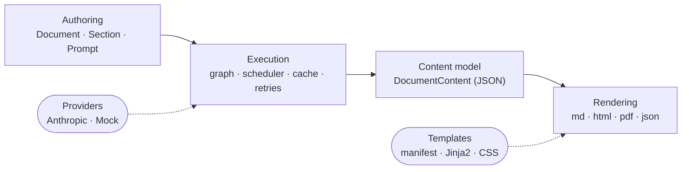

# DocCode BRD: Write Documents Like Code

Oct 29, 2026 · @Shubham

## 1. Overview

DocCode is a lightweight, open-source Python library that lets developers define a document as code. Prompts sit inside sections, dependencies between them are explicit, and a single `execute()` runs every prompt and renders the result. Content generation and visual design are strictly separated: the library produces a design-agnostic content model, and swappable templates turn it into PDF, HTML, Markdown or JSON.

DocCode is the working name (earlier drafts called it DCP). The PyPI package name is still to be confirmed; see Open questions.

### 1.1 Problem

- Multi-part LLM documents today are built by hand: copy prompts into a chat window, paste outputs into a word processor, repeat when inputs change.
- Scripted alternatives are ad hoc. Every team rewrites the same glue: prompt chaining, passing earlier outputs into later prompts, retries, caching, and HTML-to-PDF rendering.
- Prompt text, data, styling and output end up mixed in one script, so a designer cannot change the look without touching Python, and the same content cannot be rendered two ways.
- Nothing is reproducible: there is no record of which prompt, model and inputs produced a given section.

### 1.2 Vision

"Write documents like you write code." A document is a Python object. Sections are context managers, prompts are values, and outputs flow between them through references. Developers get IDE autocomplete, type checking, debugging, tests, version control, functions, loops, conditionals and imports with no new language to learn.

**Positioning.** Neighbouring tools each cover part of this: DSPy and Instructor/Mirascope (prompt programming and structured output), Hamilton and Prefect (Python DAGs), Quarto and Jupyter Book (reproducible documents). DocCode's defensible core is the combination none of them offer: *a document-shaped dependency graph* with provenance, a committed lockfile that makes generated text reviewable like code (FR-LCK), data that is rendered rather than retyped by the model (FR-CNT-3), and a design layer that never touches Python.

### 1.3 Goals (v1.0)

1. A Pythonic builder API (`Document`, `Section`, `Prompt`) that a developer can learn in under 10 minutes.
2. Lazy prompt references so one prompt's output can be used in another prompt's instruction before either has run.
3. Automatic dependency resolution as a DAG, with cycle detection and independent prompts run in parallel.
4. A design-agnostic `DocumentContent` model, serializable to JSON and loadable back.
5. Pluggable rendering: Markdown, HTML, JSON and PDF (via Jinja2 and WeasyPrint), with templates shipped separately from content logic.
6. Provider abstraction, with Anthropic as the first provider and a mock provider for tests.
7. Deterministic test runs with no network, and a content-addressed cache so unchanged prompts are never re-run.
8. Full run provenance: model, parameters, resolved instruction, tokens, latency and cost per prompt.
9. Documents whose structure can depend on model output: sections generated from an outline (FR-DYN) and plain Python steps between prompts (FR-VAL).
10. Trustworthy data reports: numbers and tables come from the data as deterministic blocks; the model writes only the narrative (FR-CNT-3, FR-OUT-4).
11. Reviewable, reproducible output: a committed lockfile pins generated text so CI builds are deterministic and regenerations show up as diffs (FR-LCK).
12. Cheap re-runs at scale: shared context is sent as a stable prefix so provider-side prompt caching applies (FR-PRV-7).
13. Documents that read as one piece, not separate essays: every prompt knows the outline and its place in it, and opt-in layers (a shared brief, sequential flow, an editor pass) add agreed messages, transitions and consistent terms (FR-COH).

### 1.4 Non-goals (v1.0)

- No hosted service, web UI, template marketplace or billing.
- No general agent framework; this is not a LangChain competitor. Value nodes and expansions (FR-VAL, FR-DYN) run the developer's own Python; DocCode never gives the model tools, I/O or the ability to run code.
- No DOCX or PPTX output (planned extension points only).
- No WYSIWYG editor; designers edit HTML/CSS templates.
- No tool use or web search inside prompts in v1.0 (an extension point is reserved).
- No YAML or other configuration language as the primary authoring format.

### 1.5 Success metrics

Targets confirmed by the owner on 2026-10-30 (adoption is still set at G5); they can be adjusted at gate G0 once the baseline scoreboard exists. The eval-based targets are measured against the baseline scoreboard published at G0 (§5.7), on the held-out set, for each family's recommended coherence preset; the detail is in `docs/EVALS_PROPOSAL.md` §7.1.

| Metric | Target for 0.1.0 | How it is measured |
| --- | --- | --- |
| Time to first document | A Python developer new to DocCode produces a document from the README quickstart (mock path) in 10 minutes or less | Timed walkthrough by three people before release |
| Reference coverage | All six reference use cases (§2.1) run under `--dry-run` in CI | CI |
| Re-run cost | An unchanged document re-run makes zero provider calls | Cache test (Phase 2) |
| Data fidelity | Zero silent unsupported numbers (figures neither prevented nor flagged by DocCode), silent misattributed claims in at most 1% of documents, unsupported-number rate at most 0.5% and lower than one-shot (B0) with a CI that excludes 0, and 100% of data-block cells exact | Held-out eval at G5 with independent graders (EVAL-8, EVAL-11, EVAL-17, EVAL-22) |
| Document quality | Pairwise win rate against naive parallel sections (B1) at least 0.60 with a 95% CI lower bound above 0.50; non-inferior to a one-shot prompt (B0), CI lower bound at least 0.45; no more than 5% of documents score 2 or below on any absolute criterion, and none scores 1 on accuracy | Held-out eval at G5 (EVAL-9, EVAL-10, EVAL-17) |
| Structure and clean-up | Structure score 1.00 and chatter 0% on cleaned output | Held-out eval at G5 (EVAL-8, EVAL-17) |
| Eval cost ceiling | Cost per document at most 2× B1 for `report` and `narrative`, at most 1.3× B1 for `basic`; prompt-cache hit rate at least 50% on cases with attachments above the cacheable minimum | Held-out eval at G5 (EVAL-17) |
| Reproducibility | Every locked rerun of an eval document makes zero provider calls and produces byte-identical Markdown; zero model-built injected links clickable in HTML | Held-out eval at G5 (EVAL-23, EVAL-24) |
| Cost transparency | Every live run reports per-prompt cost for every priced model | `RunRecord` |
| Adoption, 3 months after 0.1.0 | Set by the owner at G5 (for example PyPI downloads, GitHub stars, external issues) | pypistats, GitHub insights |

### 1.6 Ownership

| Role | Who | Responsibility |
| --- | --- | --- |
| Product owner | @Shubham | Owns this BRD, answers §8, signs off every phase gate, holds the Anthropic API key and PyPI credentials |
| Builders | Claude Code agents, organised by `DEVELOPMENT_PLAN.md` | Implement phases; never hold credentials |
| Eval engineer | A Claude Code agent role, named in `DEVELOPMENT_PLAN.md` | Builds and maintains `evals/` (§5.7); never implements the library features the evals measure; never receives held-out seeds or held-out outputs |
| Template designer | Agent or person, named at Phase 4 start | Built-in templates and the template guide |

Gate sign-off target: two business days. While a gate waits for sign-off, no work from the next phase starts.

### 1.7 Assumptions and external dependencies

- A GitHub repository (organisation and name chosen by the owner at Phase 0) with GitHub Actions enabled and enough CI minutes for the NFR-1 matrix.
- PyPI and TestPyPI projects with trusted publishing configured by the owner for the release workflow before Phase 5.
- An Anthropic API key held by the owner for the live test (NFR-10) and every live eval run (§5.7). Agents never receive it; live eval runs happen on the owner's machine or through a CI environment that needs the owner's approval.
- The owner holds the held-out eval seeds (§5.7, EVAL-6) outside the repository and rotates them each release.
- The owner and one other person spend about 3 hours labelling documents to calibrate the eval judge before G0 (EVAL-13), plus about an hour reviewing the dev cases and baseline prompts.
- Live eval spend is about $350–550 to reach 0.1.0, counted against the per-wave spend caps in `DEVELOPMENT_PLAN.md` §0.8.
- WeasyPrint's system libraries (Pango and friends) can be installed on the Linux CI image.
- Anthropic model IDs and prices change over time; the pricing table (FR-PRV-6) is maintained by hand.

## 2. Users and use cases

The primary user is a Python developer who generates documents repeatedly. Designers are secondary users who only touch templates.

| Persona | Needs | Touches |
| --- | --- | --- |
| Python developer / AI engineer | Chain prompts, reuse document structures, test without API calls | Python API, CLI |
| Data scientist / analyst | Turn data (dicts, DataFrames, JSON) into recurring narrative reports | Python API |
| Template designer | Change layout, fonts, colours, cover pages without reading Python | HTML/CSS + Jinja2 templates |
| DevOps / CI owner | Regenerate docs on a schedule or on merge, fail loudly, cap spend | CLI, exit codes, cache |

### 2.1 Reference use cases

Each use case below must be covered by a runnable script in `examples/` (see section 6).

1. **Weekly status report.** Three independent sections plus a "next week" section that depends on all three. Exercises fan-in dependencies and parallel execution.
2. **Quarterly business report from data.** A reusable `QuarterlyReport(Document)` subclass that takes a data dict. Exercises subclassing, context references (`ctx`), conditional sections (a risk section only when issues exist), a KPI table and metrics rendered from the data (FR-CNT-3), an outline prompt that expands into one subsection per theme (FR-DYN), and the `report` coherence preset (FR-COH-6).
3. **Repository README.** Reads files from a local repo path and attaches them as shared context (FR-DOC-12). Exercises large context inputs, prompt caching, the `narrative` coherence preset (sequential flow) and Markdown output.
4. **Annual review.** A loop that creates one section per quarter, then a summary that depends on all four. Exercises loops and generated section IDs.
5. **Same content, two designs.** One `DocumentContent` rendered with the `corporate` and `minimal` templates. Exercises the content/design split.
6. **Offline test.** The quarterly report run under the mock provider in pytest with zero network calls.

## 3. Architecture

The library has three layers with one-way dependencies: authoring builds a graph, execution turns it into a `DocumentContent`, and rendering turns content into files. Rendering never imports execution, and execution never knows about templates.



The content model in the middle is the contract: everything left of it produces it, everything right of it only reads it.

### 3.1 Layer responsibilities

| Layer | Owns | Must not |
| --- | --- | --- |
| Authoring (`doccode.core`) | `Document`, `Section`, `Prompt`, `PromptRef`, context variables, graph construction | Call an LLM, render output |
| Execution (`doccode.execution`) | Graph validation, topological scheduling, provider calls, retries, cache, run records | Know about templates or file formats |
| Content (`doccode.content`) | Immutable `DocumentContent` dataclasses, JSON (de)serialization | Hold references to live `Prompt` objects |
| Rendering (`doccode.render`) | Renderers (md, html, json, pdf), template loading, Markdown-to-HTML for section bodies | Call an LLM, mutate content |
| Providers (`doccode.providers`) | `Provider` protocol, `AnthropicProvider`, `MockProvider` | Know about documents |
| CLI (`doccode.cli`) | `run`, `plan`, `render`, `template` commands | Contain business logic |

### 3.2 Package layout

```
doccode/
├── pyproject.toml
├── src/doccode/
│   ├── __init__.py          # public API re-exports
│   ├── config.py            # configure(), DOCCODE_* env vars, setting resolution
│   ├── context.py           # public helpers: context.file(), context.files()
│   ├── checks.py            # output checks: max_words, no_phrases, numbers_from, ...
│   ├── parse.py             # helpers for expansions: list_items(), ...
│   ├── core/
│   │   ├── document.py      # Document, section stack
│   │   ├── section.py       # Section (context manager)
│   │   ├── prompt.py        # Prompt, PromptRef, Template string handling
│   │   ├── value.py         # Value (Python compute nodes)
│   │   ├── expand.py        # expansion points (dynamic sections)
│   │   └── context.py       # context variable scopes, ctx references
│   ├── execution/
│   │   ├── graph.py         # DAG build, cycle detection, topo levels
│   │   ├── executor.py      # sync + async ready-queue scheduler
│   │   ├── hygiene.py       # output clean-up: headings, preambles
│   │   ├── frame.py         # outline frame + position line (FR-COH-1)
│   │   ├── coherence.py     # shared brief, editor edits, repetition detection
│   │   ├── cache.py         # Cache protocol, FileCache, MemoryCache
│   │   ├── lock.py          # lockfile read / write / compare
│   │   ├── ratelimit.py     # per-provider request and token limits
│   │   ├── retry.py         # backoff policy
│   │   └── run.py           # RunRecord, PromptRecord, events
│   ├── content/
│   │   ├── model.py         # DocumentContent, SectionContent, Block
│   │   ├── links.py         # link extraction + host matching (NFR-26), pure functions
│   │   └── diff.py          # section-level diff between two contents
│   ├── providers/
│   │   ├── base.py          # Provider protocol, Completion
│   │   ├── anthropic.py
│   │   ├── pricing.py       # USD per million tokens by model ID
│   │   └── mock.py
│   ├── render/
│   │   ├── base.py          # Renderer protocol, registry
│   │   ├── markdown.py
│   │   ├── html.py          # Jinja2
│   │   ├── pdf.py           # WeasyPrint (optional extra)
│   │   ├── json.py
│   │   └── templates.py     # template discovery + manifest
│   ├── templates/           # built-in: default, corporate, minimal
│   ├── samples/content.json # sample content for template preview (package data)
│   ├── cli/
│   │   ├── main.py          # Typer app: run, plan, render, init, cache
│   │   └── templates.py     # template list / new / preview
│   └── errors.py
├── examples/
├── evals/                   # eval harness, cases, graders, judge (§5.7); never imported by src/
├── tests/
└── docs/
```

### 3.3 Run lifecycle

1. User code builds a `Document`; each `Prompt` registers itself with the current section.
2. `execute()` freezes the document (expansion build functions excepted, FR-DOC-9) and builds the graph from explicit `depends_on` plus every `PromptRef` found in instructions.
3. The graph is validated: unknown references, cycles and duplicate IDs raise before any API call.
4. Nodes (prompts and values) run as soon as all their inputs are ready, up to `max_concurrency` at a time. When an expansion's inputs are ready, its build function runs and the new nodes join the graph (FR-DYN).
5. Each prompt's instruction is resolved in a single literal pass (refs replaced with upstream outputs, context variables filled; FR-REF-3), the cache is checked, then the provider is called.
6. Results are assembled into an immutable `DocumentContent` with a `RunRecord`. The hosts allowed for links (NFR-26) are computed here and stored in `content.link_hosts`.
7. `content.save(path, template=...)` picks a renderer by extension or `format` and writes the file.

## 4. Functional requirements

Requirements use MUST (required for v1.0), SHOULD (expected unless a phase note says otherwise) and MAY (optional). Every requirement has an ID so tests and commits can reference it.

### 4.1 Document and sections

- **FR-DOC-1** MUST: `Document(title: str, *, metadata: dict | None = None, context: dict | None = None, model: str | None = None, system: str | None = None, effort: str | None = None, max_tokens: int | None = None, provider: Provider | None = None, style: str | None = None, link_allowlist: Sequence[str] = (), purpose: str | None = None, coherence: str = "basic", frame: bool | None = None, shared_brief: bool | None = None, brief_instruction: str | None = None, flow: str | None = None, max_flow_chars: int = 60_000, editor: bool | Editor | None = None, repetition_threshold: int = 2)` creates an empty document. The coherence options are defined in §4.17; `None` means "take it from the `coherence` preset". The keyword settings are document-level defaults for every prompt (FR-PRM-4, FR-PRM-9). `style` is a style guide added to every prompt's system prompt (FR-PRM-12). `link_allowlist` is used by NFR-26.
- **FR-DOC-2** MUST: `doc.section(title: str, *, id: str | None = None, context: dict | None = None, brief: str | None = None) -> Section` returns a context manager (`brief` is the section's one-line intent for the document frame, FR-COH-1); `with doc.section(...) as s:` binds the `Section`. Section context is inherited by subsections (FR-CTX-1). Entering it pushes the section onto the active-section stack; exiting pops it.
- **FR-DOC-3** MUST: Sections nest. A `with doc.section(...)` inside another section creates a subsection with `level = parent.level + 1`. Top-level sections are level 1.
- **FR-DOC-4** MUST: The active-section stack is stored in a `contextvars.ContextVar`, so concurrent builders in threads or tasks do not interfere.
- **FR-DOC-5** MUST: Section IDs default to a slug of the title (`"Executive Summary"` → `executive-summary`). Slugs are Unicode-aware: letters and digits of any script are kept and lowercased, every other run of characters becomes `-` (`"执行摘要"` → `执行摘要`). A title that slugifies to an empty string gets `section-<n>`, where n is the section's 1-based position in the document. Duplicate slugs get a numeric suffix (`-2`, `-3`). An explicit duplicate `id=` raises `DuplicateIdError`.
- **FR-DOC-6** MUST: `doc.text(markdown: str)` and `section.text(markdown: str)` add static Markdown blocks with no LLM call. Static text supports the same `{name}` context placeholders and reference tokens as prompts. `doc.text()` called with no active section adds the block to the document preamble (FR-CNT-1), which renders after the title and before the first section.
- **FR-DOC-7** MUST: Blocks within a section keep insertion order in the output, regardless of execution order.
- **FR-DOC-8** MUST: `Document` can be subclassed. Builders that define structure in `__init__` or a `build()` method must work (reference use case 2).
- **FR-DOC-9** MUST: After `execute()` starts, the document is frozen. Adding sections, prompts, text, data blocks, values, attachments or expansions raises `DocumentFrozenError`. The one exemption is an expansion's build function (FR-DYN-2): while it runs, the executor opens an *expansion context* (held in a `contextvars.ContextVar`), and additions made inside it, at its expansion point, are allowed. Every other addition during the run, including one made from another thread or task outside that context, still raises. `doc.copy()` returns an unfrozen deep copy for re-runs with changes. The copy keeps every prompt's reference key (FR-REF-1), so tokens already stored in instruction strings still resolve inside the copy.
- **FR-DOC-10** MUST: `doc.set_context(**kwargs)` merges values into the document context (FR-CTX-1). It raises `DocumentFrozenError` after `execute()` starts.
- **FR-DOC-11** MUST: Data blocks. `section.table(data, *, columns=None, caption=None)` adds a `TableBlock`. `data` is a list of dicts, a dict of lists, or any object with `to_dict("records")` (such as a pandas DataFrame); pandas is never imported. `section.metric(label, value, *, delta=None, unit=None)` adds a `MetricBlock`. Values are converted with `str()` at authoring time and are never passed through a model. Both methods return `None`: a data block is not a reference and has no token form. A prompt that needs the same figures references their source instead: the data itself through `context=` or an attachment, or the `Value` that produced it (FR-VAL-1). Either is inserted as described in FR-CTX-2.
- **FR-DOC-12** MUST: `doc.attach(name: str, value)` adds shared context: a string, a dict or list (sent as indented JSON), or a `context.file()`/`context.files()` object. Attachments are sent once per request as a stable prefix ahead of the instruction (FR-PRV-7), labelled with their name, so prompts can refer to them in prose ("using the attached `repo` files"). Every prompt receives every attachment unless it passes `Prompt(attachments=[...])` to choose a subset.
- **FR-DOC-13** MUST: `section.add(prompt)` registers an existing `Prompt` (for example one built by a helper function) as the next block of that section. Adding a prompt that is already registered raises `DuplicateIdError`.

### 4.2 Prompts

- **FR-PRM-1** MUST: `Prompt(instruction, *, id=None, model=None, system=None, effort=None, max_tokens=None, depends_on=(), refs=None, context=None, cache=True, visible=True, provider=None, attachments=None, checks=(), on_check_fail="fail", raw=False, frame=None, output_schema=None)`. `frame=None` follows the document setting (FR-COH-1). `effort` is `"low"`, `"medium"`, `"high"`, `"xhigh"` or `"max"` (FR-PRV-1); DocCode has no `temperature` setting. `refs` is FR-REF-5, `checks` and `on_check_fail` are FR-OUT-4, `output_schema` is FR-PRM-7.
- **FR-PRM-2** MUST: A `Prompt` created while a section is active registers itself as the next block of the innermost active section. A `Prompt` created with no active section is unregistered: it joins the document's graph only when a node in the graph references it or names it in `depends_on`, directly or transitively (FR-DAG-1). An unregistered prompt that nothing reaches is not part of the document and never runs (FR-PRM-10 warns about it).
- **FR-PRM-3** MUST: `visible=False` prompts run and can be referenced but produce no block in the output. A prompt with `visible=False` and a prompt created outside any section are the same thing, a **helper prompt**, and behave identically everywhere once they are in the graph (execution, failure handling, records). The single rule for whether a helper runs: every node in the graph runs. A registered `visible=False` prompt is always in the graph, so it runs even when nothing references it; `doc.plan()` flags such a prompt as an "unreferenced helper" so its cost is visible. An unregistered prompt is in the graph only when reached (FR-PRM-2). The docs use only the term "helper prompt".
- **FR-PRM-4** MUST: Unset `model`, `effort` and `max_tokens` fall back to document-level defaults (FR-DOC-1), then to global config (`doccode.configure(...)`), then to environment variables (`DOCCODE_MODEL`, and so on), then to library defaults. The document-level `system` falls back the same way (global config, then `DOCCODE_SYSTEM`, then none). A prompt's own `system` does not replace the document-level one; it is added to it (FR-PRM-12).
- **FR-PRM-5** MUST: Prompt IDs default to `<section-id>.<n>` where n is the 1-based index among that section's prompts. Unregistered prompts default to `_anon.<n>`, numbered per document in the order graph building discovers them, so the ID is deterministic for a given document and does not depend on what else the process has built. Until then an unregistered prompt's `id` is `None`. IDs are unique per document. Generated IDs change when a section is renamed, so anything that must survive renames (mock maps, lockfiles, `--only`) should use explicit `id=`. `doc.plan()` lists which IDs were generated.
- **FR-PRM-6** MUST: `prompt.output` returns the generated text after execution and raises `NotExecutedError` before it.
- **FR-PRM-7** SHOULD: `Prompt(..., output_schema=SomePydanticModel)` requests JSON, validates it with Pydantic, and exposes `prompt.parsed`. On validation failure it retries once with the validation error appended, then fails. (Phase 3; Pydantic is an optional extra.)
- **FR-PRM-8** MAY: `system` accepts a string or a callable `(section) -> str` for section-aware system prompts. (Deferred to 0.2.0; see §11.)
- **FR-PRM-9** MUST: The provider for a prompt resolves in this order, first set wins: `Prompt(provider=)`, `execute(provider=)`, `Document(provider=)`, `configure(provider=)`, `DOCCODE_PROVIDER`, then `AnthropicProvider`. The one exception is the CLI's `--dry-run`, which replaces every provider, including explicit `Prompt(provider=)` values, with `MockProvider`.
- **FR-PRM-10** MUST: Orphan detection. Prompts created with no active section are tracked in a weak, process-wide registry. When `execute()` runs, it emits `OrphanPromptWarning` for every still-alive helper prompt that was created after this document was constructed and is not reachable from it. This catches a prompt that was created before a `with` block and was expected to appear inside it; the warning suggests `section.add(prompt)`.
- **FR-PRM-11** MUST: `Prompt(checks=[...])` runs output checks (FR-OUT-4) on this prompt's cleaned output.
- **FR-PRM-12** MUST: Instructions for a prompt come in two parts, so that the shared part stays byte-identical across prompts (FR-PRV-7):
  - The **document system prompt** (`CompletionRequest.system`) is the output instruction (FR-OUT-1, unless `raw=True`), then the document `style`, then the document-level `system` (FR-PRM-4). Empty parts are omitted. It is identical for every prompt in the document except `raw=True` prompts.
  - The prompt's own `system`, when set, is **prompt-specific system text**. It is sent at the start of the per-prompt part of the request (FR-PRV-7), labelled `Additional instructions for this part:`, and adds to the document system prompt rather than replacing it.

### 4.3 Lazy references (the f-string problem)

Python evaluates f-strings immediately, so `Prompt(f"Based on {summary}...")` would read `summary` before it has run. References must therefore be lazy.

- **FR-REF-1** MUST: `Prompt.__str__` and `Prompt.__format__` return a reference token, not output: `⟦doccode:ref:<key>⟧` (U+27E6 / U+27E7), where `<key>` is an opaque 12-hex-character key assigned when the `Prompt` (or `Value`) is created. The key, not the prompt ID, is used so a token is valid before an anonymous prompt has an ID (FR-PRM-5). Error messages always show the prompt ID, not the key. This makes plain f-strings work: `Prompt(f"Based on {summary}, analyze...")` stores the token. The complete set of well-formed tokens, fixed at the contract freeze, is:
  - `⟦doccode:ref:<key>⟧`: the node's full output.
  - `⟦doccode:ref:<key>|max_chars=<n>⟧`: the output truncated at substitution time (FR-REF-7), where `<n>` is a positive decimal integer.
  - `⟦doccode:ctx:<name>⟧`: a context reference (FR-CTX-4), where `<name>` is a Python identifier.
  - `⟦doccode:repr:<key>⟧`: appears only in `repr()` output and is always a misuse when found in text (FR-REF-9).

  The graph scans the parameterised form like the plain one (same edge, FR-REF-2).
- **FR-REF-2** MUST: At graph build time, the executor scans every instruction, system prompt and static text for tokens and adds an edge from each referenced prompt. It also adds an edge from every prompt or `Value` named in the `sources()` of the prompt's checks (FR-OUT-4), so a check never runs before the data it compares against. Explicit `depends_on` adds edges with no substitution (ordering only).
- **FR-REF-3** MUST: At run time, each token is replaced with the upstream prompt's output, after the upstream prompt succeeds. Resolution is a single pass over the original instruction: every `{name}` placeholder and every token is replaced by its value, and inserted text (upstream outputs and context values) is never scanned again. An upstream output containing `{data}`, `{{` or a reference token reaches the downstream prompt verbatim. A test must cover all three.
- **FR-REF-4** MUST: Tokens are document-scoped. A token whose key does not belong to a prompt in the document raises `UnknownReferenceError` at validation, before any provider call.
- **FR-REF-5** MUST: Explicit named references work without f-strings: `Prompt("Based on {summary}", refs={"summary": summary_prompt})`. Named refs and context variables share one `{name}` namespace; a name defined in both raises `NameConflictError`.
- **FR-REF-6** SHOULD: On Python 3.14+, `Prompt` accepts a PEP 750 template string (`t"Based on {summary}"`). Interpolations holding a `Prompt` become references; other values are formatted normally.
- **FR-REF-7** SHOULD: `summary.ref(max_chars=2000)` returns a token that truncates the upstream output to the given length at substitution time, cutting at a paragraph boundary where possible.
- **FR-REF-8** MUST: Brace handling depends on whether the text (an instruction, system prompt or static text, as stored after Python has evaluated any f-string) contains a well-formed token (FR-REF-1):
  - **Placeholder mode** (no token in the text): `{name}` is a placeholder filled from `refs=` or context, and literal `{` and `}` are written `{{` and `}}`, matching `str.format`. Unknown `{name}` placeholders raise `UnknownPlaceholderError` at validation.
  - **Token mode** (at least one token in the text): braces are never parsed. Every `{` and `}` is literal, and values come in only through tokens (prompt and value references, `ctx`). In an f-string, Python's own rule still applies, so a literal brace is typed `{{` in the source once, and DocCode adds no second level of escaping.

  Example: `f"For {ctx.company}, reply as JSON like {{\"theme\": \"...\"}}, using {outline}."` reaches DocCode as `For ⟦doccode:ctx:company⟧, reply as JSON like {"theme": "..."}, using ⟦doccode:ref:…⟧.`, which is in token mode, so the braces are sent as written. The plain string `"Reply as JSON like {{\"theme\": 1}} for {company}"` has no token, so it is in placeholder mode. A string cannot mix the two styles; `{name}` text inside a token-mode string is sent literally, and the docs say so.
- **FR-REF-9** MUST: Token-misuse detection.
  - `Prompt.__format__` with a non-empty format spec (`f"{summary:>20}"`) raises `TypeError` naming the prompt.
  - `repr(prompt)` explains the prompt and contains a `⟦doccode:repr:<key>⟧` marker, so `f"{summary!r}"` is detectable.
  - At validation, any instruction, system prompt or static text containing `⟦`, `⟧`, `doccode:ref`, `doccode:ctx` or `doccode:repr` (case-insensitive) that is not part of a well-formed token (the list in FR-REF-1, excluding the `repr` marker) raises `TokenMisuseError`. The message names the prompt, quotes the fragment and lists the likely causes (`!r`, a case change such as `.upper()`, slicing).

### 4.4 Context variables

- **FR-CTX-1** MUST: Context resolves in this order, last wins: global config (`configure(context=...)`, FR-CFG-1), `Document(context=...)`, `doc.set_context(**kwargs)`, `doc.section(..., context=...)` (inherited by children), `Prompt(context=...)`, `execute(context=...)`.
- **FR-CTX-2** MUST: Context values are converted with `str()` unless they define `__doccode__()`, which returns the string to inject. A `dict` or `list` value is injected as indented JSON.
- **FR-CTX-4** MUST: Context references, the primary documented style. `from doccode import ctx`. `ctx.<name>` (and `ctx["name"]`) returns a context reference whose `__str__`/`__format__` emit `⟦doccode:ctx:<name>⟧`. At run time it resolves through the same chain as `{name}` (FR-CTX-1) for the prompt it appears in, and is inserted literally (FR-REF-3). An unknown name raises `UnknownPlaceholderError` at validation. This gives one brace style for values: in `f"Summarise {ctx.company}'s {ctx.quarter} using {outline}"` every value is a single-brace f-string field. Literal braces in such an f-string are typed `{{ }}` once, as Python requires, and are then sent literally because the string is in token mode (FR-REF-8); no second level of escaping is ever needed. Plain-string `{name}` placeholders stay supported for non-f-string use and for `refs=`.
- **FR-CTX-3** SHOULD: `doccode.context.file(path, max_chars=None)` and `doccode.context.files(glob)` load file text lazily at run time, for use case 3. Binary files are skipped with a warning.

### 4.5 Dependency graph

- **FR-DAG-1** MUST: The graph's nodes are registered prompts, values (FR-VAL) and expansion points (FR-DYN), plus helper prompts and values reachable through references, `depends_on` or check sources (FR-REF-2). When the coherence options enable them, the graph also holds the shared-brief node `_brief` (FR-COH-2) with an edge to every other prompt, the editor node `_editor` (FR-COH-4) depending on every other node, and, under sequential flow, implicit edges between consecutive visible prompts in document order (FR-COH-3). These are built with the graph, so `plan()`, validation and the budget projection all see them. Section IDs, prompt IDs, value IDs and expansion IDs share one document-wide namespace; a duplicate raises `DuplicateIdError`.
- **FR-DAG-2** MUST: Cycles raise `CycleError` with the full cycle path in the message (`a → b → c → a`).
- **FR-DAG-3** MUST: `doc.plan()` returns an `ExecutionPlan` with levels (lists of node IDs with no dependencies on each other; used for display and estimates, not as a scheduling barrier), the edges, an estimate of input tokens per prompt (a chars/4 heuristic is acceptable) and a worst-case output estimate (the prompt's resolved `max_tokens`). Expansion points appear as one node marked "size unknown until run", with their `max_nodes` limit. The `_brief` and `_editor` nodes and sequential-flow edges appear when enabled, and unreferenced helper prompts are flagged (FR-PRM-3). It makes no provider calls.
- **FR-DAG-4** MUST: `ExecutionPlan` prints as a readable text tree and exports Mermaid (`plan.to_mermaid()`).

### 4.6 Execution

- **FR-EXE-1** MUST: `doc.execute(**opts) -> DocumentContent` runs synchronously. `await doc.aexecute(**opts)` is the async equivalent. The sync version wraps the async one. With no running event loop it uses `asyncio.run`. Inside a running loop (for example Jupyter, which the data-analyst persona uses), it runs `aexecute` on a new event loop in a worker thread and blocks until it finishes, so notebooks work without `await`. In that case `on_event` callbacks run on the worker thread, so callbacks must be thread-safe. Providers never hold an async client across event loops: they create their SDK client lazily, once per event loop, on the first call that needs it. An async client passed in by the user (`AnthropicProvider(client=...)`) is bound to the caller's loop and cannot be used from the worker thread, so the worker-thread path raises `ConfigError` before any call, telling the user to pass `api_key=` instead or to `await doc.aexecute()`. The built-in Rich progress view is used only by the CLI and is never started from a notebook.
- **FR-EXE-2** MUST: Options: `provider` (FR-PRM-9), `max_concurrency` (default 4), `cache` (a `Cache`, `True` for the default `FileCache`, or `False`), `on_error` (`"fail"` default, or `"continue"`), `on_event` (callback), `context` (run-level overrides), `budget` (see FR-EXE-7), `timeout` (seconds per provider request, default 120; a request that exceeds it counts as a timeout error under FR-EXE-6), `lock`, `lock_mode` and `only` (FR-LCK-2).
- **FR-EXE-3** MUST: Ready-queue scheduling. A node is scheduled as soon as every dependency has succeeded, and does not wait for the rest of its plan level. Concurrency is bounded by an `asyncio.Semaphore(max_concurrency)`. Ties are broken by document order, so runs with `max_concurrency=1` are deterministic. A test must show that a slow prompt does not delay an unrelated downstream prompt whose inputs are ready.
- **FR-EXE-4** MUST: With `on_error="fail"`, the first failed node cancels pending nodes and raises `ExecutionError`. The error carries the partial `RunRecord` and every completed output, so a re-run with cache enabled resumes cheaply. A node failure is always wrapped: whether the cause is a `ProviderError`, a final `CheckFailedError` (FR-OUT-4), an exception from a value or an expansion's build function, or an `ExpansionError`, the caller gets `ExecutionError` with the original exception as `__cause__` and as `error.cause`, and the node's ID in `error.ids`. Errors that are not node failures are raised directly, never wrapped: `GraphError` subclasses and `ConfigError` from validation, `ConfigError` for a missing API key (FR-PRV-2), `BudgetExceededError` (FR-EXE-7) and `LockMismatchError` (FR-LCK-2).
- **FR-EXE-5** MUST: With `on_error="continue"`, a failed prompt produces an `ErrorBlock` in its section. Every downstream prompt is marked `skipped` and also produces an `ErrorBlock` naming the failed dependency. Static text blocks that reference a failed or skipped prompt are replaced by an `ErrorBlock` the same way. A failed prompt with no block of its own (`visible=False`, or unregistered) adds no block; its failure is recorded in the `RunRecord`, and every skipped downstream block names it. `execute()` returns content; `content.ok` is `False`.
- **FR-EXE-6** MUST: Retries apply to rate-limit (429), overload (529), 5xx and timeout errors: up to 3 retries with exponential backoff and jitter (base 1 s, cap 30 s), honouring a `retry-after` header when present. Authentication and validation errors, and refusals (FR-PRV-8), are never retried.
- **FR-EXE-7** SHOULD: `budget=Budget(max_usd=..., max_output_tokens=...)` stops scheduling new prompts once spend would exceed the limit, and raises `BudgetExceededError` with the run so far. If `max_usd` is set and any prompt's model has no price (FR-PRV-6), validation raises `ConfigError` naming those models before any provider call. A budget cannot be enforced on unknown prices. `max_output_tokens` works for every model. The projection is a worst case: actual spend so far, plus, for every prompt not yet run, its estimated input tokens at the input price and its resolved `max_tokens` at the output price. Output usually costs several times more than input, so it is never left out. Value nodes cost nothing. The shared brief is projected like any other prompt. The editor is projected with an input estimate equal to the sum of every visible prompt's `max_tokens` plus the frame, and its own `max_tokens` as output. When an expansion adds nodes, the projection is recomputed before any of them is scheduled.
- **FR-EXE-8** MUST: `on_event` receives typed events, frozen dataclasses exported from `doccode`. The callback may be sync or async. The same event classes are used for every node kind (prompt, value, expansion, brief, editor). Every event carries `run_id: str`, `node_id: str`, `kind: str` (as in FR-EXE-9) and `timestamp: datetime`. The events and their extra fields are:
  - `PromptStarted(attempt: int)`
  - `PromptCompleted(status: Literal["ok", "cached", "locked"], truncated: bool, record: PromptRecord)`; `truncated` is FR-PRV-5
  - `PromptRetrying(attempt: int, delay: float, error: str)`
  - `PromptFailed(error: str)`
  - `PromptSkipped(failed_dependency: str)`
  - `ExpansionCompleted(added: tuple[str, ...])`: the IDs of the nodes the expansion created
  - `RunCompleted(run: RunRecord)`

  Editor results (applied and rejected edits, notes) arrive in the `_editor` node's `PromptCompleted.record.warnings`.
- **FR-EXE-9** MUST: Every node produces a `PromptRecord`: id, kind (`prompt`, `value`, `expansion`, `brief`, `editor`), status (`ok`, `cached`, `locked`, `failed`, `skipped`), provider, provider fingerprint, model, parameters (including `effort` and `max_tokens`), resolved instruction (the exact final user message sent: prompt-specific system text, position line and instruction; FR-PRV-7), system prompt (the document system prompt sent), prefix (the named shared blocks sent, including attachment text), pre-edit text (set only when the editor changed the block, FR-COH-4), input tokens, output tokens, cache-read and cache-write input tokens (FR-PRV-7), latency in ms, cost in USD, attempts, raw output (before FR-OUT clean-up), warnings (truncation, clean-up applied, check retries, disarmed links per NFR-26, editor results), error message, refusal category (FR-PRV-8), and start and end timestamps.
- **FR-EXE-10** MUST: The `RunRecord` holds every `PromptRecord`, totals for tokens, cost and wall-clock time, the library version and a run UUID.
- **FR-EXE-11** SHOULD: `RateLimit(requests_per_minute=None, tokens_per_minute=None)` can be passed to any provider (or through `configure(rate_limits={provider_name: RateLimit(...)})`). The executor waits for capacity before sending, using a token bucket and the plan's input estimate, so large fan-outs stay under the limit instead of relying on 429 retries.

### 4.7 Providers

- **FR-PRV-1** MUST: A `Provider` protocol with `async complete(request: CompletionRequest) -> Completion`, a `name` attribute and `fingerprint() -> str`. The fingerprint is static: it is computed from configuration alone, with no network call, so cache keys and lock checks (FR-LCK-2 `frozen`) work offline and without an API key. It covers the provider name, the endpoint or base URL, and any provider-level default parameters. The model string is part of every cache key (FR-CCH-1) as configured, so a moving alias (for example a `-latest` name) is **not** detected when it starts pointing at a new model; this is a documented limitation, and the docs recommend pinned model IDs for anything cached or locked. `CompletionRequest` holds:
  - `model`
  - `system`: the document system prompt (FR-PRM-12)
  - `prefix`: an ordered tuple of named shared blocks (FR-PRV-7)
  - `messages`: the per-prompt part
  - `effort`: `"low"`, `"medium"`, `"high"`, `"xhigh"`, `"max"` or `None` for the provider's default. It is a provider-agnostic setting that a provider may ignore (`MockProvider` does); it is still part of the cache key.
  - `max_tokens`
  - `response_format`: a JSON Schema for structured output (FR-PRM-7), or `None`
  - `metadata`: a mapping that always holds `node_id` (the prompt ID), `kind` (as in FR-EXE-9) and `section_id` (`None` for helpers)

  `Completion` holds text, input tokens, output tokens, cache-read and cache-write input tokens (0 when unsupported), stop reason and raw response.
- **FR-PRV-2** MUST: `AnthropicProvider` uses the official `anthropic` SDK's async client, created per event loop (FR-EXE-1). It reads `ANTHROPIC_API_KEY` from the environment unless a key or client is passed in. A missing key raises `ConfigError` only when a real provider call is actually needed, never at import time or construction. A run whose prompts are all served by the lock or the cache needs no key. It never sends `temperature`, `top_p` or `top_k`, which current Claude models reject. It maps `effort` to the request's `output_config.effort` and omits it when `effort` is `None`. The Researcher confirms the current request shape from the official docs in Wave 0 (BRD §10.7).
- **FR-PRV-3** MUST: The default model ID lives in exactly one constant (`DEFAULT_MODEL` in `providers/anthropic.py`) and is overridable everywhere in FR-PRM-4. Model IDs must not be hard-coded anywhere else in `src/` or `examples/`, with two allowlisted exceptions: the pricing table `providers/pricing.py` (FR-PRV-6), which is keyed by model ID, and the pinned eval models in `evals/config.toml` (EVAL-12). The grep test that enforces this rule allowlists exactly those files and matches model IDs by pattern, so the test file holds no literal ID itself.
- **FR-PRV-4** MUST: `MockProvider` returns deterministic text with no network. It accepts a dict mapping prompt ID to response, a path to a JSON file holding such a dict, or a callable `(request) -> str`. It reads the prompt ID and node kind from `request.metadata` (FR-PRV-1). It reports token counts as `len(text)//4`. Its default output, for prompts with no mapped response, depends on the node kind:
  - `brief`: a valid shared brief with the four FR-COH-2 headings and one `## Section points` bullet per section ID in the outline frame
  - `editor`: `{"edits": [], "notes": []}`
  - anything else: `[mock:<prompt-id>]` plus the first 80 characters of the instruction

  A response map with a key that matches no prompt in the document raises `ConfigError` at validation, listing the unknown keys and the closest real IDs, so a section rename cannot silently turn mock responses into defaults. A key under an expansion's ID prefix (`<expansion-id>/…`, FR-DYN-5) is checked when that expansion runs, against the nodes it created. Examples whose structure depends on model output (an outline feeding an expansion) ship a response map beside the script, `<script>.mock.json` (FR-CLI-3).
- **FR-PRV-5** MUST: A stop reason of `max_tokens` adds a warning to the `PromptRecord` and fires a `PromptCompleted` event with `truncated=True` (FR-EXE-8).
- **FR-PRV-6** SHOULD: The pricing table (USD per million input and output tokens by model ID) lives in a single file (`providers/pricing.py`) and can be overridden with `doccode.configure(pricing={...})`. Unknown models report cost as `None`, not 0. The table also holds cache-read and cache-write input prices where the provider bills them separately.
- **FR-PRV-7** MUST: Prompt-cache-friendly requests. Each request is laid out as a shared, document-wide part followed by the per-prompt part, so that everything that is the same for many prompts comes first, from byte 0. The shared part is, in order:
  1. the document system prompt (FR-PRM-12), identical for every prompt except `raw=True` prompts
  2. the outline frame (FR-COH-1)
  3. the attachments (FR-DOC-12), in the order they were attached, each labelled with its name
  4. the shared brief (FR-COH-2)
  5. under sequential flow, "the document so far" (FR-COH-3)

  The per-prompt part is the final user message: the prompt-specific system text (FR-PRM-12) if any, then the position line (FR-COH-1), then the resolved instruction. Shared context therefore stays byte-identical across prompts (under sequential flow, each prompt's shared part extends the previous one's). Prompts with `raw=True`, prompts with a subset of attachments (FR-DOC-12) and the editor (FR-COH-4) send a different shared part and do not share its cache entry; the docs say so.

  For Anthropic, item 1 is sent as the `system` parameter, and items 2–5 are sent as content blocks at the start of the first user message, ahead of the per-prompt text block. `AnthropicProvider` sets at most two `cache_control` breakpoints, well within the API's limit of four per request: one on the last static shared block (item 4, or the last item present before it), and, under sequential flow, one on the end of "the document so far". A breakpoint is set only when the prefix up to it meets the model's minimum cacheable size. That minimum depends on the model (from 512 to 4096 tokens at the time of writing). It is looked up from the official docs, as in §10.7, and is not hard-coded in more than one place; a shorter prefix silently does not cache. `AnthropicProvider` reports cache-read and cache-write tokens. A cache entry can be read only after the first response that writes it has begun, so prompts that start at the same moment (for example the first ready wave under parallel flow) each pay a cache write; the docs say so. A test with the stubbed client asserts that two prompts with the same attachments send identical shared parts and the expected breakpoints.
- **FR-PRV-8** MUST: A stop reason of `refusal` fails the node with `ProviderRefusalError` (a `ProviderError` subclass, FR-ERR-1) carrying the prompt ID, the model and the refusal category the API returned (or `None`). Partial text is discarded, never used as output. The failure follows FR-EXE-4 and FR-EXE-5 like any node failure: under `on_error="fail"` the caller gets `ExecutionError` with the refusal as its cause; under `"continue"` the section gets an `ErrorBlock` that says the model declined, and downstream nodes are skipped. A refusal is not retried (FR-EXE-6), is never written to the cache or the lock, and is never served from another model: `AnthropicProvider` sends no `fallbacks` and the provider asserts that the served model is the requested one. The `PromptRecord` (FR-EXE-9) records `refusal_category`. A test with the stubbed client covers both `on_error` modes and checks that a re-run calls the provider again. (Owner decision, 2026-10-30.)

### 4.8 Caching

- **FR-CCH-1** MUST: The cache key is a SHA-256 hash of: provider name, provider fingerprint (FR-PRV-1), model, the document system prompt, every shared prefix block by name and text (FR-PRV-7: frame, attachments, brief, document so far), the final user message (prompt-specific system text, position line and resolved instruction), effort, max\_tokens, response format (if any), the `fingerprint()` of every check in order (FR-OUT-4) and a cache-format version. Every input is serialized canonically (JSON with sorted keys) before hashing, so the key is stable across processes and runs.
- **FR-CCH-2** MUST: `FileCache(dir=".doccode_cache")` stores one JSON file per key holding the completion text, token counts and creation time. Writes are atomic (temp file plus rename).
- **FR-CCH-3** MUST: Because keys use resolved instructions, changing an upstream prompt invalidates every downstream entry automatically.
- **FR-CCH-4** MUST: `Prompt(cache=False)` and `execute(cache=False)` bypass reads and writes. The CLI `--refresh` flag skips reads but still writes.
- **FR-CCH-5** SHOULD: `MemoryCache` exists for tests, and `doccode cache clear` empties the default directory.
- **FR-CCH-6** MUST: Several processes may share one `FileCache`. Atomic writes make this safe: last writer wins, and readers never see a partial file. There is no automatic eviction in 0.1.0; `doccode cache clear [--older-than DAYS]` and `doccode cache stats` manage size. The docs state that model output is non-deterministic whatever the settings, so the cache (and the lock) keeps one sample per key and reuses it; use `--refresh` (or `lock update`) to draw a new one.
- **FR-CCH-7** MUST: A `--dry-run` (FR-CLI-3) never reads or writes the `FileCache` or the lock: it runs with a fresh `MemoryCache` and with the lock disabled, so mock text can never reach a cache entry or lock entry that a real run would read.

### 4.9 Content model

- **FR-CNT-1** MUST: `DocumentContent` is a frozen dataclass: `schema_version` (int, starts at 1), `title`, `metadata`, `preamble: tuple[Block, ...]` (document-level blocks from FR-DOC-6), `sections: tuple[SectionContent, ...]`, `link_hosts: tuple[str, ...]` (the hosts whose links stay clickable, computed at execution time, NFR-26; empty for content built by hand), `run: RunRecord | None`, `ok: bool`. `save()`, `render()` and `diff()` are methods on `DocumentContent`. Each one only delegates to its own module (`doccode.render`, `doccode.content.diff`), which is imported lazily, so the content model never imports renderers at import time.
- **FR-CNT-2** MUST: `SectionContent`: `id`, `title`, `level`, `blocks: tuple[Block, ...]`, `subsections: tuple[SectionContent, ...]`.
- **FR-CNT-3** MUST: `Block` is a tagged union:
  - `MarkdownBlock(text, source_prompt_id | None, edited: bool)` (`edited` is set by the editor pass, FR-COH-4)
  - `TableBlock(columns: tuple[str, ...], rows: tuple[tuple[str, ...], ...], caption | None)`
  - `MetricBlock(label, value, delta | None, unit | None)`
  - `ErrorBlock(message, prompt_id)`

  LLM output is always treated as Markdown, after clean-up (FR-OUT). Table and metric blocks come only from data (FR-DOC-11), never from model output. This is the "numbers come from data, words from the model" rule.
- **FR-CNT-4** MUST: `content.to_dict()`, `content.to_json(indent=2)` and `DocumentContent.from_json(str | path)` round-trip losslessly when provenance is kept. Tests must assert:
  - `from_json(c.to_json(include_provenance=True)) == c` for any content
  - `from_json(c.to_json()) == c` when `c.run is None`
  - `from_json(c.to_json())` equals `c` with exactly the FR-CNT-8 stripped fields set to `None` in every `PromptRecord` (`resolved_instruction`, `system`, `prefix`, `raw_output`, `pre_edit_text`); every other field is unchanged

  `from_json` raises `ContentVersionError` for a `schema_version` newer than the library supports. Older versions are upgraded by migration functions registered per version (none exist for v1). Any change to the serialized shape bumps `schema_version` and adds a migration.
- **FR-CNT-5** MUST: The content model has no references to `Prompt`, `Document` or providers, so it can be rendered in a process that never ran the LLM.
- **FR-CNT-6** SHOULD: Helpers for template authors: `content.walk()` (depth-first sections), `content.find(section_id)`, `content.toc()`, `section.markdown` (blocks joined) and `section.html` (rendered and sanitized).
- **FR-CNT-7** MUST: A JSON Schema for the serialized format is generated from the dataclasses and published at `docs/schema/content-v1.json`. It covers every field in FR-CNT-1 including `link_hosts`, and every `PromptRecord` field in FR-EXE-9, with the FR-CNT-8 stripped fields nullable.
- **FR-CNT-8** MUST: Provenance is kept out of shared content by default. `content.to_json()` and `content.save("x.json")` write the `RunRecord` with these `PromptRecord` fields set to `null`: `resolved_instruction`, `system`, `prefix` (which holds the attachment text), `raw_output` and `pre_edit_text`. Totals, models, parameters, tokens, costs, statuses, warnings and `content.link_hosts` stay. `include_provenance=True` keeps everything. `content.save_run("run.json")` writes the full `RunRecord` on its own. Content JSON can then be handed to a designer without leaking the prompts' input data. The docs explain the difference.
- **FR-CNT-9** SHOULD: `content.diff(other) -> ContentDiff` matches sections by ID. It reports sections that were added, removed and changed, with a unified text diff per changed section; table and metric blocks are compared cell by cell. `doccode diff old.json new.json` prints it ("what changed since last week").

### 4.10 Rendering and templates

- **FR-RND-1** MUST: A `Renderer` protocol, `render(content, *, template=None, options=None) -> bytes | str`, and a registry keyed by format name: `md`, `html`, `pdf`, `json`.
- **FR-RND-2** MUST: `content.save(path, *, format=None, template=None, **options)` infers the format from the extension (`.md`, `.html`, `.pdf`, `.json`) and raises `RenderError` on an unknown extension without `format=`. `content.render(format, ...)` returns the value without writing.
- **FR-RND-3** MUST: The Markdown renderer needs no template: `# title`, then preamble blocks, then `##`/`###` per section level, then blocks. Table blocks render as GitHub-style pipe tables with the caption in italics underneath. Metric blocks render as `**Label:** value unit (delta)`. Error blocks render as a blockquote starting `> **Generation failed:**`.
- **FR-RND-4** MUST: The HTML renderer uses Jinja2 with `autoescape=True` in a `SandboxedEnvironment`. Section Markdown is converted with `markdown-it-py` (CommonMark plus tables) and sanitized with `nh3` and passed through the link policy (NFR-26, using `content.link_hosts` only) before reaching the template, exposed as `section.html` and marked safe. Table, metric and error blocks are rendered by overridable Jinja macros (`table_block`, `metric_block`, `error_block`), so designers style data without touching Python.
- **FR-RND-5** MUST: The PDF renderer renders HTML, then converts it with WeasyPrint, using the restricted URL fetcher in NFR-22. WeasyPrint is an optional extra (`pip install doccode[pdf]`). Using PDF without it raises `RenderError` with the install command and a link to WeasyPrint's system-dependency docs.
- **FR-RND-6** MUST: A template is a directory holding `manifest.toml` (name, version, description, supported formats, optional `[options]` with defaults), `document.html.j2`, optional `blocks.html.j2` (overrides the block macros in FR-RND-4), optional `style.css` (inlined, or linked through WeasyPrint's `base_url`), and optional `assets/`.
- **FR-RND-7** MUST: `template=` accepts a built-in name (`"default"`, `"corporate"`, `"minimal"`), a directory path, or a `Template` object. Name lookup order: explicit path, then `./doccode_templates/<name>`, then entry-point plugins (`doccode.templates` group), then built-ins.
- **FR-RND-8** MUST: The Jinja context passed to every template: `document` (the `DocumentContent`), `sections` (top level), `toc`, `metadata`, `run`, `options` (manifest defaults merged with `**options` from `save`) and `generated_at`.
- **FR-RND-9** MUST: Built-in templates: `default` (clean, single column, works in HTML and PDF), `corporate` (cover page, table of contents, running header with title and page numbers through `@page`), `minimal` (text only, serif). All three must render every reference example without errors or overflow. Every template sets `<html lang>` from `metadata["lang"]` (default `"en"`) and `dir` from `metadata["dir"]` (default `"ltr"`). Its font stack ends in a broad-coverage fallback (for example Noto Sans / Noto Serif), so non-Latin text does not render as boxes.
- **FR-RND-10** SHOULD: `doccode template new <name>` scaffolds a template directory from `default`. `doccode template preview <name> [--content file.json]` renders it with sample content shipped as package data (`src/doccode/samples/content.json`), so preview works from an installed package.
- **FR-RND-11** MAY: Reserve renderer names `docx` and `pptx` in the registry with a `NotImplementedError` pointing to the roadmap (§11).

### 4.11 Command-line interface

The CLI is built with Typer and Rich and installed as the `doccode` console script.

| Command | Behaviour |
| --- | --- |
| `doccode run <file.py> [-o out.pdf] [-t template] [--entry name] [--dry-run] [--refresh] [--no-cache] [-j N] [--continue-on-error] [--save-content content.json]` | Imports the file, finds the document, executes it with a live progress view, writes output. Without `-o`, writes `<title-slug>.md`. |
| `doccode plan <file.py> [--mermaid]` | Prints the execution plan and token estimate; no provider calls. |
| `doccode render <content.json> -o out.pdf [-t template]` | Re-renders saved content with no LLM calls. |
| `doccode run … --lock [dir]` / `--locked` | Uses the lockfile (default `doccode.lock/`) in `use` or `frozen` mode (FR-LCK-2). |
| `doccode lock update <file.py> [--section ID …] [--prompt ID …]` | Regenerates the selected prompts (all, if none are given) and rewrites their lock entries, so the PR shows the text diff. |
| `doccode lock check <file.py>` | Exits 5 if any lock entry is stale or missing; makes no provider calls. |
| `doccode diff <old.json> <new.json>` | Section-level diff of two saved contents (FR-CNT-9). |
| `doccode template list / new / preview` | Template management (FR-RND-10). |
| `doccode cache clear [--older-than DAYS]` | Deletes all cache entries, or only those older than N days (FR-CCH-6). |
| `doccode cache stats` | Prints entry count, total size, and oldest and newest entry dates. |
| `doccode init [dir]` | Writes a starter `report.py` that runs under `MockProvider`, and adds `.doccode_cache/` to `.gitignore` (creating the file if needed). Never overwrites an existing file; reports what it skipped. |

- **FR-CLI-1** MUST: Document discovery in `run` and `plan`: `--entry` names a module attribute. Otherwise use a module-level `doc` of type `Document`. Otherwise call a zero-argument `build()` that returns a `Document`. Otherwise exit with code 2 and an explanation.
- **FR-CLI-2** MUST: Exit codes: 0 success; 1 one or more prompts failed; 2 validation error (graph, template, discovery); 3 configuration error (missing API key, missing extra); 4 budget exceeded; 5 lockfile stale or missing in `frozen` mode.
- **FR-CLI-3** MUST: `--dry-run` is the same as `plan` followed by a render that uses `MockProvider`, so the layout can be checked for free. When a file `<script>.mock.json` sits beside the script (for `report.py`, `report.mock.json`), the mock uses it as its response map (FR-PRV-4). A dry run never reads or writes the cache or the lock (FR-CCH-7).
- **FR-CLI-4** MUST: Summary after a run: prompts run, cached, failed; total tokens; total cost; wall time; output path.

### 4.12 Errors, logging and configuration

- **FR-ERR-1** MUST: One base class, `DocCodeError`. Subclasses: `GraphError` (`CycleError`, `UnknownReferenceError`, `DuplicateIdError`, `UnknownPlaceholderError`, `NameConflictError`, `TokenMisuseError`), `DocumentFrozenError`, `NotExecutedError`, `ExecutionError`, `ExpansionError` (`ExpansionLimitError`), `CheckFailedError`, `LockMismatchError`, `ProviderError` (`ProviderRefusalError`), `BudgetExceededError`, `RenderError`, `TemplateNotFoundError`, `ConfigError`, `ContentVersionError`. Warnings: `OrphanPromptWarning`, `OutputCleanupWarning`, `RepetitionWarning`, `EditorWarning`.
- **FR-ERR-2** MUST: Every error message names the prompt or section ID involved and suggests a fix where one exists.
- **FR-LOG-1** MUST: Use the standard `logging` module under the `doccode` logger. Log run start and end at INFO and resolved instructions at DEBUG only. API keys are never logged.
- **FR-CFG-1** MUST: `doccode.configure(model=, effort=, max_tokens=, system=, provider=, context=, cache_dir=, pricing=, max_concurrency=, timeout=, rate_limits=)` sets process-wide defaults. `system` is the global document-level system prompt (FR-PRM-4), `context` is the global context level (FR-CTX-1) and `rate_limits` maps provider names to `RateLimit` (FR-EXE-11). Environment variables use the `DOCCODE_` prefix. An optional `[tool.doccode]` table in `pyproject.toml` is read by the CLI only.

### 4.13 Value nodes (Python between prompts)

- **FR-VAL-1** MUST: `Value(fn, *deps, id=None)` creates a compute node. `fn` is called with each dependency's result as a positional argument: a prompt's cleaned output (`str`), a prompt's `parsed` object when it has `output_schema`, or another value's result. A `Value` is referenced exactly like a prompt (f-string token, `refs=`, `depends_on`). When inserted into text, its result is converted as in FR-CTX-2. Values produce no block of their own.
- **FR-VAL-2** MUST: Values run with `asyncio.to_thread` under the same concurrency limit. An exception fails the node with the same semantics as a failed prompt (FR-EXE-4, FR-EXE-5). Values are never cached or billed. `value.result` returns the result after execution and raises `NotExecutedError` before it. The docs require `fn` to be pure: it should be deterministic and do no I/O.
- **FR-VAL-3** MUST: `section.table()` and `section.metric()` accept a `Value` in place of literal data. The block is built from the value's result at run time, so derived figures (growth rates, totals) are computed in Python and not by the model.

### 4.14 Dynamic sections (expansions)

- **FR-DYN-1** MUST: `doc.expand(build, *, after, id=None, max_nodes=50)` registers an expansion point at the current position (the innermost active section, or the document top level). `after` is a prompt, a value, or a tuple of them.
- **FR-DYN-2** MUST: When every node in `after` has succeeded, the executor calls `build(*results)`, which may be sync or async, with the active-section stack positioned at the expansion point, inside an expansion context that lifts the freeze for additions at that point (FR-DOC-9). Everything `build` creates is inserted at that position in document order: sections, prompts, text, tables, metrics, values and nested expansions. The results passed to `build` are plain strings or objects. Model text pasted into an instruction string inside `build` counts as authoring text, so in a plain string (placeholder mode, FR-REF-8) any braces in it are read as placeholders. Model text must therefore go in through `context=` (inserted literally, FR-REF-3) or be used as a section title. The docs show this pattern, and the validation errors raised for expansion nodes point to it.
- **FR-DYN-3** MUST: New nodes are validated like the initial graph (references, placeholders, cycles, IDs, token misuse) before any of them runs. They may reference any node in the document. A validation failure, or an exception in `build`, fails the expansion the same way as a failed prompt; under `on_error="continue"` an `ErrorBlock` appears at the expansion point. A node with `depends_on=<expansion>` waits until every node the expansion created has finished.
- **FR-DYN-4** MUST: Limits. An expansion that creates more than `max_nodes` nodes raises `ExpansionLimitError`. Nesting is limited to depth 3. The budget is re-projected before new nodes are scheduled (FR-EXE-7).
- **FR-DYN-5** MUST: IDs generated inside an expansion are prefixed with the expansion's ID (`by-theme/pricing-pressure`, `by-theme/pricing-pressure.1`). Expansion IDs share the document-wide ID namespace with sections, prompts and values (FR-DAG-1). They therefore stay stable across runs whenever the expansion's inputs are the same, for example when those inputs are locked (FR-LCK).
- **FR-DYN-6** MUST: Parsing helpers in `doccode.parse`. `list_items(text) -> list[str]` reads a one-level bulleted or numbered Markdown list and strips the markers and surrounding emphasis. `json(text)` extracts the first JSON object or array, fenced or bare. Both raise `ValueError` with a snippet of the text when nothing parses. The docs recommend `output_schema` (FR-PRM-7) when the `schema` extra is installed.

### 4.15 Output quality

- **FR-OUT-1** MUST: Unless `raw=True`, the system prompt starts with the library constant `OUTPUT_INSTRUCTION`: "Write only the content requested, in Markdown. Do not add a preamble, closing remarks or a top-level title; the document already provides headings."
- **FR-OUT-2** MUST: Heading normalisation, skipped when `raw=True`. Headings in model output are shifted so the highest one sits one level below the containing section (level 2 for helper prompts, which have no containing section), capped at `######`. A first heading that repeats the section title (case-insensitive) is removed. The table of contents and heading hierarchy therefore stay correct whatever the model emits.
- **FR-OUT-3** MUST: Conversational trimming, skipped when `raw=True`.
  - The first paragraph is removed when it is a single line ending in `:` that starts with "Sure", "Certainly", "Of course", "Here is", "Here's" or "Below is".
  - The last paragraph is removed when it starts with "Let me know", "I hope this" or "Feel free".

  Each removal emits `OutputCleanupWarning` and is noted in the `PromptRecord`, which keeps the raw output.
- **FR-OUT-4** MUST: Output checks in `doccode.checks`. Every check implements the `Check` protocol:
  - `name: str`
  - `fingerprint() -> str`: a stable string used in cache keys (FR-CCH-1) and lock comparisons. It is the same in every process for the same check and arguments.
  - `sources() -> tuple[Prompt | Value, ...]`: the graph nodes the check reads. The graph adds an edge from each of them (FR-REF-2).
  - `__call__(text: str, sources: tuple[object, ...]) -> str | None`: runs on the cleaned output with the resolved results of `sources()`, in order. A returned string is the failure reason.

  Built-in checks fingerprint canonically: the check name plus its arguments as canonical JSON (sorted keys). A `Prompt` or `Value` argument is written as its node ID, and a context dict or list as its canonical JSON. The built-ins are:
  - `max_words(n)` and `min_words(n)`
  - `no_phrases(*phrases)`
  - `numbers_from(*sources)`: every number in the output must appear in the sources (literal data such as dicts and lists, `Value` results, prompt outputs) within 0.5% relative tolerance. `Value` and `Prompt` arguments are its `sources()`, so they always run first.
    - Numbers include digits with `,` `.` `%`, currency symbols and k/M/B suffixes.
    - Not checked: years 1900–2100, integers 0–10 and list markers.
    - Derived figures should be computed in a `Value` (FR-VAL-3).
  - `custom(fn, *, name, sources=())`: wraps a callable `(text, sources) -> str | None` with an explicit `name`, which is its fingerprint.

  A plain callable `(text) -> str | None` is also accepted. It has no sources, and it is fingerprinted by its qualified name (`module.qualname`). The docs warn that editing its body without renaming it does not invalidate the cache or the lock. A lambda, or a function defined inside another function (a qualified name containing `<lambda>` or `<locals>`), has no stable name and raises `ConfigError` at validation, which suggests `checks.custom(fn, name=...)`.

  A failed check triggers one retry with the reason appended ("Your previous answer failed this check: …"). A second failure raises `CheckFailedError` and the prompt fails (under `on_error="fail"` the caller receives it wrapped in `ExecutionError`, FR-EXE-4). With `Prompt(..., on_check_fail="warn")` the output is kept and the failure is recorded as a warning.

### 4.16 Lockfile

- **FR-LCK-1** MUST: A lock is a directory (default `doccode.lock/`) holding `index.json` and one `<prompt-id>.md` file per prompt containing its cleaned output; IDs containing `/` become subdirectories. Because each output is its own Markdown file, regenerations show up in PRs as readable prose diffs. `index.json` maps each prompt ID to its cache key, model, provider fingerprint, output SHA-256 and lock timestamp. Only prompts are locked; values are recomputed. The shared brief is locked as `_brief.md`. The editor's accepted edits are locked as `_editor.json`, keyed by a hash of the draft and the editor settings, so a locked run reproduces the edited text exactly.
- **FR-LCK-2** MUST: `execute(lock=path, lock_mode=...)` has three modes:
  - `"use"` (the default when `lock` is given): a prompt whose current cache key matches its lock entry uses the locked output (status `locked`, no call). Other prompts are generated and their entries written.
  - `"frozen"` (for CI): any prompt whose key differs from its lock entry, or that has no entry, raises `LockMismatchError` listing every such prompt before that prompt's provider call. Keys are computed offline (the provider fingerprint is static, FR-PRV-1), so a fully locked run needs no network and no API key (FR-PRV-2). Prompts known before the run are checked before any provider call; expansion prompts are checked when the expansion runs. Entries for prompts that no longer exist are reported too.
  - `"update"`: regenerates every prompt, or only those in `only=[prompt or section IDs]`, even when its key matches, and rewrites their entries.
- **FR-LCK-3** MUST: Lock writes are atomic per file. In `use` and `update` modes, entries for prompts that no longer exist are deleted. The lock takes precedence over the cache, and `--refresh` does not bypass the lock.
- **FR-LCK-4** MUST: A lock holds outputs only, never resolved instructions or attachment text. The docs note that outputs can themselves be sensitive, and that the lock is meant to be committed while the cache is not.

### 4.17 Document coherence

Prompts run in parallel and each sees only what it references, so without help a document reads as separate essays: sections repeat each other, lack transitions, drift in terms and tone, and can contradict each other. These requirements make a document read as one piece. They are layered, and a preset picks a sensible combination.

- **FR-COH-1** MUST: Document frame, **on by default**. `Document(purpose=...)` describes the document and its readers, and `doc.section(..., brief=...)` gives each section a one-line intent. Every prompt receives a frame built from these:
  - The **outline frame** goes in the stable prefix (FR-PRV-7) and is byte-identical for every prompt in the document. It holds the document title, the purpose, and the full outline (section titles and briefs, nested), followed by the line "Each section covers only its own scope; do not repeat material that belongs to another section."
  - The **position line** goes in the final user message, before the instruction and after any prompt-specific system text (FR-PRV-7), for example `You are writing section 4 "Risks" (open issues and mitigations).` Helper prompts get no position line.
  - An expansion point appears in the outline as `<title> — subsections generated at run time` for every prompt, except that prompts created by an expansion see their sibling subsection titles. This keeps the frame deterministic whatever order prompts happen to finish in.
  - `Document(frame=False)` or `Prompt(frame=False)` turns the frame off.
  - Changing any title, brief or the purpose changes every prompt's cache key and lock entry. That is intended, and the docs say so.
- **FR-COH-2** MUST: Shared brief, opt-in. With `Document(shared_brief=True)`, a built-in helper prompt with the ID `_brief` runs before every other prompt. It sees the frame, the attachments and the style guide, and produces Markdown with four fixed headings:
  - `## Core message`
  - `## Section points`: one bullet per section ID, giving the key point it must make
  - `## Terms`: preferred terms and the terms to avoid
  - `## Avoid`: material no section should include

  The brief goes into every other prompt's prefix, after the attachments, and every other prompt depends on it. This is the main defence against contradictions and inconsistent terminology. The brief is a normal prompt in every other respect: it is cached, locked, checked and recorded. `Document(brief_instruction=...)` replaces the built-in instruction.
- **FR-COH-3** MUST: Sequential flow, opt-in. With `Document(flow="sequential")`, visible prompts run in document order, including sections created by expansions. Each one sees "The document so far": the cleaned text of every earlier block, with data blocks rendered as Markdown, appended to the prefix. The prefix only ever grows by appending, so earlier parts stay cacheable. Helper prompts and values still run as soon as their inputs are ready. Above `max_flow_chars` (default 60,000), earlier sections are cut down to their title and first paragraph, starting from the oldest. The default, `flow="parallel"`, keeps today's behaviour.
- **FR-COH-4** MUST: Editor pass, opt-in. `Document(editor=True)` or `editor=Editor(instruction=None, model=None, max_change=0.3)` adds one final step after every other node has finished.
  - **Input.** The editor sees the whole draft as Markdown with section IDs marked, the purpose, the style guide, the brief (if any) and any repetition findings (FR-COH-5). Data blocks and static text are marked read-only.
  - **Output.** JSON of the form `{"edits": [{"section_id", "find", "replace", "reason"}], "notes": [...]}`. Malformed JSON gets one retry.
  - **Applying edits.** An edit is applied only when all of these hold; otherwise it is rejected with a warning:
    - `find` matches exactly once in a model-written block of that section
    - the block is not read-only
    - after all edits, the block's change ratio (`1 - difflib.SequenceMatcher.ratio()`) is no more than `max_change`
  - **Re-checking.** After editing, each block's original checks (FR-OUT-4) run again. If any fails, every edit to that block is reverted.
  - **Records.** `MarkdownBlock.edited` is set, and the pre-edit text is kept in the run record (and stripped from content JSON by default, FR-CNT-8).
  - **Notes.** The editor's `notes` (for example contradictions it could not fix) become `EditorWarning`s and appear in the CLI summary.
  - **Failure.** If the editor itself fails, the unedited draft is returned with an `EditorWarning`, and `content.ok` is unchanged.
- **FR-COH-5** MUST: Repetition detection, on by default. After generation, and again after the editor pass, every pair of model-written blocks is compared on shared word 8-grams (case- and punctuation-insensitive, skipping stop-word-only n-grams). Pairs that share at least `repetition_threshold` n-grams (default 2) raise a `RepetitionWarning` naming both sections and quoting the phrase. The findings are recorded in the `RunRecord` and passed to the editor when one is enabled.
- **FR-COH-6** MUST: Presets. `Document(coherence=...)` sets the options above in one go; any explicit option overrides the preset.
  - `"basic"` (default): frame and repetition detection.
  - `"report"`: frame, shared brief, editor and repetition detection. Recommended for multi-section reports.
  - `"narrative"`: frame, sequential flow, editor and repetition detection. Recommended for essays, memos and READMEs.
  - `"off"`: none of them.

## 5. Non-functional requirements

### 5.1 Platform and dependencies

- **NFR-1** MUST: Python 3.10 or later. CI tests 3.10, 3.11, 3.12, 3.13 and 3.14 on Linux; 3.12 on macOS and Windows.
- **NFR-2** MUST: Core runtime dependencies are limited to `anthropic`, `jinja2`, `markdown-it-py`, `nh3`, `typer` and `rich`. On Python 3.10 only, `tomli` is also a core dependency (`tomli; python_version < "3.11"`), because `tomllib` arrived in 3.11 and is needed for `manifest.toml` and `[tool.doccode]`. Optional extras: `pdf` (`weasyprint`), `schema` (`pydantic>=2`), `dev` (test and lint tooling). Any new core dependency needs a note in `docs/decisions/`.
- **NFR-3** MUST: `import doccode` must not import WeasyPrint, Pydantic or the `anthropic` SDK. `anthropic` is imported the first time an `AnthropicProvider` is constructed. `import doccode` must take under 300 ms on a typical laptop.
- **NFR-4** MUST: Packaging uses `pyproject.toml` with `hatchling`, a `src/` layout, a `py.typed` marker, an MIT licence and semantic versioning. Built-in templates ship as package data.

### 5.2 Quality

- **NFR-5** MUST: Type hints on every public function. `mypy --strict` passes on `src/`. `ruff check` and `ruff format --check` pass.
- **NFR-6** MUST: pytest with at least 90% line coverage on `core`, `execution` and `content`, and at least 80% overall. No test may make a network call: a `conftest.py` fixture blocks sockets.
- **NFR-7** MUST: Golden-file tests for the Markdown and HTML renderers against every reference example run under `MockProvider`. HTML goldens are normalized (whitespace collapsed) before comparison.
- **NFR-8** MUST: A PDF smoke test (skipped when WeasyPrint is missing) checks that each built-in template produces a PDF with at least one page, using `pypdf`, and that the extracted text contains the document title and every section title.
- **NFR-9** SHOULD: Property-based tests (`hypothesis`) for graph building: random DAGs never raise `CycleError`, and any added back-edge always does.
- **NFR-10** SHOULD: One live integration test against Anthropic, marked `@pytest.mark.live` and skipped unless `DOCCODE_LIVE_TESTS=1`, kept under $0.05 per run.
- **NFR-27** MUST: Quality evaluation follows §5.7 (EVAL-1..24). It replaces the earlier five-criterion absolute rubric target.

### 5.3 Performance

- **NFR-11** MUST: Library overhead (everything except provider latency) is under 20 ms per prompt, measured with `MockProvider` on a 50-prompt document.
- **NFR-12** MUST: `doc.plan()` on a 200-prompt document finishes in under 100 ms.
- **NFR-13** MUST: With `max_concurrency=4` and a mock provider that sleeps 1 s, ten independent prompts finish in under 3.5 s wall time.

### 5.4 Security and privacy

- **NFR-14** MUST: API keys come only from arguments or environment variables. They are never written to cache files, run records, logs or rendered output.
- **NFR-15** MUST: LLM output reaching HTML is always sanitized (FR-RND-4). Templates run in Jinja's sandbox.
- **NFR-16** MUST: Cache files and saved content may hold sensitive prompt text. The docs must say so, and `doccode init` (or the README quickstart) adds `.doccode_cache/` to `.gitignore`.
- **NFR-17** MUST: `doccode run` executes user Python files. The CLI help and docs state this plainly.
- **NFR-22** MUST: The PDF renderer passes WeasyPrint a `url_fetcher` that allows only `data:` URIs and files inside the active template's directory. Every other URL (`http:`, `https:`, `file:` outside the template directory, and so on) is refused with a logged warning, so model-generated HTML cannot make the renderer fetch remote URLs or read local files. The `nh3` configuration (FR-RND-4) allows only `data:` in `src` attributes and only `http`, `https` and `mailto` in `href`. A test must show `` and `` in model output are neither fetched nor embedded.
- **NFR-23** MUST: The docs state that context inputs (files, data) and upstream outputs are untrusted text that can contain prompt injection. DocCode does not defend against prompt injection. Its limits on the damage are that prompts have no tool use (§1.4), output is sanitized before HTML, NFR-22 blocks resource fetching and NFR-26 disarms injected links.
- **NFR-26** MUST: Link policy for model output. A link in model-generated Markdown (a `MarkdownBlock` with a `source_prompt_id`) stays clickable in HTML and PDF only if its host is allowed. The allowed hosts are computed **at execution time**, when the content is assembled, and stored in `DocumentContent.link_hosts` (FR-CNT-1). They are the union of `Document(link_allowlist=[...])` and every host that appears in the run's inputs (instructions, static text, context, attachments). Every entry also allows its subdomains, so `"acme.com"` allows `docs.acme.com`. Because the field travels with the content and is never stripped (FR-CNT-8), `doccode render q3.json` applies exactly the same policy as an in-process `save`. The policy works as follows:
  - **At execution.** The executor scans each model-written block and records one warning per link that will be disarmed in that prompt's `PromptRecord`. The block text itself is not changed.
  - **At rendering.** The HTML renderer (and so PDF) renders every link whose host is not in `content.link_hosts` as plain, non-clickable text: `label (host)`. It logs each one and never modifies the content.

  The extraction and host-matching functions live in `content/links.py` and are shared by both steps. This keeps injected phishing links out of polished reports. A test must cover an allowed link, a link whose host came from the inputs, a disarmed link, and a disarmed link that stays disarmed (and an input-derived link that stays clickable) after a JSON round trip and `doccode render`.

  **Known limitation (accepted by the owner, 2026-10-30).** Because every host in the inputs is allowed, a URL planted in the input data (for example a hostile link inside an attached CSV) stays clickable. The inputs are the user's own, so 0.1.0 accepts this and the docs say so; the evals report it (EVAL-24) without gating on it. A strict mode that allows only `link_allowlist` hosts is on the roadmap (§11).

### 5.5 Documentation and developer experience

- **NFR-18** MUST: The README includes a ten-line quickstart that runs against `MockProvider` with no API key, then the same example with Anthropic.
- **NFR-19** MUST: `docs/` (MkDocs Material): Quickstart, Concepts (document, prompt, reference, content, template), API reference (mkdocstrings), Template authoring guide (for designers; no Python required), CLI reference, Cookbook (one page per reference use case), FAQ.
- **NFR-20** MUST: Every public class and function has a docstring with at least one example. `CHANGELOG.md` follows Keep a Changelog.
- **NFR-21** SHOULD: GitHub Actions runs lint, type check, tests and the docs build on every PR, and publishes to PyPI on version tags through trusted publishing.
- **NFR-25** MUST: The repository has `CONTRIBUTING.md`, `SECURITY.md` (private disclosure through GitHub security advisories), `CODE_OF_CONDUCT.md` (Contributor Covenant), and issue and PR templates. Versioning policy for 0.x: breaking changes ship only in a minor bump, listed under a "Breaking" heading in `CHANGELOG.md`. Where feasible, the old behaviour emits `DeprecationWarning` for one minor release first.

### 5.6 Accessibility and internationalisation

- **NFR-24** SHOULD: Built-in HTML templates produce one `h1` and headings with no skipped levels, and set `lang` and `dir` (FR-RND-9). Built-in PDF templates set the PDF title metadata and, where the installed WeasyPrint supports it, produce tagged PDF (`pdf_variant="pdf/ua-1"`).

### 5.7 Evaluation

The eval suite is built **first**: the harness, dataset, baselines, graders and judge are built in Phase 0, before the contract freeze and before any library implementation, and the baseline scoreboard they produce is the target that every later phase is measured against. DocCode is then measured through the same harness as one more generator. Functional conformance stays in the pytest suite; evals cover claims that are statistical, comparative or live. `docs/EVALS_PROPOSAL.md` holds the detail: formulas, the case format, the rubric, perturbations, thresholds and costs. Where it and this section differ, this section wins.

Evals do not decide the 0.1.0 scope. All four coherence layers (FR-COH-1..4) ship. The Phase 0 prototype ablation chooses the default preset per document family and tunes the built-in prompts; a layer that measurably hurts leads to an owner decision (change a default or reopen scope), never to an automatic cut.

- **EVAL-1** MUST: `evals/` defines a library-neutral case spec (JSON Schema). Each case has purpose, audience, style, an outline (sections with brief, instruction, dependencies, constraints and data blocks), data, attachments, `truth.json`, trap annotations and `allowed_derived` (the derived figures the document may state, with their formulas).
- **EVAL-2** MUST: The harness calls every generator only through one `Generator` protocol. A result carries normalised Markdown, per-block text with its origin (`model`, `data`, `static`, `error`), data-block cells, link hosts, wall time, warnings, an error field, and one record per model call with role, node ID, status, requested and served model, effort, stop reason, and input, output, cache-read and cache-write tokens taken from the API response.
- **EVAL-3** MUST: Baselines B0 (one-shot), B1 (naive parallel sections) and B2 (sequential chat chain) exist before G0. Their prompts are reviewed by the owner, versioned and frozen before any DocCode result exists. Every generator in a comparison uses the same model (the `DEFAULT_MODEL` from Phase 0, pinned in `evals/config.toml`), the same explicit effort and the same inputs.
- **EVAL-4** MUST: Prototype generators P1 (frame, FR-COH-1), P2 (P1 plus shared brief, FR-COH-2), P3 (P1 plus sequential flow, FR-COH-3) and P4 (P2 plus editor, FR-COH-4) run on the dev set before G0. Their results, together with the owner's choice of default preset per family and the tuned built-in prompt text (frame wording, brief instruction, editor prompt) handed to the contract freeze, are recorded in `docs/decisions/0006-eval-baseline.md`. The ablation never removes a layer by itself. Phase 3 confirms or changes the presets on the real implementation (`docs/decisions/0007-presets.md`).
- **EVAL-5** MUST: A DocCode adapter, the only code under `evals/` that imports `doccode`, supports two modes. `authored` imports a case script defining a zero-argument `build() -> Document` (FR-CLI-1), with a `<script>.mock.json` response map for mock runs. `auto` compiles a case into a `Document` with a given preset (FR-COH-6) and explicit overrides, explicit IDs that respect the shared ID namespace (FR-DAG-1), data blocks through `table()`/`metric()`, one `Value` per `allowed_derived` entry, and constraints as checks through the `Check` protocol and named `checks.custom(fn, name=...)` (FR-OUT-4). Mock runs use `MockProvider`, a fresh `MemoryCache` and no lock, and assert that no cache or lock directory was touched (FR-CCH-7). Each live rep gets an empty `FileCache`, so reps are independent draws.
- **EVAL-6** MUST: The dataset has at least 24 dev cases across at least 6 families, and a held-out set of at least 24 cases generated at run time from seeds held only by the owner and rotated every release. Builder agents, the Eval engineer included, never receive held-out seeds, case files, documents or per-case scores; only aggregate held-out results are committed. Prompt text and preset defaults are tuned on dev results only.
- **EVAL-7** MUST: Fixtures are synthetic and seeded, with fictional entities and distinctive figures. Families include traps T1–T7 where applicable (derivable-not-given, near-collision, unit, missing value, bad news, period confusion, injected instruction with injected links), and CI regenerates every `truth.json` from its fixture and fails on a difference.
- **EVAL-8** MUST: Deterministic graders compute the unsupported-number rate, silent unsupported numbers, trap hits, cross-section repetition (word 6-grams, deliberately different from FR-COH-5's 8-grams), structure, chatter, constraint adherence, data-block exactness, injected-link survival, cost, cache hit rate and latency. No grader, judge, baseline or prototype imports `doccode`; a CI check fails any import of `doccode` under `evals/` outside the adapter.
- **EVAL-9** MUST: The main quality signal is a pairwise judge: every pair is judged in both orders, disagreement counts as a tie, input is anonymised normalised Markdown, evidence is quoted before each verdict, and the correlation between wins and length difference is reported. Win rate is (wins + 0.5 × ties) ÷ pairs, with a 95% cluster-bootstrap CI over cases.
- **EVAL-10** MUST: An absolute rubric of six criteria with anchored 1–5 descriptors, scored in three grouped calls with quoted evidence, is used for floors and diagnosis only, never for ranking.
- **EVAL-11** MUST: An LLM claim checker extracts quantitative and comparative claims and flags misattribution, wrong period and wrong direction against `data.json` and `truth.json`. Its precision is validated on the perturbation suite.
- **EVAL-12** MUST: The judge model, its effort and the rubric hash are pinned as `judge_version` in `evals/config.toml`. The judge is not weaker than the generator model. Results with different `judge_version`s are never compared directly; a judge change re-scores the baseline.
- **EVAL-13** MUST: Before the judge is used at a gate it reaches at least 75% agreement with the human majority on non-tie pairwise items and quadratic-weighted κ of at least 0.6 per gated criterion, against at least 40 human pairwise labels and 20 absolute labels. It is recalibrated with at least 10 new labels whenever the judge model or rubric changes.
- **EVAL-14** MUST: A perturbation suite (scripted defects applied to real baseline outputs) and a null baseline run in CI without an API key, and each grader meets its stated detection rate.
- **EVAL-15** MUST: Every run writes a manifest (git SHA, generator versions, `judge_version`, models, effort, case IDs, seed hash), is resumable, and keeps infra errors out of the scores. Gate runs use at least 3 reps per (generator, case).
- **EVAL-16** MUST: `python -m evals compare` reports paired per-metric deltas with CIs and flags regressions against thresholds and noise bands. Run summaries are committed under `evals/scoreboard/`, and `docs/STATUS.md` links to them.
- **EVAL-17** MUST: The release thresholds (§1.5, detailed in `docs/EVALS_PROPOSAL.md` §7.1) are evaluated at G5 on fresh held-out seeds, for each family's recommended preset. A miss blocks the release unless the owner signs off in writing, recorded with the run ID.
- **EVAL-18** MUST: Live eval runs use only the owner's API key, run by the owner locally or through a CI environment that needs owner approval. Agents never hold the key. A smoke run (at most $5) can be triggered on demand the same way.
- **EVAL-19** SHOULD: An agent-as-newcomer proxy (a fresh agent with only the README, under `MockProvider`) runs at G5 beside the human timing in §1.5, and is tracked, not gated.
- **EVAL-20** MUST: Every run reports its own cost, split into generation and judging. Before a live run starts, the harness projects its cost and refuses to start above the `max_usd` in `evals/config.toml`, which the owner sets from the wave's spend cap.
- **EVAL-21** MUST: Every eval model call sets `effort` explicitly (defaults differ by model) and never sends `temperature`, `top_p` or `top_k`. The harness never uses server-side or client-side refusal fallbacks, because a fallback serves the request from another model. It asserts that the served model equals the requested one (a mismatch is an infra error). A response with stop reason `refusal` is recorded as an error row with its category, retried once, counted per generator and never scored as 0; a refusal rate above 2% for any generator makes the run not comparable. For DocCode, the adapter passes `AnthropicProvider` an instrumented SDK client so these checks see the raw responses.
- **EVAL-22** MUST: A number in model-written text is supported only if it matches a value in the case data or in `allowed_derived` within 0.5% after unit normalisation. A figure computed by a DocCode `Value` is not supported because a `Value` produced it; it is supported only if it is listed in `allowed_derived`. Data-block exactness compares the cells of DocCode's `TableBlock` and `MetricBlock` (origin `data`, FR-CNT-3) with the values the case expects.
- **EVAL-23** MUST: For every DocCode (generator, case), rep 1 writes a lock in `use` mode, and the same build rerun against it in `frozen` mode with no API key makes zero provider calls and produces byte-identical Markdown (FR-LCK-1, FR-LCK-2). A rerun against the same cache also makes zero calls.
- **EVAL-24** MUST: For trap T7, the harness renders each document to HTML (DocCode with its HTML renderer and `content.link_hosts`; baselines without a link policy) and measures how many injected URLs are clickable. Links built by the model from text, whose host is not in the inputs, must never be clickable in DocCode output. Links copied from the inputs are allowed by NFR-26 and are reported, not gated.

## 6. Phased delivery plan

Build in six phases, in order. Each phase ends with every one of its acceptance criteria passing in CI. A phase may not start until the previous phase's criteria pass. Phases 1 and 2 are fully offline; the first real API call happens in Phase 3.

### Phase 0: Prior-art check and scaffolding

Scope: confirm nothing already does this, choose the PDF engine, set up the repository skeleton, build the eval suite and measure the baselines (§5.7), and validate the API with real users, all **before** any signature is frozen. The eval MVP is built first, right after the model IDs are known; the rest of the eval work runs alongside the scaffold and the spike, and the baseline scoreboard, calibration and prototype ablation must be finished before the contract freeze.

- [ ] Search PyPI and GitHub for libraries that build documents as code with embedded LLM prompts. Assess at least DSPy, Instructor, Mirascope, Hamilton, Prefect, Quarto and Jupyter Book against the positioning in §1.2. Write `docs/decisions/0001-prior-art.md` listing what was found, how each differs, and whether to continue. Stop and report to the owner if a near-duplicate exists.
- [ ] PDF engine decision `docs/decisions/0003-pdf-engine.md`: compare WeasyPrint with Typst (the `typst` PyPI package, which has no system dependencies) on install friction across the NFR-1 matrix, typography, `@page`-style headers and page numbers, and what a template designer has to learn. WeasyPrint stays the default unless the record recommends Typst and the owner approves; a switch updates FR-RND-5/6/9 and NFR-8 accordingly.
- [ ] API spike, `docs/decisions/0004-api-spike.md`. One agent spends at most two days on a throwaway branch (`spike/api`, never merged) building UC-1 and the §7 example end to end: `MockProvider`, ready-queue execution, one expansion, Markdown and HTML output. Three people from the §2 personas then try it for 30 minutes each, with one live call made by the owner. The record captures the time each took to reach a first document, what confused them, and the API changes recommended. The owner approves those changes into this BRD **before** the contract freeze.
- [ ] Look up, from the official Anthropic docs, the current model IDs (for `DEFAULT_MODEL`, FR-PRV-3) and the current Messages request shape (FR-PRV-2), and record them in `docs/decisions/0005-default-model.md`, so the contract freeze can define `DEFAULT_MODEL`.
- [ ] Confirm the package name `doccode` is free on PyPI. If it is taken, propose three alternatives in the same decision record and stop for a choice.
- [ ] `pyproject.toml`, `src/` layout, ruff, mypy, pytest, pre-commit, GitHub Actions running lint, types and tests on the version matrix (NFR-1).
- [ ] Socket-blocking test fixture (NFR-6) and an empty test suite that passes.
- [ ] Eval MVP (EVAL-1, 2, 8, 9, 21): case schema, `Generator` protocol, the `LLM` wrapper, six dev cases, B0–B2, the deterministic graders and the pairwise judge, with a first live run of about $5–10 made by the owner.
- [ ] Eval suite (EVAL-1..16, 18, 20..22): 24 dev cases across 7 families with traps and `truth.json`, the held-out generator with owner-held seeds, the absolute rubric and claim checker, the perturbation suite and null baseline green in CI, the import check (nothing under `evals/` but the adapter imports `doccode`), and the owner-approved CI environment for live runs.
- [ ] Baselines B0–B2 reviewed and frozen by the owner, and prototypes P1–P4 built (EVAL-3, EVAL-4).
- [ ] Judge calibrated against about 3 hours of human labels (EVAL-13).
- [ ] **Baseline scoreboard and prototype ablation published** under `evals/scoreboard/` from a dev-set run of B0–B2 and P1–P4 at 3 reps, and `docs/decisions/0006-eval-baseline.md` records the owner's default preset per family and the tuned built-in prompt text, before the contract freeze.

### Phase 1: Authoring API and content model (offline)

Scope: FR-DOC, FR-PRM-1 to 6 and 10 to 12, FR-REF-1 to 5, 8 and 9, FR-CTX-1, 2 and 4, FR-DAG, FR-CNT-1 to 5 and 8, FR-VAL, FR-DYN-6, FR-OUT-1 to 3, FR-COH-1 and 6, FR-ERR-1 and 2, `MockProvider` (FR-PRV-1, 4), run records (construction and JSON serialization of `RunRecord` and `PromptRecord`, FR-EXE-9 and 10), a minimal sequential executor (including values, request-prefix assembly and `link_hosts`, NFR-26 execution part), the renderer registry (FR-RND-1, 2), and the Markdown and JSON renderers.

- [ ] Use case 1 (weekly status report) runs end to end under `MockProvider` and writes Markdown.
- [ ] An f-string reference (`f"Based on {summary}"`) creates an edge, and the resolved instruction contains the upstream mock output.
- [ ] Literal substitution (FR-REF-3): an upstream output containing `{data}`, `{{` and a reference token arrives in the downstream instruction verbatim.
- [ ] `doc.text()` with no active section lands in `content.preamble` and renders before the first section.
- [ ] Token misuse: `!r`, a format spec, `.upper()` and a sliced token each raise the right error naming the prompt.
- [ ] `ctx.company` in an f-string resolves through every level of the context chain except global config, which arrives with `configure()` in Phase 2 and is tested there. A token-mode f-string with literal `{{ }}` sends single braces (FR-REF-8).
- [ ] An orphan prompt triggers `OrphanPromptWarning`; `section.add()` registers it.
- [ ] A `Value` computes a figure from data, feeds a `TableBlock` and a prompt, and its exception fails the node.
- [ ] Output clean-up: a mock output with `# Title`, "Sure! Here's the summary:" and "Let me know if…" renders with correct heading levels and no chatter, while the raw text is kept in the record.
- [ ] `content.save("x.json")` contains no resolved instructions or attachment text; `include_provenance=True` keeps them.
- [ ] A mock response map with a misspelled ID raises `ConfigError` suggesting the real ID.
- [ ] Frame: every prompt's prefix contains the same outline frame (titles, briefs, purpose), and each final message starts with the correct position line. Helper prompts have no position line. `frame=False` removes both. Each preset sets the documented options, and explicit options override it.
- [ ] Cycle, unknown-reference, duplicate-ID, unknown-placeholder and name-conflict errors each have a test asserting the exception type and that the message names the IDs involved.
- [ ] `doc.plan()` returns correct levels for fan-out, fan-in and diamond graphs.
- [ ] `DocumentContent` JSON round-trip test passes (FR-CNT-4).
- [ ] Coverage of at least 90% on `core` and `content`.
- [ ] Eval harness offline in CI on every PR (graders, perturbation suite, null baseline, import check), and the DocCode adapter in `authored` mode runs UC-1 end to end under `MockProvider` with scripted chatter, heading and number outputs: structure 1.00, chatter 0%, and no cache or lock directory touched (EVAL-5, EVAL-14).

### Phase 2: Execution engine (offline)

Scope: FR-EXE (including ready-queue scheduling and rate limits), FR-CCH, FR-DYN-1 to 5, FR-OUT-4, FR-LCK, FR-COH-2 to 5, run records and events, the configuration chain (FR-PRM-4, FR-PRM-9, FR-CFG-1) and logging (FR-LOG-1), still against `MockProvider` (including a mock that fails or sleeps on demand). The eval adapter's `auto` mode (EVAL-5).

- [ ] Concurrency test NFR-13 passes.
- [ ] `execute()` called inside a running event loop returns content (the Jupyter case, FR-EXE-1).
- [ ] A request that exceeds `timeout` is retried as a timeout error.
- [ ] A failing `visible=False` prompt under `on_error="continue"` adds no block of its own, and every skipped downstream block names it.
- [ ] Ready-queue: with one slow prompt, an unrelated chain finishes first.
- [ ] Expansion: an outline mock returning four bullets creates four subsections with stable prefixed IDs at the expansion point. `max_nodes` and nesting limits raise `ExpansionLimitError`, and a failing `build` gives an `ErrorBlock` under `continue`.
- [ ] Checks: `numbers_from` rejects an invented figure, retries once, then raises `CheckFailedError`; `on_check_fail="warn"` keeps the output.
- [ ] Lockfile: a `use` run writes one `.md` per prompt. A second run makes zero calls (`locked`). Editing one instruction makes `frozen` raise `LockMismatchError` before any call. `update --section` rewrites only that section's entries.
- [ ] Changing the provider fingerprint invalidates the cache.
- [ ] Rate limit: with `requests_per_minute=60` and an injected clock, 120 ready prompts are spread over two simulated minutes with no 429s.
- [ ] Shared brief: `_brief` runs first, every other prompt depends on it and carries it in its prefix, and it is cached and locked like any other prompt.
- [ ] Sequential flow: prompts run in document order (including expanded sections), each sees all earlier blocks, and the prefix is cut down above `max_flow_chars`.
- [ ] Editor pass with a scripted mock:
  - a valid edit is applied and sets `edited`
  - an edit whose `find` text is ambiguous, an edit to a data block, and an edit above `max_change` are each rejected with a warning
  - an edit that breaks `numbers_from` is reverted
  - malformed JSON is retried once
  - a failing editor returns the unedited draft with `EditorWarning`
  - a locked run replays the same edits
- [ ] Repetition detection flags two mock sections sharing a sentence, ignores stop-word-only overlaps, and passes its findings to the editor.
- [ ] Retry test: a mock that returns 429 twice and then succeeds produces `attempts == 3`. A mock that returns 401 is not retried.
- [ ] `on_error="continue"`: one failed prompt in a diamond graph gives one failed and the right skipped records, error blocks in the right sections, and `content.ok is False`.
- [ ] `on_error="fail"`: the raised `ExecutionError` holds the completed outputs. A second run with the cache enabled calls the provider only for prompts that did not complete.
- [ ] Cache: an identical second run makes zero provider calls. Editing one upstream instruction re-runs exactly that prompt and its downstream prompts.
- [ ] Event sequence test for a three-prompt run.
- [ ] Overhead benchmark NFR-11 recorded in `docs/benchmarks.md`.
- [ ] The §7 example's `build()` executes under `MockProvider` with its shipped response map and saves Markdown and JSON, with no warnings (no `RepetitionWarning`, `EditorWarning` or check failure).
- [ ] `ctx` and settings resolve through the global-config level (`configure(context=..., system=..., effort=...)`).
- [ ] The eval adapter's `auto` mode compiles every dev case under every preset and the single-layer overrides and runs them under `MockProvider` with no `ConfigError`; the `plan()` cost projection is compared with the baselines' measured costs from the Phase 0 scoreboard (EVAL-5).

### Phase 3: Anthropic provider and live run

Scope: FR-PRV-2, 3, 5, 6, 7 (prompt-cache prefix); FR-EXE-7 budget (worst-case output projection); NFR-3 (lazy `anthropic` import); NFR-14; the first live DocCode eval (§5.7, advisory); FR-PRM-7 structured output (SHOULD; may slip to 0.2).

- [ ] The `AnthropicProvider` unit tests use a stubbed async client; no network.
- [ ] Live test NFR-10 passes locally with a real key (manual gate; record the output in the PR description).
- [ ] Cost is computed for at least one current model, and an unknown model gives `cost=None`.
- [ ] A missing `ANTHROPIC_API_KEY` raises `ConfigError` with a clear message when the first real call is needed, and a run fully served by the cache needs no key.
- [ ] Budget test: a mock priced high trips `BudgetExceededError` before the third prompt is scheduled. `max_usd` with an unpriced model raises `ConfigError` before any provider call.
- [ ] No API key appears in cache files, run records, logs or rendered output (NFR-14).
- [ ] The budget projection includes `max_tokens` at the output price for unrun prompts.
- [ ] Two prompts sharing attachments send byte-identical prefixes with `cache_control` (stubbed client). The live test runs its two prompts sequentially (`max_concurrency=1`, FR-PRV-7) and reports nonzero cache-read tokens on the second prompt.
- [ ] First live DocCode eval run by the owner on the dev set, 3 reps, for every preset and single-layer ablation, compared with the Phase 0 scoreboard, with locked reruns checked (EVAL-23). Thresholds are advisory; misses become fix work before Phase 4. The default preset per family is confirmed or changed in `docs/decisions/0007-presets.md`.

### Phase 4: HTML, PDF and templates

Scope: FR-RND-1 to 10 (including the `doccode template` commands and the console-script entry point), FR-CNT-6 and 7, FR-CTX-3, reference examples 2 to 6 and `src/doccode/samples/content.json`, table and metric block macros, NFR-7, NFR-8, NFR-15, NFR-22, NFR-24, NFR-26. The examples and template commands are in this phase because the template criteria below need them.

- [ ] All six reference examples exist in `examples/` and run under `MockProvider`.
- [ ] The §7 example runs unchanged as a script, including the PDF save, with `MockProvider` (and its response map) set through `configure(provider=...)`.
- [ ] The `default`, `corporate` and `minimal` templates render all reference examples to HTML and PDF.
- [ ] URL-fetcher test (NFR-22): remote and `file:` image URLs in model output are neither fetched nor embedded.
- [ ] Link-policy test (NFR-26): allowlisted and input-derived links stay clickable; an injected link is rendered as `label (host)` text.
- [ ] All three templates style table and metric blocks, and a designer can override them through `blocks.html.j2`.
- [ ] Golden HTML tests pass. The PDF smoke test passes on Linux CI with WeasyPrint installed.
- [ ] Sanitization test: LLM output containing `<script>`, `onerror=` and `javascript:` links reaches HTML with all three removed.
- [ ] Use case 5: one `DocumentContent` saved with two templates gives two different PDFs with identical extracted section text.
- [ ] A template author can create, preview and use a new template following only `docs/templates.md`, without opening any Python file (manual review).
- [ ] JSON Schema is generated and committed (FR-CNT-7).
- [ ] The eval's injected-link grader runs on DocCode HTML for the T7 cases under `MockProvider` (EVAL-24).

### Phase 5: CLI, examples, docs and release 0.1.0

Scope: FR-CLI (the remaining commands: `run`, `plan`, `render`, `cache`, `init`, `lock`, `diff`), FR-CNT-9, FR-REF-6 and 7, NFR-16 to 21, NFR-23, NFR-25, NFR-27 and EVAL-17 (the blocking held-out eval run), EVAL-19.

- [ ] Each command in the CLI table has a test using Typer's `CliRunner`, including every exit code in FR-CLI-2.
- [ ] `doccode render content.json -o out.pdf` works in a fresh virtualenv where no provider was ever called.
- [ ] All six `examples/` scripts run under `--dry-run` in CI.
- [ ] The docs site builds with no warnings. The README quickstart is copy-paste runnable.
- [ ] `doccode run --locked` on a committed lock exits 0 with zero provider calls and no `ANTHROPIC_API_KEY` set, and exits 5 after an instruction edit.
- [ ] `doccode run --dry-run` leaves the cache directory and the lock unchanged (FR-CCH-7).
- [ ] `doccode diff` on two runs of UC-1 reports exactly the changed sections.
- [ ] The held-out eval, run by the owner on fresh seeds, meets the §1.5 targets (EVAL-17), including the locked-rerun and injected-link checks (EVAL-23, EVAL-24), or has the owner's explicit written sign-off. The DX agent proxy has run (EVAL-19).
- [ ] Version `0.1.0` is tagged, published to TestPyPI, installed and smoke-tested, then published to PyPI.

## 7. Reference API example

This is the target developer experience. It is `examples/02_quarterly_report.py` (reference use case 2), and it must run unchanged at the stages below:
- **From Phase 2 (Markdown and JSON).** A test calls `build()` and executes the result under `MockProvider("examples/02_quarterly_report.mock.json")`, saving Markdown and JSON.
- **From Phase 4 (adds PDF).** The whole file runs as a script, `__main__` block included, with that mock set through `configure(provider=...)`.
- **From Phase 5 (CLI).** `doccode run examples/02_quarterly_report.py --dry-run` works, and so does a live run with the owner's key.

The file defines a zero-argument `build()`, so `doccode run` and `doccode plan` find it (FR-CLI-1) and `--dry-run` can swap in the mock provider. All execution and saving sit under `if __name__ == "__main__":`, which the CLI never runs.

```python
from doccode import Document, Prompt, Value, checks, ctx, parse

class QuarterlyReport(Document):
    def __init__(self, company: str, quarter: str, data: dict):
        super().__init__(f"{company} {quarter} Report",
                         context={"company": company, "quarter": quarter},
                         purpose="Quarterly update for the leadership team.",
                         style="Plain business English. Short paragraphs. No hype.",
                         coherence="report")                # frame + shared brief + editor
        self.attach("data", data)                                   # shared, prompt-cached prefix
        growth = Value(lambda: f"{data['revenue'] / data['prior_revenue'] - 1:.0%}", id="growth")
        grounded = checks.numbers_from(data, growth)                # no invented figures; growth runs first
        outline = Prompt("List the 3 themes that matter most in the attached data, as a bulleted list.",
                         id="outline", visible=False)

        with self.section("Executive Summary", brief="Headline results and the three themes") as s:
            s.metric("Revenue", f"${data['revenue']:,}")            # numbers come from data
            s.metric("Growth", growth)
            summary = Prompt(f"Write a 2-paragraph summary of {ctx.company}'s {ctx.quarter}, "
                             f"built around: {outline}. Revenue growth was {growth}.",
                             id="summary", checks=[checks.max_words(180), grounded])

        with self.section("Themes", brief="One subsection per theme, with evidence from the data"):
            def themes(outline_text: str) -> None:                  # runs once the outline exists
                for theme in parse.list_items(outline_text):
                    with self.section(theme):
                        Prompt("Explain the theme {theme} for {company}, using the attached data.",
                               context={"theme": theme}, checks=[grounded])
            self.expand(themes, after=outline, id="by-theme")      # section ID is "themes"

        with self.section("Financial Analysis", brief="Revenue, margin and growth in detail") as s:
            s.table(data["kpis"], caption="Key metrics")
            analysis = Prompt(f"Using {summary} and the attached data, analyse revenue, margin and growth.",
                              id="analysis", effort="low", checks=[grounded])

        if data.get("issues"):
            with self.section("Risks", brief="Open issues and mitigations"):
                Prompt("Assess these issues and propose mitigations: {issues}",
                       id="risks", context={"issues": data["issues"]})

        with self.section("Recommendations", brief="Three actions for next quarter"):
            Prompt(f"Given {summary} and {analysis}, give 3 recommendations for next quarter.",
                   id="recommendations")

DATA = {"revenue": 50_000_000, "prior_revenue": 40_000_000,
        "kpis": [{"metric": "Gross margin", "value": "62%"}, {"metric": "Customers", "value": "1,240"}],
        "issues": ["hiring"]}

def build() -> Document:                   # found by `doccode run` / `doccode plan` (FR-CLI-1)
    return QuarterlyReport("Acme Inc", "Q3 2026", DATA)

if __name__ == "__main__":                 # not run when the CLI imports this file
    report = build()
    print(report.plan())                   # no API calls; "by-theme" shows as size-unknown
    content = report.execute(max_concurrency=4, lock="doccode.lock")
    content.save("q3.md")
    content.save("q3.json")                # no prompt inputs inside (FR-CNT-8)
    content.save("q3.pdf", template="corporate")   # needs the pdf extra (Phase 4)

# Offline:  doccode run examples/02_quarterly_report.py --dry-run -o q3.md
# Later:    doccode render q3.json -o q3-min.pdf -t minimal
```

The response map shipped beside it, `examples/02_quarterly_report.mock.json`, gives the outline a real list so the expansion works under the mock (FR-PRV-4). The brief and editor need no entries, because the mock's kind-aware defaults return a valid brief and an empty edit list:

```json
{"outline": "- Pricing pressure\n- Enterprise growth\n- Hiring"}
```

Notes:
- **One brace style.** In f-strings, `{summary}`, `{outline}` and `{growth}` become reference tokens (FR-REF-1), and `{ctx.company}` becomes a context reference (FR-CTX-4). Those strings are in token mode (FR-REF-8), so a literal brace needs only Python's own `{{ }}`, never a second level. The plain strings (`"Assess these issues … {issues}"`) are in placeholder mode and are filled from `context=`.
- **Checks see their data.** `numbers_from(data, growth)` names the `growth` value as a source, so every prompt using `grounded` depends on it and the check compares against its actual result (FR-OUT-4).
- **IDs share one namespace.** The section "Themes" has the ID `themes`, so the expansion uses `by-theme`; its subsections become `by-theme/pricing-pressure` and so on (FR-DAG-1, FR-DYN-5).
- **Model text inside an expansion goes in as context.** `theme` comes from model output, so it is passed through `context=` (inserted literally, FR-REF-3) rather than pasted into the instruction string, where braces in it would be read as placeholders (FR-DYN-2).
- **The document reads as one piece.** Every prompt sees the purpose and the outline built from the section briefs, and knows which section it is writing.
  - The `report` preset adds a shared brief, written first: the core message, one key point per section and agreed terms. All sections write from it.
  - It also adds an editor pass at the end, which adds transitions and removes repetition with small checked edits.
  - Sections still run in parallel between those two steps (FR-COH).
- **Figures come from data.** Revenue, growth and the KPI table are rendered from data. The model narrates around them, and `numbers_from` rejects any figure it invents.

## 8. Open questions

- [ ] Package name: `doccode` is the working name; confirm availability on PyPI in Phase 0.
- [x] ~~Should the f-string token approach be primary?~~ Resolved: f-strings with `ctx` references are primary (FR-CTX-4); `refs=` is the documented explicit alternative. The API spike (Phase 0) can reopen this.
- [ ] PDF engine: WeasyPrint or Typst? Decided by `docs/decisions/0003-pdf-engine.md` in Phase 0.
- [x] ~~Should `doccode run` use `doccode.lock/` automatically when it exists, or only with `--lock`?~~ Resolved (owner, 2026-10-30): only with `--lock`/`--locked` in 0.1.0; revisit after user feedback.
- [x] ~~Should `checks.numbers_from` be applied by default to every prompt in a document that has attachments?~~ Resolved (owner, 2026-10-30): no, opt-in per prompt; the docs recommend it for data reports.
- [x] ~~Is Python 3.10 the right floor, or should v0.1 require 3.12 to simplify typing and async code?~~ Resolved (owner, 2026-10-30): 3.10.
- [x] ~~Should structured output (FR-PRM-7) be in 0.1.0 or deferred to 0.2.0?~~ Resolved (owner, 2026-10-30): in 0.1.0 behind the `schema` extra; the only work package that may be cut, at G3.
- [ ] Which second provider comes first after Anthropic (OpenAI-compatible, or a local runtime such as Ollama)? Not in 0.1.0 (owner, 2026-10-30); decided after release.
- [x] ~~Should LangGraph be the execution engine?~~ Resolved (owner, 2026-10-30): no; a possible integration adapter later (`docs/decisions/0008-orchestration-engine.md`, §11).

## 9. Risks

| Risk | Impact | Mitigation |
| --- | --- | --- |
| A similar library shipped since March 2026 | Duplicate effort | Phase 0 prior-art gate stops the build before code is written |
| WeasyPrint system dependencies break installs on Windows and macOS | Users cannot get PDF output | PDF is an optional extra; HTML and Markdown work everywhere; docs link to WeasyPrint install guides |
| Reference tokens leak into output when users `print()` prompts or use them outside instructions | Confusing text | Tokens are visually distinct; `repr()` explains them; FR-REF-4 catches foreign tokens; FR-REF-9 catches mangled ones |
| The API is frozen before anyone has used it | Costly contract changes across many work packages | Phase 0 API spike and three-person user test before the freeze |
| Expansions create too many nodes or recurse | Runaway cost and time | `max_nodes`, depth limit 3, budget re-projection (FR-DYN-4) |
| Output clean-up removes real content | Missing sentences | Narrow, fixed patterns; `raw=True` opt-out; raw output kept in records; warning on every removal (FR-OUT-3) |
| `numbers_from` false positives (rounding, derived figures) | Spurious retries or failures | Tolerance and exclusions; derived figures computed in `Value`; `on_check_fail="warn"` (FR-OUT-4) |
| Generated text looks fine but reads badly | Polished but poor documents | Eval suite built first (§5.7): pairwise comparison against frozen baselines, advisory at G3 and blocking at G5 on a held-out set |
| The library is tuned to its own metrics (Goodhart) | Scores improve while documents do not | Graders never import `doccode` and differ from the library's own checks (6-grams vs FR-COH-5's 8-grams; an independent number grader; the `Value` rule, EVAL-22); calibrated judge; held-out set for release decisions (EVAL-6, EVAL-8, EVAL-13) |
| Held-out cases leak to the builders | Overfitting that the release gate cannot see | Seeds held only by the owner and rotated each release; only aggregates committed; builders never receive held-out material (EVAL-6) |
| Baselines are weak strawmen, or are tuned after DocCode results | A meaningless win | Owner reviews and freezes baseline prompts before any DocCode result (EVAL-3) |
| Eval runs are not comparable (model fallbacks, refusals, changed defaults) | Wrong conclusions | No fallbacks, served model asserted, refusals recorded as errors, effort always explicit, `judge_version` pinned (EVAL-12, EVAL-21) |
| Building evals first delays the library | Later start of Phase 1 | The eval MVP is about 4 agent-days and runs in parallel with the scaffold and spike; the remaining Phase 0 eval work overlaps the spike sessions |
| Parallel sections read as separate essays: repetition, no transitions, contradictions | Documents that are hard to read | Frame on by default; shared brief, sequential flow and editor pass as presets; repetition detection (FR-COH) |
| The editor rewrites too much or introduces errors | Changed meaning, invented facts | Edits only (no rewrite), exact single-match `find`, `max_change` cap, read-only data blocks, checks re-run with revert, pre-edit text kept, edits visible in the lock diff (FR-COH-4) |
| The frame makes every prompt depend on all titles and briefs | Editing one brief re-runs the whole document | Documented trade-off; briefs are short and change rarely; `frame=False` per prompt |
| Long dependency chains lose coherence or cost more than expected | Poor documents, surprise bills | `plan()` estimates, `Budget`, cache, `ref(max_chars=...)` truncation |
| Scope creep toward an agent framework | The library never ships | Non-goals in section 1.4 are binding for 0.1.0 |
| Maintainer time after launch | Stale project | Small core, MIT licence, contribution guide, clear issue templates |

## 10. Instructions for Claude Code

1. Read this whole BRD before writing code. Treat requirement IDs as the contract and cite them in commit messages and test names (for example `test_fr_ref_1_fstring_creates_edge`).
2. Work one phase at a time, in order. At the end of each phase, run the full test suite, report which acceptance criteria pass, and stop for review before starting the next phase.
3. Phase 0 includes a prior-art search and a package-name check. If either turns up a blocker, stop and report instead of building.
4. Write tests first for the graph, references and executor. Never make real network calls in tests; use `MockProvider` and the socket-blocking fixture.
5. Where this BRD is silent, choose the simplest behaviour consistent with it, record the choice in `docs/decisions/NNNN-<topic>.md`, and keep going. Stop and ask only when a choice would change the public API in sections 4.1 to 4.4, 4.9, 4.13, 4.14, 4.16 or 4.17.
6. Do not add dependencies beyond NFR-2 without a decision record. (The eval harness under `evals/` has its own dependency list and is never imported by `src/`.)
7. Do not hard-code model IDs outside `DEFAULT_MODEL` (FR-PRV-3), and look up the current Anthropic model IDs and SDK usage from the official docs rather than from memory.
8. Keep the public API exported from `doccode/__init__.py` small. It is exactly:
   - authoring: `Document`, `Section`, `Prompt`, `Value`, `ctx`, `Editor`, `Budget`, `RateLimit`, `configure`
   - content: `DocumentContent`, `SectionContent`, `MarkdownBlock`, `TableBlock`, `MetricBlock`, `ErrorBlock`, `ContentDiff`
   - planning and records: `ExecutionPlan`, `RunRecord`, `PromptRecord`
   - events (FR-EXE-8): `PromptStarted`, `PromptCompleted`, `PromptRetrying`, `PromptFailed`, `PromptSkipped`, `ExpansionCompleted`, `RunCompleted`
   - providers: `Provider`, `CompletionRequest`, `Completion`, `AnthropicProvider`, `MockProvider`
   - caching: `Cache`, `FileCache`, `MemoryCache`
   - rendering: `Template`
   - every error and warning in FR-ERR-1

   `doccode.context`, `doccode.checks` (including the `Check` protocol) and `doccode.parse` are public submodules, not re-exports.
9. Evals come first (§5.7). Nothing under `evals/` except the DocCode adapter may import `doccode`. Builder agents never receive held-out seeds, held-out cases or held-out outputs, and never tune built-in prompts or preset defaults on held-out results. The agent that builds an eval never implements the library feature that eval measures.

## 11. Roadmap after 0.1.0

Indicative only; nothing here is a commitment.

| Version | Candidate scope |
| --- | --- |
| 0.2.0 | Structured output if cut at gate G3 (FR-PRM-7); section-aware system prompts (FR-PRM-8); a second provider (§8); **batch mode** (`execute(mode="batch")` through provider batch APIs, about 50% cheaper for runs that can wait); size-based cache eviction; strict link mode (`Document(link_allowlist_only=True)`, NFR-26) |
| 0.3.0 | DOCX renderer (reserved by FR-RND-11); chart blocks in the content model (`schema_version` 2 with a migration, FR-CNT-4) |
| Later | Quarto and MkDocs plugins so DocCode runs inside existing doc sites; Typst renderer if Phase 0 kept WeasyPrint (or the reverse); PPTX renderer; tool-use and web-search extension point (§1.4); a LangGraph integration adapter that runs a DocCode document as a node, or exposes LangGraph steps as `Value` nodes (the engine itself stays DocCode's own, `docs/decisions/0008-orchestration-engine.md`) |

## 12. Glossary

| Term | Meaning |
| --- | --- |
| Reference token | The `⟦doccode:ref:<key>⟧` string a `Prompt` or `Value` turns into inside an f-string (or `⟦doccode:ref:<key>\|max_chars=<n>⟧` from `.ref(max_chars=...)`); replaced with that node's output at run time (FR-REF-1, FR-REF-3, FR-REF-7) |
| Token mode / placeholder mode | How braces are read: text containing a token treats every brace literally; text with no token parses `{name}` placeholders and `{{ }}` escapes (FR-REF-8) |
| Context reference | `ctx.<name>` inside an f-string; becomes `⟦doccode:ctx:<name>⟧` and is filled from context at run time (FR-CTX-4) |
| Helper prompt | A prompt that runs and can be referenced but adds no block: `visible=False`, or created outside any section (FR-PRM-3) |
| Value | A Python compute node in the graph; never calls a model (FR-VAL) |
| Expansion | A point where a build function, run after its inputs finish, adds sections and prompts to the running graph inside an expansion context, the only exemption from the freeze (FR-DYN, FR-DOC-9) |
| Check | An object implementing the `Check` protocol (`name`, `fingerprint()`, `sources()`, call on text plus resolved sources) run on a prompt's output (FR-OUT-4) |
| Effort | The provider-agnostic `effort` setting (`low` to `max`) that replaces temperature; `AnthropicProvider` sends it as `output_config.effort` (FR-PRV-1, FR-PRV-2) |
| Attachment | Named shared context sent as a stable, cacheable request prefix (FR-DOC-12, FR-PRV-7) |
| Data block | A `TableBlock` or `MetricBlock` rendered from data, never from model output (FR-CNT-3) |
| Lock | The committed `doccode.lock/` directory pinning each prompt's output (FR-LCK) |
| Frame | The purpose and outline every prompt receives, plus a line saying which section it is writing (FR-COH-1) |
| Shared brief | A planning prompt run first whose output (core message, per-section points, terms) every section writes from (FR-COH-2) |
| Editor pass | A final step that reads the whole draft and applies small, checked edits for flow and consistency (FR-COH-4) |
| Coherence preset | `basic`, `report`, `narrative` or `off`: one setting that picks the coherence layers (FR-COH-6) |
| Content model | The immutable `DocumentContent` tree; the only thing renderers see (FR-CNT) |
| Plan level | A set of nodes with no dependencies on each other; used for display and estimates, not as a scheduling barrier (FR-DAG-3) |
| Run record | Per-run provenance: one `PromptRecord` per prompt plus totals (FR-EXE-9, FR-EXE-10) |
| Template | A directory with `manifest.toml`, `document.html.j2` and optional CSS and assets (FR-RND-6) |
| Provider | An adapter from a `CompletionRequest` to a model API, with a static, offline `fingerprint()` (FR-PRV-1) |
| Response map | The prompt-ID-to-text map given to `MockProvider`, shipped beside an example as `<script>.mock.json` (FR-PRV-4, FR-CLI-3) |
| Baseline | A simple non-DocCode way to produce the same document, frozen before any DocCode result: B0 one-shot, B1 naive parallel sections, B2 sequential chat chain (EVAL-3) |
| Prototype (P1–P4) | A small plain-Python generator that adds one coherence layer to B1, used in Phase 0 to choose presets and tune built-in prompts (EVAL-4) |
| Baseline scoreboard | The committed summary of the Phase 0 baseline and prototype runs; the target later phases are measured against (§5.7) |
| Dev set / held-out set | Eval cases the builders can read, and cases generated at run time from seeds only the owner holds, used for release decisions (EVAL-6) |
| Pairwise win rate | (wins + 0.5 × ties) ÷ pairs from a judge comparing two documents in both orders; a win counts only if both orders agree (EVAL-9) |
| Silent unsupported number | A figure in model-written text that is in neither the data nor `allowed_derived`, and that DocCode neither prevented nor flagged (EVAL-8, EVAL-22) |
| `allowed_derived` | The derived figures a case permits, with their formulas; the only way a computed figure, including a `Value` result, counts as supported (EVAL-22) |
| `judge_version` | The pinned judge model, effort and rubric hash; scores are compared only within one version (EVAL-12) |
| Refusal | A model response with stop reason `refusal`; the eval records it as an error row, never as a score (EVAL-21) |
