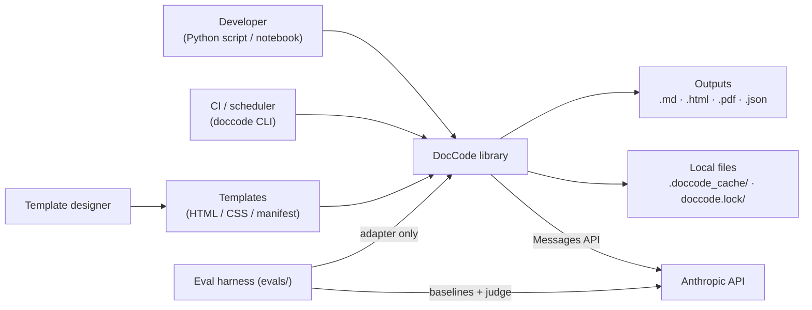
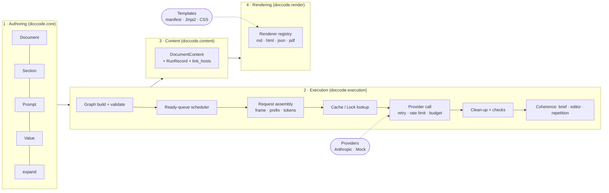
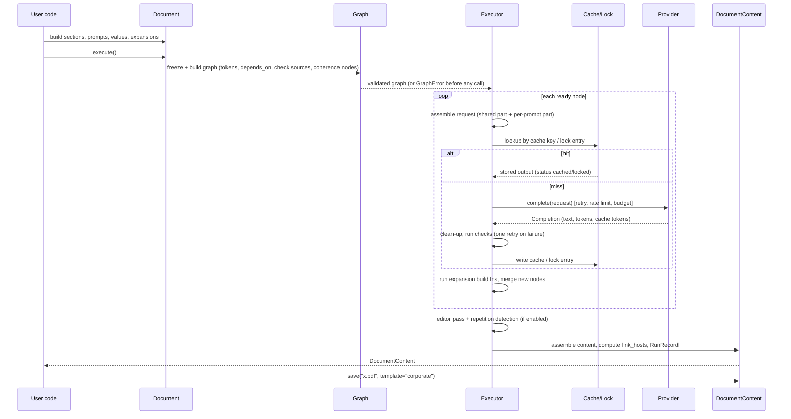
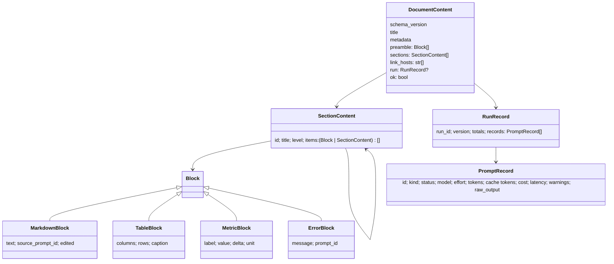
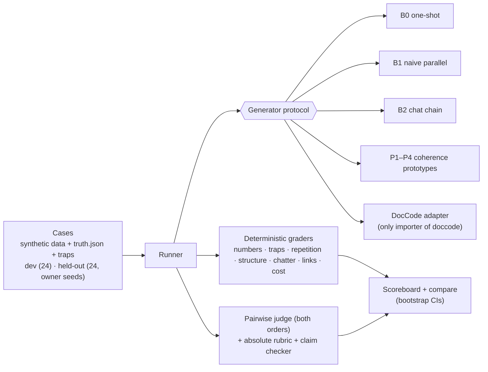

# DocCode High-Level Design

Oct 29, 2026 · @Shubham · Companion to `DocCode BRD Write Documents Like Code.md` (the BRD), `DEVELOPMENT_PLAN.md` and `EVALS_PROPOSAL.md`

This document explains how DocCode is put together: its parts, how data moves through them, and the design decisions behind them. It adds no requirements. Requirement IDs (FR-…, NFR-…, EVAL-…) point to the BRD, which wins wherever the two differ.

## 1. Purpose and scope

DocCode is a Python library for writing multi-section, LLM-generated documents as code. A developer describes the document in Python: its sections, the prompts inside them, how prompts depend on each other, and the data to use. One call generates every section, and a template renders the result as Markdown, HTML, JSON or PDF.

The design has five goals:

1. **Correct ordering with as much parallelism as possible.** Prompts form a dependency graph; anything whose inputs are ready runs.
2. **Trustworthy output.** Figures come from data, not the model. Model output is cleaned up and checked.
3. **One coherent document**, even though sections are generated separately.
4. **Reproducible and cheap re-runs**, through a cache, a committed lockfile and provider-side prompt caching.
5. **Content separate from design.** Templates never touch Python, and content can be re-rendered without calling a model.

Out of scope for 0.1.0: hosted services, giving the model tools or web access, DOCX/PPTX output, and agent frameworks (BRD §1.4).

## 2. System context



| Actor | Interacts through | Never needs |
| --- | --- | --- |
| Developer | Python API (`Document`, `Prompt`, `ctx`, `Value`, `expand`), CLI | Template knowledge |
| CI owner | `doccode run --locked`, exit codes, lock and cache | An API key, when the lock covers every prompt |
| Template designer | `doccode template new/preview`, Jinja2 HTML/CSS | Any `.py` file |
| Owner | Gate sign-off, live eval runs, held-out seeds | — |

## 3. Architecture

The library has four stages with one-way dependencies, plus side components. The content model in the middle is the contract between them: everything to its left produces it, and everything to its right only reads it.



### 3.1 Components

| Component | Package / module | Responsibility | Key BRD refs |
| --- | --- | --- | --- |
| Authoring API | `core/document.py`, `section.py`, `prompt.py`, `value.py`, `expand.py`, `context.py` | Build the document tree. Turn references inside f-strings into tokens. Hold settings and context. No I/O. | FR-DOC, FR-PRM, FR-REF, FR-CTX, FR-VAL, FR-DYN-1 |
| Graph | `execution/graph.py` | Discover nodes and edges, validate, compute display levels and cost estimates, merge subgraphs that expansions add | FR-DAG, FR-REF-2/4/9 |
| Scheduler / executor | `execution/executor.py` | Run each node once its inputs are ready, with failure modes, expansions, coherence steps and lock modes | FR-EXE, FR-DYN-2..5, FR-LCK-2 |
| Request assembly | `execution/frame.py` + executor | Build the shared, cacheable part and the per-prompt part; resolve tokens in one literal pass | FR-PRV-7, FR-COH-1, FR-REF-3 |
| Clean-up | `execution/hygiene.py` | Fix heading levels, remove a duplicated title, trim chatter | FR-OUT-1..3 |
| Checks | `checks.py` | The `Check` protocol and the built-in checks (`numbers_from`, `max_words`, …) | FR-OUT-4 |
| Coherence | `execution/coherence.py` | Shared-brief format, applying editor edits, repetition detection | FR-COH-2..5 |
| Cache / lock | `execution/cache.py`, `lock.py` | Store outputs by content hash; keep the committed lock of approved outputs | FR-CCH, FR-LCK |
| Reliability | `execution/retry.py`, `ratelimit.py` | Back off and retry, apply rate limits | FR-EXE-6, FR-EXE-11 |
| Records | `execution/run.py` | `PromptRecord` / `RunRecord` and typed events | FR-EXE-8..10 |
| Providers | `providers/base.py`, `anthropic.py`, `mock.py`, `pricing.py` | Provider-neutral request and response types; adapters; pricing | FR-PRV |
| Content model | `content/model.py`, `links.py`, `diff.py` | Immutable content tree, JSON, link hosts, diffs | FR-CNT, NFR-26 |
| Rendering | `render/*`, `templates/` | Renderer registry, Jinja2 sandbox, sanitisation, PDF | FR-RND, NFR-15/22 |
| CLI | `cli/main.py`, `cli/templates.py` | `run`, `plan`, `render`, `lock`, `diff`, `cache`, `init`, `template` | FR-CLI |
| Config | `config.py` | `configure()`, `DOCCODE_*` environment variables, resolution order | FR-CFG-1, FR-PRM-4/9 |

### 3.2 Dependency rules

- `content` imports nothing from `core`, `execution` or `providers`. Content can be rendered in a process that never ran a model (FR-CNT-5).
- `render` never imports `execution`. `execution` never knows about templates or file formats.
- `providers` know nothing about documents. They see only `CompletionRequest` and `Completion`.
- `import doccode` loads neither `anthropic` nor WeasyPrint nor Pydantic (NFR-3).
- Nothing under `evals/` imports `doccode` except the eval adapter (EVAL-8).

## 4. How a run works

### 4.1 End-to-end flow



### 4.2 Step by step

1. **Authoring.** Each `Prompt` attaches itself to the section open at the time it's created (a stack kept in a `contextvars.ContextVar`). A prompt created outside any section is a helper: it adds no block of its own. Inside f-strings, prompts and `ctx` references become tokens such as `⟦doccode:ref:<key>⟧`.
2. **Freeze and graph build.** `execute()` freezes the document. Only expansion build functions may still add to it. The graph's nodes are prompts, values and expansion points, plus `_brief` and `_editor` when enabled. Edges come from:
   - tokens found in the text
   - `depends_on`
   - the sources each check compares against
   - document order, under sequential flow
3. **Validation.** Cycles, unknown references, duplicate IDs, unknown placeholders, mangled tokens and unpriced models under a dollar budget all raise errors before any call is made.
4. **Scheduling.** A ready queue bounded by `max_concurrency` starts each node as soon as its inputs have succeeded; there is no waiting for a whole "level" to finish. Ties are broken by document order.
5. **Request assembly.** See §5.2. Tokens and placeholders are replaced in a single pass, and inserted text is never scanned again.
6. **Cache, then lock, then provider.** The lock takes precedence over the cache. A dry run uses a fresh in-memory cache and no lock.
7. **Post-processing.** The output is cleaned up first, and the prompt's checks then run on the cleaned text. A failed check gets one retry with the reason appended.
8. **Expansions.** When an expansion's inputs finish, its build function adds sections and prompts at that position. The new subgraph is validated and merged, and the budget is re-projected.
9. **Coherence.** If enabled, the editor runs last, followed by repetition detection.
10. **Assembly.** The executor produces a `DocumentContent` with blocks in document order (not execution order), the `link_hosts` set and the `RunRecord`.

### 4.3 Failure model

| Situation | `on_error="fail"` (default) | `on_error="continue"` |
| --- | --- | --- |
| A provider error after retries, a final check failure, or an exception in a value or expansion | Cancel pending nodes; raise `ExecutionError` with the cause, the partial run record and completed outputs (a cached re-run resumes cheaply) | Failed node → `ErrorBlock`; downstream nodes → `skipped` with an `ErrorBlock`; `content.ok = False` |
| Graph or config error, budget exceeded, lock mismatch | Raised directly, never wrapped | Same |
| Editor fails | Unedited draft plus `EditorWarning` | Same |
| The model refuses (`stop_reason: "refusal"`, FR-PRV-8) | `ExecutionError` caused by `ProviderRefusalError` with the category; not retried, not cached or locked, never re-routed to another model | `ErrorBlock` saying the model declined; downstream nodes skipped |
| Retryable API errors (429, 529, 5xx, timeout) | Up to 3 retries with exponential backoff and jitter, honouring `retry-after` | Same |

## 5. Key design decisions

### 5.1 Lazy references through tokens

**Problem.** Python evaluates f-strings immediately, so `f"Using {summary}"` would read the output before it exists.
**Decision.** `Prompt.__str__` and `__format__` return an opaque token. The graph scans text for tokens to find edges, and the executor replaces them with outputs at run time.
**Consequences.**
- One brace style for values.
- Text containing a token is in "token mode", where every brace is literal. Text with no token is in "placeholder mode", where `{name}` is filled from context.
- Misuse is caught at validation: `!r`, format specs on prompts, `.upper()` and slicing all raise errors. A format spec on a `Value` (`f"{growth:.0%}"`) is kept in the token and applied at substitution, so the value keeps its number.
- Two silent slips are caught too: `{name}` text in a token-mode string that names a context value (write `{ctx.name}`), and a prompt or value passed through `context=`, which would add no edge.
- Inserted text is never re-parsed, so model output can't inject placeholders.

### 5.2 The request is split into a shared part and a per-prompt part

```
┌──────────────────────── shared part (same bytes for many prompts) ───────────────────────┐
│ 1 document system prompt │ 2 outline frame │ 3 attachments │ 4 shared brief │ 5 doc-so-far* │
└────────────────────────────────────────────────────────────────────────────┬─────────────┘
                                              cache_control breakpoint(s) ──┘
┌──────────── per-prompt part (final user message) ────────────┐
│ prompt-specific system text │ position line │ instruction      │
└──────────────────────────────────────────────────────────────┘
* sequential flow only
```

**Why.** Provider-side prompt caching only reuses an identical prefix. Putting everything shared first means large attachments are paid for once per document, not once per prompt. A prompt's own `system` text adds to the document's system prompt and is sent in the per-prompt part, so it can't break the shared prefix.
**Limits.**
- At most two breakpoints are used, well within the API's limit of four.
- Caching only applies above a minimum prefix size, which depends on the model.
- Prompts that start at the same moment all pay the cache write.
- `raw=True` prompts, prompts with a subset of attachments, and the editor don't share the cache entry.

### 5.3 Data blocks, `Value` nodes and checks

- **Rule:** numbers come from data, words from the model. `section.table()` and `section.metric()` render data directly into `TableBlock` and `MetricBlock`, never through a model.
- **Derived figures** such as growth rates are computed in Python with `Value` nodes and passed to prompts as references.
- **The `numbers_from` check** rejects figures in model output that aren't in its sources, within 0.5% tolerance. Its sources become graph edges, so a check always runs after the values it compares against.
- **The `Check` protocol** gives every check a stable fingerprint, so caching stays deterministic. Plain lambdas are refused; use `checks.custom(fn, name=…)`.

### 5.4 Dynamic structure through expansions

**Problem.** A fixed graph can't express "write an outline, then one section per item".
**Decision.** `doc.expand(build, after=outline)` registers a point in the document. When `outline` finishes, `build(outline_text)` runs inside the frozen document and adds sections and prompts there.
**Guardrails.**
- New nodes are validated before they run, with at most `max_nodes` nodes and nesting depth 3.
- IDs are prefixed with the expansion ID, so they stay stable across runs. The expansion ID defaults to the containing section's ID (`themes` → `themes/pricing-pressure`).
- Model text goes in through `context=`, which is inserted literally, never by pasting it into an instruction string. A placeholder whose text appears in the build's inputs is rejected (FR-DYN-7).

### 5.5 Coherence layers

| Layer | When it runs | What it adds | Cost |
| --- | --- | --- | --- |
| Frame (on by default) | Every prompt | Purpose and outline in the shared part, plus "you are writing section N" | Almost none (cached) |
| Shared brief | Before all prompts | Core message, one point per section, agreed terms. Every prompt depends on it. | +1 serial call |
| Sequential flow | Prompts run in document order | "The document so far" in the shared part | No parallelism; longer prompts |
| Editor | After all nodes | Small, checked find-and-replace edits (≤ 30% of a block). Data blocks are read-only. Checks re-run, and failing edits are reverted. | +1 call over the whole document |
| Repetition detection (on by default) | After generation and after editing | Shared 8-grams between sections become warnings, which are passed to the editor | Free |

Presets: `basic` (frame and repetition), `report` (adds the brief and editor), `narrative` (adds sequential flow and the editor), `off`. Any explicit option overrides the preset. All four layers ship. The Phase 0 eval ablation picks the default preset for each document family and tunes the built-in prompts (BRD §5.7).

**Provisional (owner, 2026-10-30).** The G0 prototypes test three variations on the BRD text: the editor reuses the sections' shared prefix instead of a different one (FR-PRV-7); the frame also carries audience and style; under sequential flow, old sections are trimmed to their first paragraph past `max_flow_chars`. Decision 0006 confirms or rejects each one for the library (BRD §4.17).

### 5.6 Reproducibility: cache and lock

Model output is never deterministic. Current Claude models accept no `temperature`; DocCode's `effort` setting controls reasoning depth, not sampling. Reproducibility therefore comes from storage:

| | Cache (`.doccode_cache/`) | Lock (`doccode.lock/`) |
| --- | --- | --- |
| Committed to git | No (in `.gitignore`) | Yes |
| Key | SHA-256 over every input to the request (provider fingerprint, model, shared blocks, final message, effort, max_tokens, response format, check fingerprints) | The same key, kept in `index.json` |
| Holds | Completion text and token counts | One `.md` per prompt (readable diffs in PRs), `_brief.md`, `_editor.json` |
| Purpose | Skip unchanged prompts locally | Approved text; deterministic CI with `--locked` and no API key |
| Modes | read+write, `--refresh` (write only), off | `use`, `frozen` (CI; raises `LockMismatchError` and exits 5), `update [--section]` |

The provider fingerprint is static: it is computed from configuration with no network call. Pinned model IDs are recommended, because the cache can't detect a model alias that starts pointing at a new model.

### 5.7 Content and rendering

- `DocumentContent` is frozen and serialises to JSON. `to_json()` strips prompt inputs (resolved instructions, attachments, raw output) by default, so the file is safe to hand to a designer. `save_run()` keeps the full provenance.
- Renderers are looked up by format in a registry. HTML uses a sandboxed Jinja2 environment with autoescape. Section Markdown goes through `markdown-it-py`, then `nh3` sanitisation, then the link policy.
- **Link policy.** A link stays clickable only if its host appears in the run's inputs or in an allowlist. The allowed hosts are computed during execution and stored in `content.link_hosts`, so re-rendering from JSON gives the same result.
- **PDF.** HTML is converted with WeasyPrint (an optional extra) using a URL fetcher that allows only `data:` and files from the template directory. Model output can therefore never make the renderer fetch remote URLs or read local files.

## 6. Data model



Node kinds: `prompt`, `value`, `expansion`, `brief`, `editor`. Statuses: `ok`, `cached`, `locked`, `failed`, `skipped`. `SectionContent.items` keeps blocks and subsections in insertion order; `blocks` and `subsections` are derived views. Section IDs and node IDs (prompts, values, expansions) are separate namespaces per document, so a section and its prompt may share an ID.

## 7. Providers

```
Provider (protocol)
  name, fingerprint() -> str          # static: no network
  async complete(CompletionRequest) -> Completion

CompletionRequest: model, system, prefix[(name, text)], messages, effort, max_tokens,
                   response_format, metadata{node_id, kind, section_id, feeds_expansion?}
Completion:        text, input/output tokens, cache_read/cache_write tokens, stop_reason, raw
```

- **AnthropicProvider**
  - Uses the official async SDK. It is imported lazily, and one client is created per event loop.
  - `effort` is sent as `output_config.effort`, and a structured-output schema as `output_config.format`. It never sends `temperature`, `top_p`, `top_k`, an assistant prefill or a forced tool choice.
  - A stop reason of `max_tokens` or `model_context_window_exceeded` marks the output as truncated.
  - It places the `cache_control` breakpoints.
  - A missing API key is an error only when a real call is needed.
- **MockProvider** is deterministic and makes no network calls. It takes a response map (a dict or a `<script>.mock.json` file) or a callable. Its defaults depend on the node kind: a valid brief for `brief`, an empty edit list for `editor`, a three-item list for a prompt that feeds an expansion, and otherwise `[mock:<id>]` with the unresolved instruction, references shown as `{id}`. Misspelled prompt IDs in the map are errors. `plan.mock_template()` gives a ready-to-edit map.
- **Pricing** lives in one table, `providers/pricing.py`, including cache-read and cache-write prices. An unknown model reports cost as `None`, not 0. A model whose rates rise above a prompt-size threshold (Haiku 5.5 above 100k tokens) has a second set of rates, applied to the whole call.

## 8. Execution environments

| Environment | How it runs | Notes |
| --- | --- | --- |
| Script | `doc.execute()` uses `asyncio.run` | Default |
| Async app | `await doc.aexecute()` | Same engine |
| Jupyter | `execute()` detects the running event loop and runs on a worker thread with its own loop | Callbacks must be thread-safe; a client passed in by the user is refused (pass `api_key=`) |
| CLI / CI | `doccode run file.py [--dry-run / --locked / -o out.pdf]` | Finds a module-level `doc` or a `build()` function. Exit codes 0 to 5. Rich progress view. |
| Dry run | Every provider is replaced with the mock, which loads `<script>.mock.json` | Never touches the cache or lock |

## 9. Cross-cutting concerns

- **Configuration.** Settings resolve from the prompt, then the document, then `configure()`, then `DOCCODE_*` environment variables, then library defaults. The provider resolves in its own order: `Prompt`, then `execute()`, then `Document`, then `configure()`, then the environment, then Anthropic.
- **Cost control.**
  - `plan()` estimates cost up front.
  - `Budget(max_usd=…)` projects the worst case: spend so far plus `max_tokens` at output price for every prompt not yet run.
  - Rate limits use a token bucket per provider.
- **Observability.** Typed events (`PromptStarted`, `PromptCompleted`, `PromptRetrying`, `PromptFailed`, `PromptSkipped`, `ExpansionCompleted`, `RunCompleted`) and the `doccode` logger, which logs resolved instructions only at DEBUG. Every call has a `PromptRecord`.
- **Security and privacy.**
  - API keys are never written to the cache, records, logs or output.
  - Model output is sanitised before it reaches HTML, and the PDF renderer can't fetch remote URLs or read local files.
  - Injected links are disarmed.
  - Content JSON strips prompt inputs.
  - The docs warn that inputs can carry prompt injection and that `doccode run` executes user Python.
- **Performance targets.** Under 20 ms of library overhead per prompt, `plan()` under 100 ms for 200 prompts, and `import doccode` under 300 ms (NFR-3, NFR-11..13).

## 10. Evaluation architecture

The eval suite is built before the library and lives in `evals/`, outside the package (BRD §5.7, `EVALS_PROPOSAL.md`).



- Baseline prompts are frozen before any DocCode result exists. DocCode has to beat naive parallel generation and be no worse than one-shot.
- Graders never use DocCode's own checks, so DocCode can't pass by construction.
- The judge is calibrated against human labels, and every pair is judged in both orders.
- Live runs use only the owner's key. Refusals are error rows; there are no model fallbacks.
- The held-out seeds never reach the agents that build the library.

## 11. Packaging and deployment

- One PyPI package, `doccode-py` (imported as `doccode`, decision 0002): hatchling, `src/` layout, MIT licence, Python 3.10 and later.
- Core dependencies: `anthropic`, `jinja2`, `markdown-it-py`, `nh3`, `typer`, `rich` (plus `tomli` on 3.10).
- Extras: `pdf` (WeasyPrint), `schema` (Pydantic), `dev`.
- Built-in templates and sample content ship as package data.
- Third-party templates are discovered through the `doccode.templates` entry point.
- There is no hosted service: DocCode runs wherever its user's Python runs.

## 12. Trade-offs and known limitations

| Decision | Benefit | Cost or limitation |
| --- | --- | --- |
| Token-based f-string references | Plain Python, IDE support, no DSL | Token-misuse rules to learn; one string can't mix token and placeholder styles |
| Parallel generation by default | Speed | Coherence needs the frame, brief and editor layers |
| Outline frame in every prompt | Sections know their place, cheaply | Editing any brief or title invalidates every cache and lock entry |
| Static provider fingerprint | Offline cache and lock checks | Can't detect a moving model alias, so pin model IDs |
| Committed lock of outputs | Deterministic CI, reviewable diffs | Outputs in the repo can themselves be sensitive |
| Link policy based on input hosts | Disarms links the model made up | A URL injected through the data stays clickable (accepted for 0.1.0, reported by the evals, not gated; strict mode on the 0.2.0 roadmap) |
| No `temperature` | Matches current Claude API | No sampling control; reproducibility rests on the cache and lock |

## 13. Open items

1. ~~**Refusal handling.**~~ Resolved 2026-10-30: FR-PRV-8 (see §4.3).
2. ~~**Package name.**~~ Resolved 2026-10-30 (decision 0002): `doccode-py` on PyPI, `import doccode`.
3. ~~**PDF engine.**~~ Resolved 2026-10-30 (decision 0003): WeasyPrint.
4. **Default model and presets.** Default model resolved 2026-10-30 (decision 0005): `claude-sonnet-5-5`. Presets are decided at G0 (decision 0006); both are confirmed at G3 (0007).
5. ~~**Using the lock by default.**~~ Resolved 2026-10-30: only with `--lock`/`--locked` in 0.1.0.
6. ~~**Orchestration engine.**~~ Resolved 2026-10-30: DocCode's own scheduler, not LangGraph (`docs/decisions/0008-orchestration-engine.md`).
7. **Spike ambiguities.** Six small API questions from the spike (decision 0004 F11) are open until after the user sessions and must be settled before WP-003 (BRD §8).
